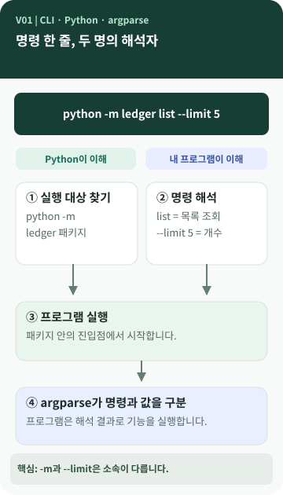

# Chapter 01 — 터미널에 입력한 한 줄을 컴퓨터는 어떻게 알아들을까?

> AI가 용돈 기입장을 만들어 줬습니다. 그런데 화면에서 버튼을 누르는 대신 `python -m ledger list --limit 5` 같은 문장을 입력합니다. **이 문장을 누가 읽고, 어디서부터 프로그램이 시작되는 걸까요?**

**이 장에서 알게 되는 것** ① CLI가 무엇인지 ② `-`와 `--`의 차이가 무엇인지 ③ Python의 `-m` 뒤에는 왜 프로그램 이름이 오는지 ④ `argparse`가 하는 일은 무엇인지.

📱 **그림과 개념 설명만으로 기본 내용을 이해**할 수 있습니다. 💻 뒤쪽의 짧은 명령·코드는 자신의 프로젝트에 대응시켜 보는 선택 자료입니다.

---

## 클릭하는 대신 문장으로 일을 시킨다면

GUI(Graphical User Interface)는 화면의 버튼과 메뉴처럼 **눈에 보이는 요소를 사용해 조작하는 방식**입니다. CLI(Command-Line Interface)는 **문자로 명령을 전달하는 방식**입니다. `Interface`는 사람과 프로그램이 만나는 접점이라고 이해해도 좋습니다. GUI에서 '거래 조회' 버튼을 누르는 것과 CLI에서 `list`를 입력하는 것은 방법만 다를 뿐 같은 요청일 수 있습니다. `[개념]`

용돈 기입장이 CLI로 만들어졌다는 것은 '화면이 없어서 불완전하다'는 뜻이 아닙니다. 프로그램을 이용하는 방법이 다르다는 뜻입니다. 명령이 일정한 규칙을 갖기 때문에 반복 실행·자동화에도 적합하지만, 처음에는 정확한 명령을 기억해야 한다는 불편함이 있습니다.

## 한 줄의 명령을 둘로 나누어 보기



### 그림 읽는 법

위쪽 명령의 **앞부분은 Python이**, 뒷부분은 **실행된 용돈 기입장 프로그램이** 해석합니다. 번호는 실행 흐름이고, 두 영역을 가르는 선은 책임의 차이입니다. `[개념]`

| 입력 부분 | 의미 | 누가 해석하나 |
| --- | --- | --- |
| `python` | Python 실행 프로그램을 시작 | 운영체제와 Python |
| `-m` | 뒤에 나오는 모듈 또는 패키지를 실행 | Python |
| `ledger` | 이 프로젝트에서 선택한 패키지 이름 | Python이 실행 대상을 찾음 |
| `list` | 거래 목록을 보여 달라는 하위 명령 | 용돈 기입장 |
| `--limit` | 결과 개수를 지정하는 긴 옵션 | 용돈 기입장 |
| `5` | `--limit`에 전달한 실제 값 | 용돈 기입장 |

`ledger`는 **모든 교육생이 써야 하는 이름이 아닙니다.** 같은 과제를 `pocketbook`, `money.py`, `app.py` 등으로 구현했다면 실행법도 달라질 수 있습니다. `[프로젝트 사례]`

## `-` 하나와 `--` 둘은 왜 다를까?

CLI에는 오래된 관례가 있습니다. `-h`, `-m`처럼 한 글자로 쓰는 **짧은 옵션**, `--help`, `--limit`처럼 이름을 알아보기 쉽게 쓰는 **긴 옵션**입니다. 긴 옵션이라는 말은 하이픈을 두 개 붙이는 *형식*을 가리킵니다. 이름이 반드시 여러 글자여야 한다는 보장은 없습니다. 실제로 허용되는 옵션은 프로그램이 정합니다. `[개념]`

여기서 특히 주의할 점은 `-m`은 **Python의 옵션**이고 `--limit`은 **용돈 기입장 프로그램의 옵션**이라는 사실입니다. 같은 터미널 한 줄에 있어도 소속이 다릅니다.

> **미션 요구 확인:** M03 설계 문서에는 '옵션 표기를 `-`로 통일'이라는 공식 원문 기록과 `--limit` 등 두 개의 하이픈을 사용하는 공식 예시가 함께 남아 있습니다. 이 프로젝트는 예시와 CLI 관례를 근거로 `--` 긴 옵션을 선택했습니다. 이 문구의 충돌을 해소한 *새 공식 규칙*이 확인된 것은 아닙니다. `[요구 추적]` `[프로젝트 사례]`

## 이름을 풀어 보면 `argparse`가 보입니다

`argument`(인자·전달값) + `parse`(문장·자료의 구조를 분석하다)에서 나온 이름이 `argparse`입니다. 사용자가 입력한 문장을 '무엇을 하라는지'와 '어떤 값을 쓸지'로 나누는 **Python 표준 라이브러리**입니다. `[개념]`

예를 들어 `list --limit 5`를 읽고 '목록 조회라는 동작'과 '표시 개수 5'를 구분합니다. 이 과정에서 필요한 값이 빠졌는지, 정수여야 하는 곳에 문자가 들어왔는지도 기본적으로 검사할 수 있습니다. 다만 '예산은 얼마까지 허용하나?' 같은 업무 규칙까지 모두 판단하는 것은 아닙니다.

## 모듈과 패키지: 왜 `-m` 뒤에 이름이 올까요?

프로그램 소스가 여러 파일로 나뉠 수 있습니다. Python에서 보통 **모듈(module)**은 Python 코드가 들어 있는 파일을, **패키지(package)**는 관련 모듈을 묶어 사용하는 구조를 가리킵니다. Python의 `-m`은 이름으로 지정한 모듈을 실행하게 합니다. 대상이 실행 가능한 패키지라면 일반적으로 그 안의 `__main__.py`가 실행됩니다. `[개념]`

### 같은 기능, 다른 실행법

```bash
python main.py                 # 파일을 직접 실행하는 예
python -m ledger --help       # M03 프로젝트의 패키지 실행
python -m ledger list --limit 5
```

*위 두 실행 방식은 이 프로젝트에 모두 있습니다. 다른 교육생에게도 같은 파일·패키지가 있다는 뜻은 아닙니다.* `[프로젝트 사례]`

## 💻 실제 프로젝트에서는 어떻게 되어 있을까? (선택)

아래는 M03의 `ledger/__main__.py`에서 가져온 핵심 형태입니다.

```python
from ledger.cli import main

if __name__ == "__main__":
    sys.exit(main(sys.argv[1:]))
```

전체 코드를 읽으려 애쓸 필요는 없습니다. **프로그램의 입구가 `cli.main()`으로 이어진다**는 것만 찾아보세요. M03의 `ledger/cli.py`에는 `ArgumentParser`와 `add_argument("--limit", type=int, ...)`가 들어 있습니다. `[프로젝트 사례]`

자신의 결과물에서는 '프로그램을 시작하는 명령'과 '명령을 해석하는 부분'을 찾아보면 됩니다. `argparse`를 사용하지 않은 프로그램도 가능합니다.

## 다른 사람에게 이렇게 설명할 수 있습니다

> "CLI는 버튼 대신 문자로 프로그램을 사용하는 방법이에요. `python`은 프로그램을 시작하고, `-m`은 Python에게 어떤 모듈을 실행할지 알려 줍니다. 그다음의 `list`와 `--limit 5`는 용돈 기입장에 전달되는 명령과 옵션입니다. 이 프로젝트는 `argparse`가 그것을 분석해요."

**한 문장 정리:** 명령줄 한 줄에도 **실행하는 쪽(Python)**과 **일을 수행하는 쪽(내 프로그램)**의 역할이 나뉘어 있습니다.

**AI에게 물어볼 질문:** "내 프로젝트의 실행 명령 한 줄을 Python이 해석하는 부분과 내 프로그램이 해석하는 부분으로 나눠 설명해 줘. 코드는 수정하지 마."
