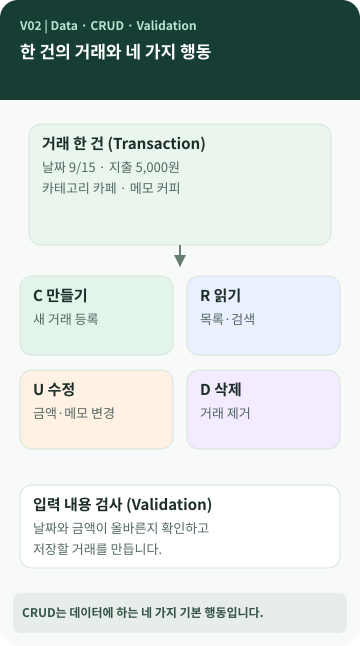

# Chapter 02 — 거래를 '추가'했다는 것은 프로그램 안에서 무슨 일이 일어난 걸까?

> 가계부에 지출을 한 건 기록했습니다. 눈에는 입력한 내용이 보이지만, 프로그램 안에서는 **날짜와 금액이 어떻게 한 건의 거래로 묶일까요?**

**이 장에서 알게 되는 것** ① 데이터와 거래 한 건의 차이 ② CRUD라는 네 가지 기본 기능 ③ 입력값 검사가 필요한 이유 ④ 클래스·객체·`dataclass`는 어떤 도움을 주는지.

---

## 거래 한 건은 여러 정보를 묶은 약속입니다

커피 한 잔을 5,000원에 샀다고 해 보겠습니다. '5000'이라는 숫자만 저장하면 수입인지 지출인지, 언제 사용했는지 알기 어렵습니다. 그래서 날짜·구분·금액·카테고리·메모처럼 **서로 관련된 정보를 하나의 거래**로 묶습니다. 이때 날짜, 금액 같은 개별 항목을 흔히 **필드(field)**라고 부릅니다. `[개념]`



그림의 가운데에는 '한 건의 거래'가 있습니다. 네 방향의 작업은 서로 다른 종류의 거래를 뜻하지 않습니다. **같은 거래 데이터를 대상으로 하는 서로 다른 행동**입니다.

## CRUD는 어려운 기술의 이름이 아니라 네 가지 행동입니다

CRUD는 네 동사의 첫 글자를 모은 말입니다. `[개념]`

| 영어 | 일상적인 뜻 | 용돈 기입장에서 하는 일 |
| --- | --- | --- |
| **C**reate | 만들다 | 새 거래 기록 |
| **R**ead | 읽다 | 거래 조회 또는 검색 |
| **U**pdate | 갱신하다 | 잘못 적은 금액·메모 수정 |
| **D**elete | 삭제하다 | 필요 없는 거래 제거 |

거래를 만들고 읽고 고치고 지우는 일은 용돈 기입장뿐 아니라 연락처, 도서 대출 기록, 예약 서비스에서도 공통으로 나옵니다. 그래서 CRUD를 이해하면 다른 프로그램의 기능도 조금 쉽게 보입니다.

## 입력한 내용은 왜 바로 저장하지 않을까요?

'금액 5,000원'처럼 숫자여야 하는 값에 '오천원쯤'이라고 쓰거나 존재하지 않는 카테고리를 입력하면 프로그램이 어떤 거래를 저장해야 하는지 애매해집니다. 그래서 보통 입력 후 **검사(validation)**를 거칩니다. 유효하다는 것은 '그 프로그램이 정한 규칙에 맞는다'는 뜻입니다. `[개념]`

M03에서는 카테고리를 먼저 등록해야 거래에 사용할 수 있고, 금액은 양의 정수로 검사합니다. 새 거래를 저장하기 전에 내부 ID를 정합니다. 모든 구현이 이 정책을 반드시 따라야 하는 것은 아닙니다. `[프로젝트 사례]`

## 클래스와 객체를 아주 간단히 이해한다면

**클래스(class)**는 데이터를 어떤 항목으로 묶고 어떻게 다룰지 정한 틀, **객체(object)**는 그 틀에 따라 실제 값을 담고 있는 한 건의 대상이라고 생각해 볼 수 있습니다. 도서 대출증 서식과 실제 작성된 대출증의 관계에 비유할 수 있지만, Python의 클래스는 데이터를 담는 것 외에도 동작을 정의할 수 있으므로 완전히 같은 것은 아닙니다. `[개념]`

M03에는 거래를 표현하는 `Transaction` 클래스가 있고, `@dataclass`를 붙여 관련 데이터를 다루기 편하게 만들었습니다. **`dataclass`는 자료형 검증을 모두 대신하는 기능이 아닙니다.** 그래서 별도 검증 코드가 있습니다. `[프로젝트 사례]`

## 💻 실제 프로젝트와 연결하기 (선택)

```python
@dataclass
class Transaction:
    id: int
    type: str
    date: datetime.date
    amount: int
    category: str
    memo: str = ""
```

*M03의 `ledger/models.py`에서 핵심 필드 일부를 발췌했습니다. 실제 클래스에는 `tags`도 있습니다.* 이 코드를 외울 필요는 없습니다. 하나의 거래에 날짜와 금액 같은 필드가 묶여 있다는 사실을 확인하면 충분합니다.

M03의 실제 흐름은 **명령에서 입력받기 → 검사하기 → Transaction 만들기 → 저장하기**입니다. `cli.py`, `validators.py`, `models.py`, `services.py`, `repository.py`로 분리했지만, 다른 교육생은 한 파일 안에서 같은 역할을 처리할 수도 있습니다. `[프로젝트 사례]`

## 공식 요구와 이 프로젝트의 선택

M03 요구사항 추적표에는 거래의 CRUD 기능과 입력 검증이 포함됩니다. 이 프로젝트가 선택한 정수형 내부 ID, `Transaction` dataclass, 등록된 카테고리만 허용하는 정책, 여러 파일로 책임을 나눈 구조는 **구현 사례**입니다. `[요구 추적]` `[프로젝트 사례]`

## 다른 사람에게 이렇게 설명할 수 있습니다

> "CRUD는 데이터를 만들고, 읽고, 수정하고, 삭제하는 네 가지 기본 작업이에요. 용돈 기입장은 날짜와 금액 같은 값을 거래 한 건으로 묶어 관리하고, 잘못된 값은 저장하기 전에 검사할 수 있습니다."

**한 문장 정리:** CRUD는 **데이터를 다루는 기본 행동**, 거래 한 건은 **관련된 정보들을 하나로 묶은 데이터**입니다.

**AI에게 물어볼 질문:** "내 프로그램에서 거래 한 건을 어떤 항목으로 관리하는지 쉬운 표로 보여 줘. 코드 수정은 하지 말고, CRUD 기능과 연결해 줘."
