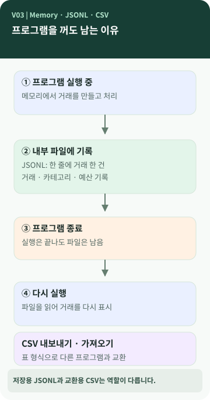

# Chapter 03 — 프로그램을 껐다 켜도 내역이 남아 있는 이유는 뭘까?

> 용돈 기입장을 닫았다가 다시 열어도 어제 등록한 거래가 있습니다. **프로그램이 꺼져 있는 동안 그 거래는 어디에 있었을까요?**

**이 장에서 알게 되는 것** ① 실행 중 메모리와 저장 파일의 차이 ② 영구 저장이 무엇인지 ③ JSON·JSONL·CSV의 차이 ④ 저장용 파일과 교환용 파일의 역할.

---

## 프로그램이 기억하는 방법은 한 가지가 아닙니다

실행 중인 프로그램이 값을 다루는 공간으로 **메모리(memory)**를 생각할 수 있습니다. 그런데 프로그램이 종료되면 일반적으로 그 프로그램이 사용하던 값도 더 이상 유지되지 않습니다. 다음번 실행에서 다시 읽으려면 파일이나 데이터베이스처럼 **지속적으로 남는 저장소**가 필요합니다. 이를 영속성(persistence)이라고 부릅니다. `[개념]`



그림을 위에서 아래로 보면 **입력 → 파일에 쓰기 → 프로그램 종료 → 다시 실행 → 파일에서 읽기**로 이어집니다. 오른쪽의 CSV는 필요할 때 가져오거나 내보내는 별도의 통로입니다. CSV를 내보냈다고 두 파일이 자동으로 동기화되는 것은 아닙니다.

## JSON, JSONL, CSV라는 이름부터

**JSON(JavaScript Object Notation)**은 이름에 JavaScript가 들어가지만, 다양한 프로그램이 사용하는 텍스트 데이터 표현 형식입니다. 이름과 값의 관계를 표현하는 데 적합합니다. **JSONL(JSON Lines)**은 JSON 데이터 하나를 **한 줄에 하나씩** 기록합니다. **CSV(Comma-Separated Values)**는 기본적으로 쉼표로 값을 구분하는 표 형태의 텍스트입니다. `[개념]`

### 같은 거래 한 건, 서로 다른 표현

**JSONL의 한 줄** — 읽기 편하도록 띄어쓰기를 넣은 교육용 예시:

```json
{"date":"2026-09-15","type":"expense","amount":5000,"category":"카페"}
```

**CSV의 표** — 날짜·구분·금액·카테고리를 열로 나눈 교육용 예시:

```csv
date,type,amount,category
2026-09-15,expense,5000,카페
```

실제 M03의 JSONL에는 내부 ID, 메모, 태그도 들어가며, CSV에는 별도의 공통 헤더를 사용합니다. 위 짧은 두 줄은 **형식 차이만 설명하려고 단순화**했습니다.

## 왜 하나만 쓰지 않았을까?

JSONL은 거래를 한 건씩 읽거나 뒤에 새 기록을 추가하기 편합니다. CSV는 표로 옮기거나 다른 프로그램과 주고받기 편합니다. 그러나 JSONL은 이미 저장된 거래를 수정하거나 삭제할 때 파일을 다시 써야 할 수 있고, CSV는 쉼표·큰따옴표를 포함한 값과 자료형을 조심해서 처리해야 합니다. `[개념]`

M03에서는 `transactions.jsonl`, `categories.jsonl`, `budgets.jsonl` 세 파일을 **내부 저장용**으로, CSV를 **가져오기·내보내기용**으로 선택했습니다. JSONL을 사용하더라도 추가 기능이 늘어나면 파일을 여러 개 관리해야 하고, 여러 사용자가 동시에 편집하는 큰 서비스에는 별도의 설계가 필요할 수 있습니다. `[프로젝트 사례]`

> **구현 주의:** M03은 CSV를 import할 때 내부 거래 ID를 새로 발급합니다. 같은 CSV를 두 번 가져오면 동일한 내용의 거래가 다시 추가될 수 있습니다. CSV가 백업과 똑같은 의미는 아닙니다. `[프로젝트 사례]`

## 💻 파일이 실제로 존재하는지 확인하기 (선택)

이 프로젝트의 기본 폴더는 `./data`입니다. 기존 자료를 지우거나 덮어쓰지 말고, 파일을 **읽기만** 하세요. M03에서는 다음과 같은 파일을 사용합니다. `[프로젝트 사례]`

```text
data/
├── transactions.jsonl   # 거래 내역
├── categories.jsonl     # 카테고리
└── budgets.jsonl        # 월 총예산
```

예를 들어 `python -m ledger list`는 저장 파일을 읽어 목록을 보여 줍니다. 새로운 거래를 입력하려면 등록된 카테고리가 필요하고, `add`는 대화형으로 입력을 받습니다. 프로그램 실행 방식은 사람마다 다를 수 있습니다.

## 공식 요구와 프로젝트 선택

M03의 요구사항 추적표에는 파일에 데이터를 영구 저장하고 CSV import/export를 제공하는 항목이 있습니다. 반면 **세 개의 JSONL 파일로 나눌지, 다른 저장 형식을 사용할지**는 이 프로젝트의 설계 선택과 구체적 요구 조건을 함께 확인해야 합니다. `[요구 추적]` `[프로젝트 사례]`

## 다른 사람에게 이렇게 설명할 수 있습니다

> "프로그램을 실행하는 동안 다루는 값과, 프로그램을 꺼도 남는 저장 파일은 달라요. 우리 프로그램은 거래를 JSONL 파일에 남기고 다음 실행에서 다시 읽습니다. CSV는 주로 데이터를 다른 프로그램과 주고받을 때 사용해요."

**한 문장 정리:** 데이터를 **처리하는 일**과 데이터를 **다음 실행까지 남기는 일**은 별개의 책임입니다.

**AI에게 물어볼 질문:** "내 프로그램의 데이터를 저장하는 파일이나 데이터베이스가 무엇인지, 종료 후 다시 실행할 때 어떤 경로로 읽는지 그림처럼 단계별로 알려 줘. 코드는 수정하지 마."
