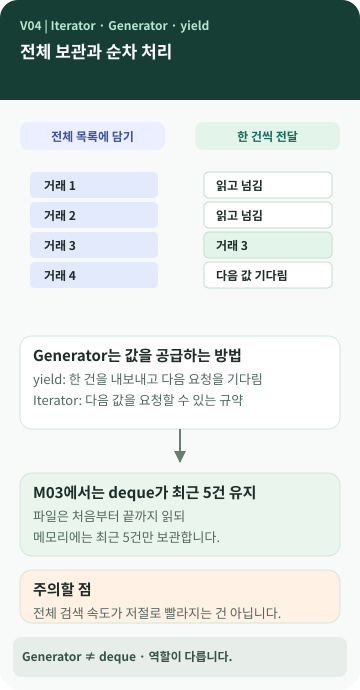

# Chapter 04 — 데이터를 꼭 한꺼번에 꺼내야 할까?

> 거래가 다섯 건일 때는 아무 문제없지만, 10만 건이라면 어떨까요? **모든 거래를 한꺼번에 메모리에 올리지 않고도 처리할 수 있을까요?**

**이 장에서 알게 되는 것** ① 데이터를 차례로 처리한다는 뜻 ② Iterator와 Generator의 관계 ③ `yield`가 하는 일 ④ Generator를 써도 무조건 빠른 것은 아닌 이유.

---

## 책을 읽는 두 가지 방법에서 출발해 봅니다

한 권의 책을 모두 복사해 책상에 펼쳐 놓을 수도 있고, 필요한 순서대로 한 장씩 넘기면서 읽을 수도 있습니다. 데이터도 비슷합니다. **전체를 한꺼번에 모아 놓고 처리할 수도 있고, 한 건씩 받아 처리할 수도 있습니다.** 이 비유는 읽는 방식의 차이를 설명하기 위한 것이지 실제 메모리 동작을 정확히 복제한 것은 아닙니다. `[보충 설명]`



### 그림 읽는 법

왼쪽은 데이터를 모두 리스트에 담아 두는 방식입니다. 오른쪽은 다음 값이 필요할 때마다 거래를 하나씩 건네는 방식입니다. 그림의 작은 시계는 **한 번에 한 건씩 처리된다는 뜻이지, 전체 검색 시간이 반드시 짧다는 뜻은 아닙니다.**

## Iterable, Iterator, Generator를 한 번에 외우지 마세요

이 세 이름은 관계가 있습니다. `[개념]`

- **Iterable(순회 가능한 것)**: `for`문 등에서 차례로 다룰 수 있는 대상입니다. 예를 들어 거래 목록이 있습니다.
- **Iterator(반복자)**: 다음 값을 요청하면 다음 항목을 주는 객체입니다. 끝에 도달하면 더 이상 값이 없다고 알립니다.
- **Generator(제너레이터)**: `yield` 등을 이용해 만들 수 있는, 값을 차례로 만들어 건네는 Iterator의 한 종류입니다.

따라서 "Generator는 Iterator와 전혀 다른 방식"이라기보다는 **Generator가 Iterator의 한 종류**라고 이해하는 편이 정확합니다. `yield`는 값을 내보내면서 함수의 실행 위치와 상태를 남겨 두었다가 다음 요청에 이어서 실행할 수 있게 합니다.

## `list --limit 5`에는 두 가지 기술이 함께 일합니다

M03 프로젝트에서는 파일의 거래를 `iter_all()`이 하나씩 내보냅니다. 그다음 **`deque(maxlen=5)`가 최근 들어온 다섯 건만 보관**합니다. `[프로젝트 사례]`

| 맡은 역할 | 사용하는 기술 | 하는 일 |
| --- | --- | --- |
| 파일에서 거래를 하나씩 전달 | Generator (`yield`) | 전체 파일을 리스트로 미리 만들지 않음 |
| 받은 거래 중 최근 5개를 보관 | `deque(maxlen=5)` | 새 거래가 들어오면 오래된 거래를 제외 |
| 화면에 결과를 표시 | CLI 출력 | 다섯 건을 최근 추가 순서부터 보여 줌 |

**중요한 구분:** 최근 다섯 건만 보이더라도 이 구현은 **거래 파일을 처음부터 끝까지 순회**합니다. '최근 5개만 읽었다'고 설명하면 틀립니다. 여기에서 '최근'도 날짜가 아니라 **나중에 추가한 거래**를 뜻합니다.

## Generator의 장점과 한계

Generator는 **값을 차례로 넘기면서 처리**하는 일에 유용합니다. 전체 파일을 한꺼번에 리스트에 담는 일을 피할 수 있습니다. 하지만 전체 파일에서 조건에 맞는 거래를 찾으려면 끝까지 읽을 수도 있으므로 검색 시간이 자동으로 줄어드는 것은 아닙니다. `[개념]`

실제 M03의 `search`는 조건에 맞는 거래를 모두 모아서 반환하므로, 맞는 거래가 많으면 그만큼 메모리가 필요합니다. `export`는 결과를 CSV로 한 행씩 기록하기 때문에 모든 결과를 한꺼번에 담지 않습니다. 같은 Generator를 써도 **받는 쪽이 무엇을 하느냐**에 따라 특징이 달라집니다. `[프로젝트 사례]`

## 💻 `yield`는 실제로 어떻게 생겼을까요? (선택)

```python
def iter_all(self) -> Iterator[Transaction]:
    for record in _iter_jsonl(self.path):
        yield Transaction.from_dict(record)
```

*M03 `ledger/repository.py`의 실제 메서드입니다.* 지금은 괄호·들여쓰기를 모두 해석할 필요가 없습니다. `yield`가 **한 건의 Transaction을 다음 소비자에게 넘긴다**는 역할만 확인해 보세요. `[프로젝트 사례]`

## 공식 요구와 프로젝트 선택

M03 요구사항 추적표에는 Generator의 실제 사용이 포함됩니다. 반면 최근 N건을 위해 `deque`를 쓰는 방법, 검색에서 결과를 모으는 방법 등은 M03의 구체적인 구현 선택입니다. `[요구 추적]` `[프로젝트 사례]`

## 다른 사람에게 이렇게 설명할 수 있습니다

> "Iterator는 데이터를 다음 것부터 차례로 받을 수 있게 하는 방식이고, Generator는 그 Iterator를 만드는 방법 중 하나예요. 우리 프로그램은 JSONL 거래를 하나씩 전달하고, 최근 5건을 보관하는 일은 `deque`가 따로 합니다. 그래서 모든 거래를 한 번에 메모리에 담지 않을 수 있지만, 파일을 아예 안 읽는 건 아니에요."

**한 문장 정리:** Generator는 **값을 공급하는 방법**, `deque`는 **받은 값 중 무엇을 보관할지 정하는 도구**입니다.

**AI에게 물어볼 질문:** "내 프로그램에서 데이터를 한 번에 모으는 곳과 하나씩 처리하는 곳을 구분해 줘. Generator가 없다면 어떤 방식인지도 설명해 줘."
