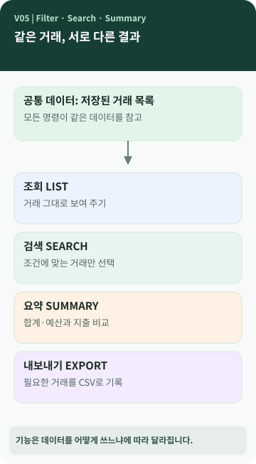

# Chapter 05 — 같은 거래로 목록도 만들고 월별 합계도 낼 수 있을까?

> 용돈 내역은 하나인데, `list`를 실행하면 거래가 보이고 `summary`를 실행하면 금액 합계가 나옵니다. **같은 데이터가 어떻게 서로 다른 결과가 될까요?**

**이 장에서 알게 되는 것** ① 원본 데이터와 가공 결과의 차이 ② 검색 조건·필터·집계의 뜻 ③ 예산과 실제 지출을 비교하는 방법 ④ 데이터를 읽는 일과 업무 규칙을 적용하는 일의 구분.

---

## 원본 데이터는 같아도 질문이 달라지면 답이 달라집니다

월말에 영수증이 한 묶음 있다고 생각해 보세요. '어떤 순서로 썼지?', '카페에서만 얼마 썼지?', '이번 달 지출 총액은?', '예산을 넘겼나?'는 **같은 영수증 묶음에 던지는 서로 다른 질문**입니다. 프로그램에서도 거래를 보관하는 일과 그 거래에서 결과를 만드는 일을 구분할 수 있습니다. `[보충 설명]`



그림 가운데의 거래 데이터가 여러 갈래로 나뉩니다. 이 화살표는 **원본 거래가 네 벌로 복사되어 저장된다는 뜻이 아닙니다.** 여러 기능이 같은 데이터에 접근해 각자의 결과를 만든다는 뜻입니다.

## 용어를 일상적인 말로 풀어 보면

- **조회(list/read)**: 거래 내역을 보여 주는 것입니다.
- **필터(filter)**: 조건에 맞는 거래만 통과시키는 일입니다.
- **검색(search)**: 날짜·카테고리·검색어 같은 조건을 주고 일치하는 거래를 찾는 일입니다.
- **집계(aggregation)**: 여러 값을 합치거나 개수를 세어 요약하는 일입니다.
- **예산(budget)**: 미리 정한 지출 기준입니다. 실제로 사용한 금액과 비교할 수 있습니다.

검색과 집계는 경쟁 관계가 아닙니다. **검색은 해당 거래를 고르고, 집계는 그 거래의 수치를 묶어 의미를 만듭니다.** `[개념]`

## 거래는 무엇을 거쳐 '월간 요약'이 될까요?

1. 저장된 거래를 읽습니다.
2. 지정한 달에 속하는 거래를 고릅니다.
3. 수입과 지출을 구분해 각각 더합니다.
4. 카테고리별 지출도 계산할 수 있습니다.
5. 월간 예산과 비교해 남은 금액 또는 초과 여부를 표시합니다.

예를 들어 예산 30만 원, 실제 지출 32만 원이라면 2만 원 초과입니다. **예산을 초과했다고 이미 입력한 거래가 자동으로 삭제되거나 다음 거래가 반드시 차단되는 것은 아닙니다.** M03에서는 예산을 **보고와 비교를 위한 기준**으로 사용했습니다. `[프로젝트 사례]`

## 처리 역할을 나누는 이유

M03에서는 저장된 자료를 제공하는 쪽을 `Repository`, 거래 검색·월 요약 같은 규칙을 적용하는 쪽을 `Service`, 사람에게 명령과 결과를 보여 주는 쪽을 `CLI`로 나누었습니다. `[프로젝트 사례]`

처음에는 이름이 낯설지만 **자료를 찾아오는 역할 / 자료로 계산하는 역할 / 사람에게 보여 주는 역할**이라고 생각하면 구분하기 쉽습니다. 역할을 나누면 코드를 고칠 위치를 찾는 데 도움이 되는 반면 파일이 많아져 처음 읽는 사람이 더 복잡하게 느낄 수도 있습니다. 이것은 하나의 설계 선택이지 모든 정답의 형태가 아닙니다.

## 💻 실제 사용 사례 (선택)

```bash
python -m ledger list --limit 5
python -m ledger search --category 카페
python -m ledger summary --month 2026-09
```

*위 명령은 M03 프로젝트 기준입니다. 해당 카테고리와 데이터가 없으면 출력이 다를 수 있습니다.* `[프로젝트 사례]`

M03의 `LedgerService`에서는 `list_transactions`, `search`, `monthly_summary`, `export_csv` 등이 같은 저장소의 거래를 사용하지만 처리 방법은 다릅니다. 조건에 맞는 거래를 결과 리스트로 모으는 `search`와 파일로 한 줄씩 기록하는 `export`는 메모리 사용 방식도 다릅니다.

## 공식 요구와 프로젝트 선택

요구사항 추적표에 목록 조회, 검색 조건, 월간 요약·예산, CSV 내보내기가 포함됩니다. 월 전체 예산 정책, 처리 파일의 분리 방식, 검색 결과를 최신 추가 순서로 돌려주는 방식은 프로젝트 사례입니다. `[요구 추적]` `[프로젝트 사례]`

## 다른 사람에게 이렇게 설명할 수 있습니다

> "저장된 거래는 같아도 프로그램이 어떤 질문을 하느냐에 따라 결과가 달라져요. 조회는 거래를 보여 주고, 검색은 조건에 맞는 거래를 고르고, 월간 요약은 금액을 합산합니다. 우리 프로그램에서는 예산을 지출과 비교하는 기준으로 사용합니다."

**한 문장 정리:** **데이터를 보관하는 일**과 **그 데이터로 의미 있는 결과를 만드는 일**을 구분하면 프로그램 구조가 보입니다.

**AI에게 물어볼 질문:** "내 프로그램의 목록·검색·요약 기능은 같은 데이터를 어떻게 다르게 사용하는지 보여 줘. 함수 이름은 마지막에 간단히 덧붙여 줘."
