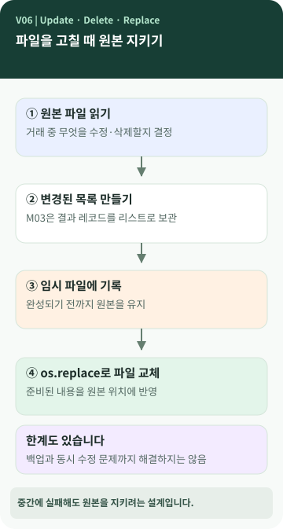

# Chapter 06 — 거래 한 건을 수정하면 저장 파일에는 어떤 일이 일어날까?

> 화면에는 금액 한 건만 바뀌었는데, 파일 안에서도 숫자 몇 글자만 고쳐질까요? **저장 도중 프로그램이 멈추면 기존 내역은 어떻게 될까요?**

**이 장에서 알게 되는 것** ① 수정·삭제가 파일 저장과 어떻게 연결되는지 ② 임시 파일을 사용하는 이유 ③ 안전하게 저장하려는 설계의 장점과 한계.

---

## 화면에서 고친 것과 파일에 남는 것은 다릅니다

프로그램이 거래를 수정해 화면에 새 결과를 보여 준다고 해서, 반드시 저장 파일도 바뀐 것은 아닙니다. 다음에 다시 실행했을 때까지 변경이 남으려면 **영구 저장된 데이터에 반영**해야 합니다. 2장의 Update·Delete와 3장의 저장 개념이 여기서 만납니다. `[개념]`



### 그림 읽는 법

'원본을 즉시 고치기' 대신 '변경된 내용을 다른 파일에 준비한 후 교체하기'로 나누어 그렸습니다. **기존 파일을 바꿀 준비가 완료됐는지**를 확인하는 과정이 핵심입니다.

## JSONL은 새 기록과 기존 기록을 다루는 방법이 다릅니다

JSONL의 끝에 새 거래를 한 줄 추가하는 것은 비교적 간단합니다. 하지만 중간에 있는 거래를 바꾸거나 지우려면 앞뒤 거래를 유지하면서 내용을 새로 구성해야 할 수 있습니다. `[개념]`

M03의 `update`와 `delete`는 기존 거래를 읽고 **변경 뒤의 레코드 목록을 만든 다음**, 별도의 임시 파일에 기록합니다. 기록이 끝나면 `os.replace()`로 원본을 교체합니다. `[프로젝트 사례]`

여기서 '임시 파일'은 잠깐 사용하는 작업용 파일이고, '원본'은 다음 실행에서 다시 읽는 실제 파일입니다. `replace`는 교체한다는 뜻입니다.

## 왜 번거롭게 임시 파일을 만들까요?

원본 파일을 열자마자 덮어쓰면 기록 도중 오류가 났을 때 앞부분만 바뀐 **불완전한 파일**이 남을 위험이 있습니다. 임시 파일을 먼저 완성하면 **교체하기 전까지 원본을 유지할 가능성**이 높아집니다. `[개념]`

하지만 이것이 모든 장애를 해결하는 것은 아닙니다. 동시 수정 충돌, 백업, 저장장치 문제 등은 별도의 대책이 필요합니다. 그리고 M03은 수정·삭제할 때 변경된 레코드 전체를 메모리의 리스트에 모으므로, **Generator를 쓴다고 해서 이 기능까지 항상 적은 메모리만 사용하는 것은 아닙니다.** `[프로젝트 사례]`

## 변경할 거래를 어떻게 찾을까요?

한 건의 거래에는 보통 구분할 수 있는 번호(ID)가 있습니다. M03은 내부적으로 정수 ID를 사용하고, 사용자에게는 `TX-000012`처럼 꾸며 보여 줄 수 있습니다. ID는 금액이나 날짜가 같아도 거래를 구분하기 위한 수단입니다. `[프로젝트 사례]`

또 '수정할 값을 지정하지 않았다'는 상황과 '메모를 빈 문자열로 바꿔 달라'는 상황도 다를 수 있습니다. M03에서는 이런 차이를 내부적으로 `UNSET`으로 구분했습니다. 모든 교육생이 같은 방식을 구현해야 하는 것은 아닙니다.

## 💻 실제 프로젝트에서 확인할 부분 (선택)

```text
TransactionRepository.update / delete
          ↓
_atomic_write_jsonl(...)
          ↓
임시 파일 기록 → os.replace(...)
```

*M03 실제 코드의 함수 이름을 연결한 구조이며, 실행 가능한 Python 코드가 아닌 설명 그림입니다.* 거래 수정·삭제는 기존 자료를 손상시키지 않도록 **연습용 복사본 또는 별도 데이터 폴더**에서 확인하세요. `[프로젝트 사례]`

## 공식 요구와 프로젝트 선택

거래 수정과 삭제는 CRUD의 일부이며 요구사항 추적표에 포함됩니다. 임시 파일과 `os.replace()`를 결합해 원본을 보호하려는 방식은 M03이 선택한 구현입니다. `[요구 추적]` `[프로젝트 사례]`

## 다른 사람에게 이렇게 설명할 수 있습니다

> "거래 수정·삭제는 화면만 바꾸는 게 아니라 파일에도 남겨야 해요. 우리 프로그램은 원본을 바로 덮지 않고 변경 내용을 임시 파일에 다 쓴 다음 교체해요. 중간에 실패했을 때 원본 손상 위험을 줄이려는 설계지만 모든 장애를 막는 건 아니에요."

**한 문장 정리:** 수정·삭제는 **어떤 데이터를 바꿀지 결정하는 일**과 **그 결과를 안전하게 남기는 일**로 나뉩니다.

**AI에게 물어볼 질문:** "내 프로그램은 거래를 수정할 때 원본 저장 파일을 어떻게 바꾸나요? 임시 파일을 사용하지 않는다면 위험을 줄이는 다른 장치가 있는지도 설명해 줘."
