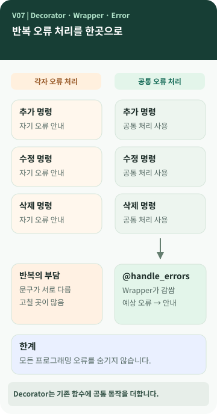

# Chapter 07 — 같은 오류 처리를 여러 번 만들지 않으려면?

> 거래를 추가할 때도, 삭제할 때도 문제가 생길 수 있습니다. **서로 다른 기능에서 비슷한 오류 안내를 보여 주려면 같은 코드를 계속 반복해야 할까요?**

**이 장에서 알게 되는 것** ① 함수와 공통 작업의 개념 ② Decorator라는 이름의 뜻 ③ Wrapper가 기존 동작을 감싼다는 의미 ④ 공통 오류 처리의 편리함과 주의점.

---

## 같은 일을 반복하면 무엇이 불편할까요?

세 명의 직원이 서로 다른 서류를 처리한다고 생각해 보세요. 각 직원이 오류 안내 문구를 자기 방식으로 만들면 어떤 곳은 친절하고 어떤 곳은 무슨 일이 생겼는지 알기 어렵습니다. **공통 안내 기준을 하나로 정하면** 같은 유형의 오류를 더 일관되게 알려 줄 수 있습니다. 프로그래밍에서도 여러 기능에 공통으로 필요한 동작을 한곳에 모으는 방법이 있습니다. `[보충 설명]`



그림 왼쪽은 명령마다 비슷한 오류 처리 코드가 반복되는 모습이고, 오른쪽은 여러 명령이 **공통 오류 처리로 둘러싸인 실행 경로**를 이용하는 모습입니다. '명령을 한 번만 실행한다'거나 '모든 오류를 없앤다'는 뜻은 아닙니다.

## Decorator라는 말을 풀어 보면

**Function(함수)**는 특정 작업을 수행하도록 묶어 둔 코드입니다. **Decorator(데코레이터)**는 원래 함수를 다른 함수로 감싸, 그 함수가 호출될 때 추가 동작을 제공할 수 있는 방법입니다. **Wrapper(래퍼)**는 '감싸는 것'이라는 뜻으로, 실제 감싸는 함수에 흔히 붙이는 이름입니다. `[개념]`

일상적인 '장식'과 이름이 닮았지만, **겉모습만 바꾸는 기능은 아닙니다.** 실행 전에 무언가 확인하거나, 실행 후 기록을 남기거나, 예상한 오류를 공통 형식으로 바꾸는 기능에도 사용합니다.

## M03에서는 무엇을 공통 처리했을까요?

M03에는 거래가 존재하지 않는 상황, 입력값이 올바르지 않은 상황 같은 예상 가능한 오류가 있습니다. `@handle_errors`는 프로그램의 명령 실행부를 감싸 **예상된 `LedgerError`를 사용자에게 보여 줄 오류·힌트 안내와 종료 코드 1로 바꾸는 역할**을 합니다. 정상적으로 처리되면 0을 반환합니다. `[프로젝트 사례]`

여기서 **Exception(예외)**은 실행 중 '정상 흐름대로 계속하기 어렵다'는 상황을 알리는 수단입니다. 어떤 오류인지에 따라 프로그램이 사용자에게 다른 안내를 할 수 있습니다.

또 `argparse`가 처리하는 잘못된 명령 형식은 별도로 종료 코드 2를 사용합니다. 따라서 'Decorator가 모든 오류를 처리한다'고 이해하면 안 됩니다. 그리고 이 프로젝트의 Decorator는 예상하지 않은 프로그래밍 오류까지 조용히 감추지 않습니다. `[프로젝트 사례]`

## 장점뿐 아니라 어려운 점도 있습니다

공통 오류 안내를 바꾸고 싶을 때 한곳에서 바꿀 수 있다는 장점이 있습니다. 반대로 함수를 누가 먼저 감싸는지 이해하지 못하면 **실제 실행 경로가 눈에 바로 보이지 않을 수 있습니다.** 따라서 작은 프로그램에서는 단순한 `try/except`가 이해하기 쉬울 수도 있습니다. `[개념]`

Decorator는 설계 도구이지 모든 프로그램이 반드시 같은 방식으로 공통 작업을 분리해야 한다는 의미는 아닙니다.

## 💻 `@`가 붙은 코드는 어떻게 볼까요? (선택)

```python
@handle_errors
def _dispatch(args: argparse.Namespace) -> None:
    ...
```

*M03 `ledger/cli.py`의 실제 Decorator 적용 위치를 단순 발췌했습니다. `...`는 생략된 코드라는 뜻입니다.* `@handle_errors`를 '바로 아래 함수에 공통 오류 처리를 적용했다'는 표시로 먼저 읽어 보세요. `[프로젝트 사례]`

참고로 `@dataclass`도 `@`를 쓰지만, 이것은 데이터를 담는 클래스를 더 간편하게 만드는 용도입니다. 문법 모양이 같다고 목적까지 같은 것은 아닙니다.

## 공식 요구와 프로젝트 선택

M03 요구사항 추적표에는 Decorator의 **실제 사용**이 포함됩니다. 오류 안내를 `@handle_errors` 하나에 모으고 `LedgerError`만 처리하는 범위를 정한 것은 이 프로젝트의 설계입니다. `[요구 추적]` `[프로젝트 사례]`

## 다른 사람에게 이렇게 설명할 수 있습니다

> "Decorator는 원래 함수의 동작을 감싸 공통 기능을 더하는 방법이에요. 우리 용돈 기입장에서는 예상한 오류가 났을 때 각 명령이 따로 처리하지 않고 같은 오류·힌트 안내를 보여 주도록 사용했습니다. 모든 오류를 해결하는 마법은 아니에요."

**한 문장 정리:** Decorator는 **원래 기능을 유지하면서 공통 동작을 둘러서 추가하는 방법**입니다.

**AI에게 물어볼 질문:** "내 프로젝트에 `@`가 붙은 함수가 있나요? 있다면 무엇을 감싸고 무엇을 추가하는지, 없다면 같은 기능을 어떤 방식으로 구현했는지 설명해 줘."
