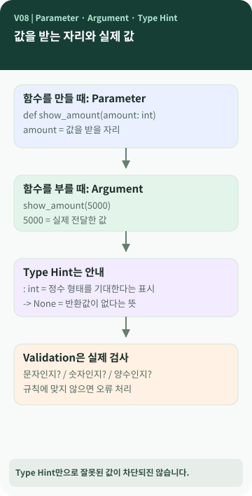

# Chapter 08 — `amount: int`라고 적으면 잘못된 값을 막을 수 있을까?

> 거래의 금액은 숫자여야 합니다. 그런데 함수에 `amount: int`라고 적혀 있다면, **누군가 문자를 전달했을 때 Python이 자동으로 막아 줄까요?**

**이 장에서 알게 되는 것** ① Parameter와 Argument의 차이 ② 자료형(Type)의 뜻 ③ Type Hint가 해 주는 일과 못 하는 일 ④ `argparse`와 실제 값 검증의 차이.

---

## 함수는 일을 하는 작은 단위입니다

함수(Function)는 어떤 작업을 수행하도록 이름을 붙여 묶어 둔 코드입니다. 예를 들어 '금액에 부가세를 더한다' 또는 '거래를 기록한다' 같은 작업입니다. 함수에는 **밖에서 값을 받아들이는 자리**가 있을 수 있습니다. `[개념]`



### 그림 읽는 법

위쪽은 **함수를 정의한 자리(Parameter)**와 **함수를 사용할 때 넣은 실제 값(Argument)**이 대응한다는 뜻입니다. 아래쪽은 **자료형 안내(Type Hint)**와 **입력값 검사(Validation)**가 서로 다른 역할임을 보여 줍니다.

## Parameter와 Argument, 왜 두 말이 있을까요?

**Parameter(매개변수)**는 함수를 정의할 때 '여기에 값을 받겠습니다'라고 정해 둔 자리입니다. **Argument(인자·인수)**는 그 함수를 사용할 때 전달하는 실제 값입니다. `[개념]`

```python
def show_amount(amount):
    print(amount)

show_amount(5000)
```

여기에서 `amount`는 Parameter이고, `5000`은 Argument입니다. 이 단어는 앞에서 만난 `argparse`의 *argument*와 연결됩니다. CLI에서는 '명령줄에서 전달된 인자'라는 의미로 조금 넓게 사용합니다.

## Type Hint라는 이름을 풀어 보면

**Type(타입)**은 값의 종류, 즉 자료형입니다. 정수(`int`), 글자(`str`) 등이 있습니다. **Hint(힌트)**는 '이런 값을 예상합니다'라는 안내입니다. 그래서 Type Hint는 **이 함수가 어떤 자료형을 받거나 돌려주는지 읽는 사람과 분석 도구에 알려 주는 표시**입니다. `[개념]`

```python
def show_amount(amount: int) -> None:
    print(amount)
```

여기서 `amount: int`는 정수 입력을 기대한다는 뜻이고 `-> None`은 특별한 반환값이 없음을 나타냅니다. 이 표시 자체만으로 **Python이 모든 잘못된 입력을 자동 거부하는 것은 아닙니다.** 그래서 실제로 값을 확인하는 코드가 필요할 수 있습니다.

## 검사도 한 번에 끝나는 일이 아닙니다

용돈 기입장에서는 다음 두 상황이 다릅니다. `[개념]`

1. **형식 문제** — `--limit`에 숫자가 아닌 문자열을 적었습니다. `argparse`의 `type=int`가 기본적인 변환 단계에서 이를 확인할 수 있습니다.
2. **업무 규칙 문제** — 숫자이긴 하지만 `--limit 0`을 적었습니다. '최근 몇 개'는 양수여야 한다는 규칙은 별도 코드에서 검사해야 합니다.

M03의 `LedgerService.list_transactions(limit: int)`는 Type Hint를 표시하고, 함수 안에서 `limit <= 0`도 검사합니다. **표시와 검증이 함께 있지만 같은 일은 아닙니다.** `[프로젝트 사례]`

## Type Hint를 쓰면 어떤 점이 좋을까요?

코드를 처음 보는 사람이 **함수가 어떤 값을 기대하는지** 알아보기 쉬워집니다. 편집기나 정적 분석 도구가 실수를 미리 찾아주는 데도 도움이 됩니다. 반면 표기를 많이 사용하면 초심자에게 기호가 복잡해 보일 수 있고, 실행 중 안전을 보장하는 기능으로 과대평가하기 쉽습니다. `[개념]`

처음에는 `:`와 `->`가 '자료형 안내 표시'라는 사실만 이해해도 충분합니다.

## 💻 실제 프로젝트에서 확인하기 (선택)

```python
def list_transactions(self, limit: int) -> list[Transaction]:
    if limit <= 0:
        raise ValidationError(...)
```

*M03 `ledger/services.py`에서 의미를 보여 주기 위해 발췌·축약한 코드입니다. `...`는 실제 오류 메시지를 생략했다는 뜻입니다.* 위쪽의 `: int`는 안내, 아래쪽의 `limit <= 0`은 실행 중 검사입니다. `[프로젝트 사례]`

## 공식 요구와 프로젝트 선택

M03 요구사항 추적표는 공개 API의 Type Hint 사용과 잘못된 입력에 대한 처리를 다룹니다. Type Hint만으로 검증이 끝나는 것은 아니며, 이 프로젝트는 `argparse`, `validators.py`, Service의 규칙을 나누어 사용했습니다. `[요구 추적]` `[프로젝트 사례]`

## 다른 사람에게 이렇게 설명할 수 있습니다

> "Parameter는 함수에서 값을 받을 자리이고 Argument는 실제로 넣는 값이에요. `amount: int`처럼 쓰는 Type Hint는 어떤 종류의 값을 기대하는지 알려 주는 표시입니다. 실행할 때 정말 올바른 값인지 검사하는 일은 별도의 코드가 맡을 수 있어요."

**한 문장 정리:** **입력의 의미를 설명하는 것(Type Hint)**과 **실제로 올바른 입력인지 판단하는 것(Validation)**은 다릅니다.

**AI에게 물어볼 질문:** "내 프로그램의 함수 한 개를 골라 Parameter, Argument, Type Hint, 실제 입력 검증이 어디에 있는지 코드를 수정하지 말고 설명해 줘."
