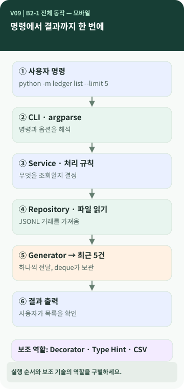
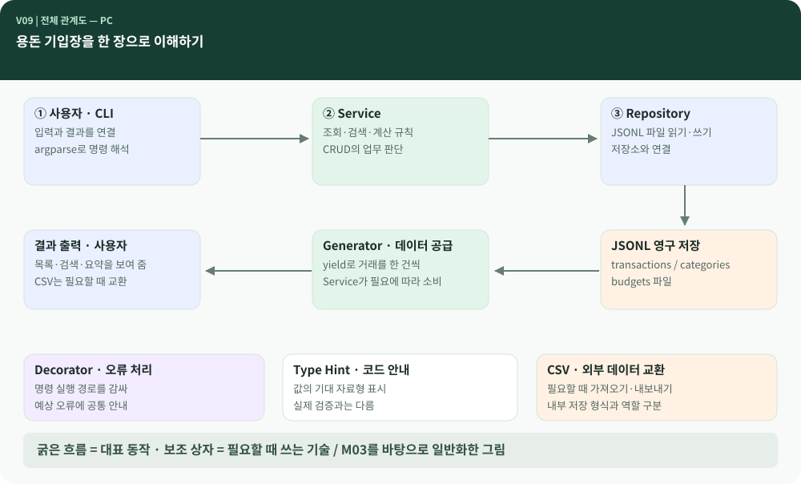

# Chapter 09 — 내가 만든 용돈 기입장은 하나의 프로그램으로 어떻게 움직일까?

> CLI, CRUD, JSONL, CSV, Generator, Decorator, Type Hint를 따로 배웠습니다. 이제 다시 `list` 명령을 실행해 봅니다. **이 여러 개념은 한 번의 결과를 만들기 위해 어디에서 만나고 있을까요?**

**이 장에서 알게 되는 것** ① 프로그램의 시작부터 결과까지 이어지는 큰 흐름 ② 데이터·업무 규칙·사용자 접점의 다른 역할 ③ 각 기술이 '어느 자리에 쓰이는지' ④ 자신의 프로젝트를 설명할 수 있는 틀.

---

## 한 번의 명령이 지나가는 길

용돈 기입장에 다음처럼 요청할 수 있습니다. 이 문장은 M03 프로젝트의 예입니다. `[프로젝트 사례]`

```bash
python -m ledger list --limit 5
```

여기서 `python -m ledger`가 프로그램을 시작하고 `list --limit 5`는 목록 기능에 전달됩니다. 그 뒤에는 여러 역할이 순서대로 일합니다.



### 그림 읽는 법

1. **위에서 아래로 이어지는 굵은 화살표**는 대표적인 `list` 실행 흐름입니다.
2. 가운데는 **사용자 명령 → 입력 해석 → 기능 처리 → 파일 읽기 → 결과 구성 → 출력**의 순서입니다.
3. 양옆의 가는 연결선은 모든 단계에서 순서대로 실행되는 일이 아니라, 특정 단계가 **필요할 때 사용하는 보조 역할**입니다.
4. 저장 파일에서 결과로 돌아가는 방향은 **데이터가 읽혀 오는 경로**입니다.

## 이름이 달라도 역할은 비교할 수 있습니다

M03에서는 사용자와 만나는 `CLI`, 거래 검색·합계 등의 규칙을 적용하는 `Service`, 파일을 읽고 쓰는 `Repository`로 책임을 나눴습니다. `[프로젝트 사례]`

이는 팀을 나누어 일하는 조직과 비슷하게 설명할 수 있지만, 모든 프로그램이 이 세 이름의 파일을 반드시 갖추는 것은 아닙니다. 어떤 교육생의 코드는 한 파일에 모두 있을 수 있고, 다른 교육생은 다른 계층 이름을 쓸 수 있습니다.

중요한 것은 **사람의 입력을 받는 일 / 데이터를 이용해 판단하는 일 / 저장된 데이터를 읽고 쓰는 일**을 구분해 설명할 수 있는지입니다.

## 주요 기술은 모두 같은 일을 하는 것이 아닙니다

| 지금까지 배운 개념 | 전체 프로그램에서 맡는 역할 |
| --- | --- |
| CLI·argparse | 사용자 명령을 받아 의미 있는 입력으로 해석 |
| CRUD | 프로그램이 거래 데이터를 다루는 네 가지 기본 행동 |
| JSONL·CSV | 데이터를 저장하고 외부로 교환하는 형식 |
| Generator | 필요할 때 데이터를 하나씩 전달하는 방식 |
| Decorator | 공통으로 필요한 동작을 함수에 덧붙이는 방법 |
| Type Hint | 함수 입력과 반환값의 기대 자료형을 표시 |

이 표에서 **모든 것이 똑같은 단계에 순서대로 등장하는 것은 아닙니다.** 예를 들어 Type Hint는 실행 중 반드시 한 번 지나가는 처리 단계가 아니라 코드를 읽고 확인할 때 도움을 주는 정보입니다. Decorator는 함수 호출 경로를 감쌀 수 있고, CSV는 필요할 때만 import/export에 쓰입니다.

## 💻 PC에서 보는 전체 관계도



*PC용 관계도입니다. 모바일 그림과 내용은 같지만 역할 간 연결을 한 화면에서 비교합니다.*

이 그림은 **M03를 바탕으로 일반화한 구조**입니다. 내 프로젝트가 단일 파일이거나 다른 저장 형식을 쓰더라도, 그림의 '역할'을 대응시키면 전체 동작을 설명할 수 있습니다.

## 마지막으로 자신의 프로그램을 생각해 보세요

- **입구:** 나는 어떤 명령으로 프로그램을 시작했을까?
- **입력:** 사용자의 명령이나 금액을 누가 해석하고 검사할까?
- **처리:** 거래 추가·검색·월간 요약은 어디에서 계산할까?
- **저장:** 프로그램을 꺼도 기록이 남는 곳은 어디일까?
- **공통 장치:** Generator·Decorator·Type Hint를 어디에 사용했고, 왜 사용했을까? 없거나 다른 방식이라면 그 차이는 무엇일까?

이 질문은 시험문제가 아니라 **자신의 결과물을 설명할 때 사용할 길잡이**입니다. 기술마다 정답을 외우는 것보다 전체 흐름이 이어지는지를 살펴보세요.

## 내가 설명할 수 있는 한 문단

> "제 용돈 기입장은 명령을 입력하면 시작돼요. 프로그램은 어떤 작업을 할지와 전달받은 값을 해석하고, 거래 추가나 검색 같은 기능을 실행합니다. 거래 데이터는 저장 파일에서 읽거나 파일에 기록하기 때문에 프로그램을 껐다 켜도 남습니다. 데이터의 형태와 처리 규칙을 구분해 관리했고, 필요한 곳에서는 Generator로 순차 처리하거나 Decorator로 공통 오류 처리를 묶을 수 있어요. Type Hint는 코드가 어떤 값을 기대하는지 알려 줍니다."

위 문단은 **공통 개념을 설명하는 예시**입니다. 자신의 실제 구현과 다른 부분이 있다면 반드시 고쳐서 설명하세요. `ledger`의 구조와 다르더라도 미션의 개념을 설명할 수 있습니다.

**한 문장 정리:** 프로그램은 기술 이름의 모음이 아니라 **입력부터 결과까지 여러 역할이 협력하는 하나의 흐름**입니다.

**AI에게 물어볼 질문:** "내 용돈 기입장의 실제 파일과 함수만을 근거로 입력 → 처리 → 저장 → 출력 흐름도를 그려 줘. Generator·Decorator·Type Hint는 실행 단계가 아니라 각각 어떤 역할로 적용됐는지 구분해 줘. 코드는 수정하지 마."
