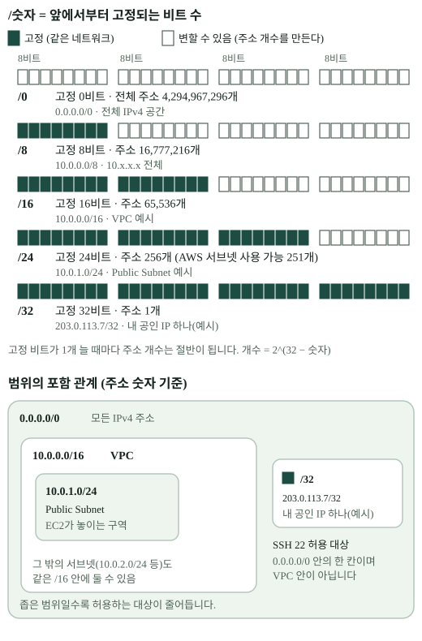

# 2. 일반 네트워크의 역할은 AWS에서 무엇이 맡을까?

> 내 서버를 인터넷에 연결할 때 필요한 **주소, 길, 출입 규칙, 응답하는 프로그램**은 AWS에서 각각 무엇일까요?

일반 기업망의 구조를 먼저 살펴보고, 패킷의 여행에서 주소를 따라 이동하는 과정을 확인한 뒤 AWS의 대응 역할을 비교합니다. [기업 홈페이지 전체 구성도와 장면별 보강 자료](../supplement/README.md)의 그림 0·1을 읽고, [패킷의 여행 체험](../supplement/README.md#packet-journey)에서 한 단계씩 진행해 보세요. 이어서 아래 표에서 각 역할이 AWS의 무엇에 대응하는지 비교할 수 있습니다.

## 먼저 ‘이름’이 아니라 ‘하는 일’을 맞춰 보기

`[개념]` 직접 네트워크를 구성해도, AWS에서 구성해도 다음 질문은 같습니다. **서버를 어느 주소 범위에 둘까? 인터넷으로 가는 길은 어디인가? 누구의 접속을 받을까? 요청을 받는 프로그램은 무엇인가?** AWS는 이 일을 여러 논리적 자원으로 나눠 설정합니다. [기존 공개 개념 연결 — 일반 네트워크 / AWS 네트워크 역할 비교](https://hyun02063185-ax-beginner.github.io/codyssey-mission-tech-glossary/#/connections/network-aws-role-comparison).

| 일반 네트워크에서 하는 일 | B3-1에서 사용한 AWS 구성 | 역할이 만나는 지점 | 같다고 보면 놓치는 점 |
| --- | --- | --- | --- |
| 내부 네트워크의 범위를 정함 | **VPC** `10.0.0.0/16` | 자원을 둘 논리적 네트워크와 주소 범위를 정함 | VPC는 물리 케이블이나 스위치 한 대가 아님 |
| 네트워크를 주소 대역으로 나눔 | **Subnet** `10.0.1.0/24` | VPC 범위 일부에 EC2를 둠 | AWS Subnet은 한 가용 영역(AZ)에 속함. ‘Public’은 이름이 아니라 연결된 경로로 결정됨 |
| 서버를 네트워크에 연결하고 사설 주소를 부여함 | EC2의 **네트워크 인터페이스(ENI, 가상 네트워크 카드)** 와 사설 IPv4 | 서버가 Subnet의 주소로 통신함 | 보안 그룹은 Subnet 전체가 아니라 인터페이스에 적용됨 |
| 목적지에 따라 다음 길을 선택함 | Subnet에 연결한 **Route Table** | `0.0.0.0/0 → IGW`처럼 목적지와 다음 대상을 적음 | Route Table은 패킷이 통과하는 장비가 아닌 **경로 규칙표** |
| 내부망과 인터넷을 연결함 | VPC의 **Internet Gateway(IGW)** 와 EC2의 Public IPv4 | 외부 IPv4와 사설 IPv4 사이의 연결을 가능하게 함 | IGW만 붙여서는 공개 접속이 완성되지 않음. IPv4에서는 일대일 주소 변환도 수행함 |
| 서버로 오는 접속을 제한함 | EC2 인터페이스의 **Security Group** | 출발지·프로토콜·목적 포트별 허용 규칙을 둠 | 경계에 세운 방화벽 장비와 위치가 다르고, 허용된 연결의 상태를 기억함 |
| 요청에 실제로 응답함 | **EC2** 안의 **Nginx** | 컴퓨터 위에서 웹 서버가 TCP 80의 HTTP 요청에 응답함 | EC2는 컴퓨터, Nginx는 그 안에서 실행하는 프로그램 |

이 표는 **역할의 대응**입니다. 전통적인 사내망에도 설계 방식이 여럿이고, AWS 자원이 물리 장비와 정확히 1:1로 바뀌는 것은 아닙니다. 예를 들어 IGW는 막연한 ‘라우터 한 대’, Security Group은 ‘Subnet 전체에 놓인 방화벽’이라고 외우면 실제 적용 지점을 놓칩니다. [AWS VPC 개요](https://docs.aws.amazon.com/vpc/latest/userguide/what-is-amazon-vpc.html), [AWS의 Subnet·Route Table 설명](https://docs.aws.amazon.com/vpc/latest/userguide/how-it-works.html).

## B3-1 구성에 대입해 보기

`[B3-1 사례]` [2026-10-14 배포 기록](https://github.com/hyun02063185-AX-beginner/Codyssey_B3-1/blob/c68929943f1904a5c7c8033d2d49a30ace56e3d1/docs/deployment-log-2026-10-14.md)을 역할 순서로 다시 읽으면 다음과 같습니다.

1. **주소 계획:** VPC `10.0.0.0/16` 안에 Subnet `10.0.1.0/24`를 만들고 EC2를 배치했습니다. EC2의 당시 사설 주소는 `10.0.1.149`였습니다.
2. **인터넷 연결:** IGW를 VPC에 붙이고, Subnet에 연결된 Route Table에 `0.0.0.0/0 → IGW`를 적었습니다. EC2에는 자동 할당 Public IPv4를 사용했습니다.
3. **접근 통제:** Security Group에서 공개 웹 요청은 HTTP TCP 80에 `0.0.0.0/0`, 관리자 접속은 SSH TCP 22에 당시 작업자 공인 IP 한 개(`/32`)를 허용했습니다.
4. **응답 서비스:** EC2 안에서 Nginx가 80번 포트의 요청을 받아 빌드된 `dist/` 파일을 제공했습니다.

[그림 크게 열기](../assets/aws-network-roles.svg)

그림의 Route Table은 Subnet에 **연결된 규칙표**로, Security Group은 EC2의 **네트워크 인터페이스에 적용되는 규칙**으로 읽으세요. 화살표를 패킷이 장비를 하나씩 통과하는 실제 물리 경로로 읽으면 안 됩니다. 3장에서는 외부 접속 조건을, 4장에서는 허용 규칙을 더 자세히 봅니다.

## 같은 숫자도 놓인 자리에 따라 다릅니다

`[개념]` CIDR은 IPv4 주소 **범위**를 적는 방법입니다. `/숫자`는 앞에서 고정한 비트 수로, 숫자가 클수록 범위가 좁아집니다. [CIDR 용어 설명](../../../terms/cidr.md).

[그림 크게 열기](../assets/cidr-range.svg)

| 표기 | 전체 IPv4 주소 수 | B3-1에서 읽는 자리 |
| --- | ---: | --- |
| `10.0.0.0/16` | 65,536 | VPC 내부 주소 범위 |
| `10.0.1.0/24` | 256 | 그 VPC 안의 Subnet 범위 |
| `0.0.0.0/0` | 전체 IPv4 공간 | Route Table에서는 **기본 경로의 목적지**, SG에서는 **모든 출발지** |
| 작업자 주소 `/32` | 1 | VPC 밖에서 오는 관리자 공인 IP 한 개를 SG에서 지정 |

AWS의 일반적인 IPv4 Subnet은 앞 4개와 마지막 1개 주소를 예약합니다. 그래서 이 `/24`의 **전체 주소는 256개**, 자원에 **할당 가능한 주소는 보통 251개**입니다. [AWS Subnet CIDR 문서](https://docs.aws.amazon.com/vpc/latest/userguide/subnet-sizing.html). 운영자의 `/32`는 VPC 안에 새로 만든 Subnet이 아닙니다.

## 네트워크 규칙과 로그인 권한은 또 다릅니다

`[개념]` Security Group은 네트워크 접속 가능 여부를, SSH 키는 Linux 서버의 로그인 자격을 판단합니다. IAM은 AWS API나 콘솔에서 **누가 어떤 클라우드 자원을 조작할 수 있는지**를 다룹니다. 세 가지를 모두 ‘권한’이라고 부르더라도 검사하는 대상과 시점이 다릅니다. B3-1에서는 SSH 접속을 사용했고, 정적 파일 제공 EC2에 IAM 인스턴스 프로필을 붙이지 않았습니다. IAM 작업자 권한의 최소 범위가 실제로 검증되었다는 기록도 없습니다. [B3-1 IAM 기록](https://github.com/hyun02063185-AX-beginner/Codyssey_B3-1/blob/c68929943f1904a5c7c8033d2d49a30ace56e3d1/README.md#iam-최소권한).

AWS에는 Subnet에 적용하는 **Network ACL**도 있습니다. 이는 Security Group과 적용 지점·상태 처리 방식이 다릅니다. Network ACL은 연결 상태를 기억하지 않아 요청과 응답 방향을 각각 평가하고, Security Group은 허용된 연결의 상태를 기억합니다. B3-1은 기본 Network ACL을 유지했으므로 이 사례의 핵심 설정은 Route Table과 Security Group입니다. [AWS Network ACL 문서](https://docs.aws.amazon.com/vpc/latest/userguide/vpc-network-acls.html).

## 내 프로젝트에 연결하기

`[확인 활동]` 내 배포에서 아래 다섯 질문에 **서비스 이름과 근거**를 붙여 답해 보세요.

1. 서버나 호스팅 대상은 어떤 **주소 범위**에 있는가?
2. 인터넷으로 나가거나 들어올 **경로와 공개 주소**는 무엇인가?
3. 웹 방문자와 관리자의 접속을 각각 **어디에서 제한**하는가?
4. HTTP 요청을 실제로 받는 **프로그램 또는 관리형 서비스**는 무엇인가?
5. AWS 리소스 조작 권한과 서버 로그인 자격은 **어떻게 구분**되는가?

관리형 호스팅을 썼다면 플랫폼이 대신 관리하는 항목을 표시하세요. 직접 설정하지 않았다는 사실도 자기 아키텍처를 정확히 설명하는 답입니다.

**한 문장 정리:** 일반 네트워크의 주소 구획·경로·인터넷 연결·접근 통제·서버 응답을 AWS에서는 VPC·Subnet·Route Table·IGW·Security Group·EC2와 웹 서버가 나누어 맡습니다.

[← 이전: 배포](01-deployment-path.md) · [다음: 인터넷 경로 →](03-internet-path.md)
