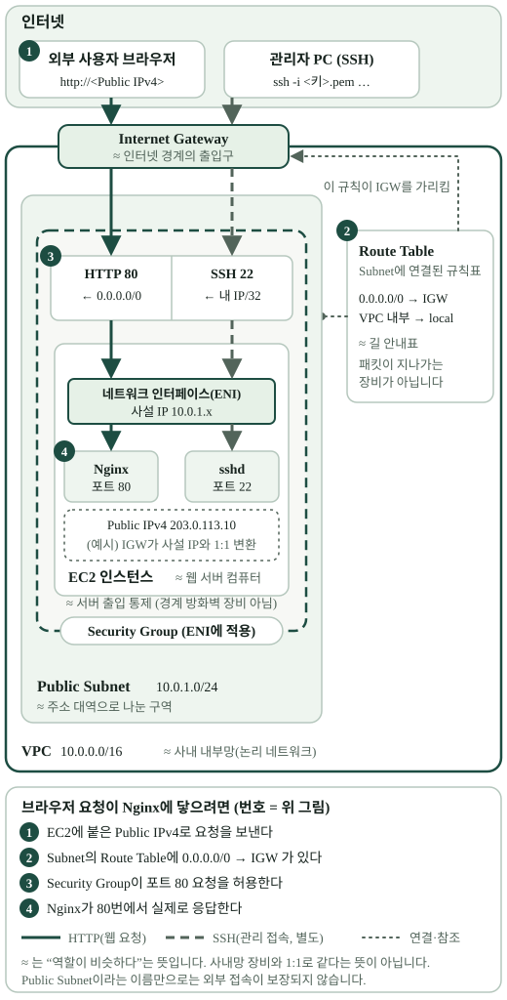

# 3. Public Subnet이면 바로 접속될까?

> Subnet 이름에 “Public”을 붙이면 인터넷에서 EC2가 열릴까요?

## 경로와 주소는 다른 조건

`[개념]` AWS에서 **Public Subnet**은 인터넷 게이트웨이(IGW)로 향하는 경로가 있는 Route Table에 연결된 Subnet입니다. 하지만 외부 IPv4 사용자가 인스턴스에 도달하려면 인스턴스의 Public IPv4, 허용된 보안 규칙, 응답하는 서버도 필요합니다. 이름만 `public`으로 붙이거나 경로만 만든 것으로 접속이 보장되지는 않습니다. [AWS 인터넷 게이트웨이 문서](https://docs.aws.amazon.com/vpc/latest/userguide/VPC_Internet_Gateway.html).



[그림 크게 열기](../assets/aws-network-roles.svg)

그림은 **역할 관계**를 단순화했습니다. 실제 AWS 구성에서 Route Table은 Subnet에 연결되고, 보안 그룹은 EC2의 네트워크 인터페이스에 적용됩니다.

`[B3-1 사례]` VPC에 IGW를 붙이고, Public Route Table에 `0.0.0.0/0 → IGW`를 추가했습니다. 이 Route Table을 Subnet에 **명시적으로 연결**했고 EC2에 자동 할당 Public IPv4를 사용했습니다. [배포 작업 기록](https://github.com/hyun02063185-AX-beginner/Codyssey_B3-1/blob/c68929943f1904a5c7c8033d2d49a30ace56e3d1/docs/deployment-log-2026-10-14.md#작업-순서와-결과).

```
외부 브라우저 → Public IPv4 → IGW/VPC 경로 → 보안 규칙 → EC2의 Nginx
```

이 흐름은 확인 순서를 보여 주는 교육용 단순화입니다. IPv4에서 IGW는 인스턴스의 Public IPv4와 사설 IPv4 사이의 일대일 주소 변환을 수행합니다. 서버 안에서 사설 주소를 보더라도 외부에서는 Public IPv4로 접근할 수 있는 이유입니다. **자동 할당 Public IPv4는 고정 주소가 아닙니다.** 인스턴스의 중지·시작 등으로 바뀔 수 있습니다.

## 내 프로젝트에 연결하기

`[확인 활동]` 외부에서 열리지 않는다면 Subnet 이름보다 ① 연결된 Route Table ② IGW 경로 ③ 현재 Public IPv4 또는 다른 공개 엔드포인트 ④ 보안 그룹 ⑤ 웹 서버 응답을 차례로 확인하세요. 로드 밸런서나 관리형 호스팅을 사용했다면 인터넷 진입점이 EC2 자체가 아닐 수 있습니다.

**한 문장 정리:** Public Subnet은 인터넷으로 향하는 **경로의 성질**이고, 실제 외부 접속에는 주소·접근 규칙·응답하는 서비스가 함께 필요합니다.

[← 이전: 주소 범위](02-vpc-subnet-cidr.md) · [다음: 출입 규칙 →](04-security-group.md)
