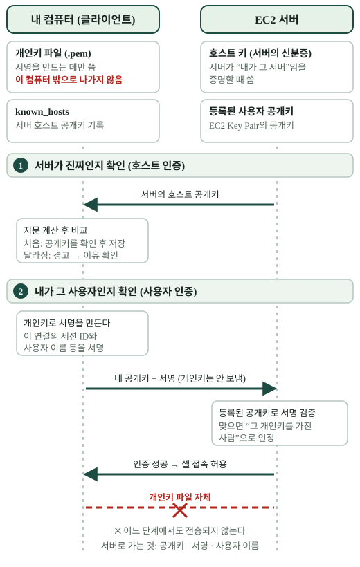

# 5. 개인키를 보내지 않고 어떻게 로그인할까?

> `ssh -i`에 개인키 파일을 넣으면 그 파일이 EC2로 전송될까요?

## 서로 다른 두 확인

`[개념]` SSH 연결에서는 먼저 **서버가 누구인지** 확인하는 호스트 인증과, **접속자가 로그인할 자격이 있는지** 확인하는 사용자 인증을 구분합니다. 처음 접속할 때 보이는 호스트 키 지문은 서버 신원 확인과 관계있고, 내 개인키는 사용자 인증에 쓰입니다. [SSH 키 자세히 보기](../../../terms/ssh-key.md).



[그림 크게 열기](../assets/ssh-key-auth.svg)

| 확인 | 서버가 진짜인가? | 접속자가 자격이 있는가? |
| --- | --- | --- |
| 증명하는 쪽 | 서버 | 내 SSH 클라이언트 |
| 관련 키 | 서버의 호스트 키 | 내 키 쌍 |
| 내 컴퓨터에 남는 것 | 확인한 호스트 공개키 (`known_hosts`) | 보호해야 할 개인키 파일 |
| 서버에 있는 것 | 서버의 호스트 개인키 | 허용한 사용자의 공개키 목록 |

`[개념]` 사용자 인증 시 클라이언트는 연결에 고유한 값 등을 **개인키로 서명**하고 서버는 공개키로 검증합니다. 개인키 파일 자체는 서버로 보내지 않습니다. `ssh -i`는 클라이언트가 읽을 로컬 개인키 경로를 지정합니다. 이는 “공개키로 암호화하고 개인키로 복호화해서 로그인한다”는 설명과 다릅니다.

`[B3-1 사례]` EC2 Key Pair를 사용했고, 개인키 파일의 내용·경로는 저장소에 기록하지 않았습니다. Amazon Linux 2023 인스턴스의 사례 명령에는 `ec2-user`를 썼지만, 기본 사용자 이름은 선택한 이미지(AMI)에 따라 다릅니다. 아래는 **문서용 예시**이며 주소 `203.0.113.10`은 실제 서버가 아닙니다.

```sh
chmod 400 ./demo-key.pem
ssh -i ./demo-key.pem ec2-user@203.0.113.10
```

키 파일과 주소를 실제 값으로 바꾸기 전에는 접속되지 않습니다. 개인키를 Git에 올리지 마세요. 처음 보는 호스트 지문이나 바뀐 지문은 별도 근거로 확인하고, 경고를 지우는 것만으로 해결하지 않습니다.

## 내 프로젝트에 연결하기

`[확인 활동]` 내가 서버에 직접 접속한다면 ① 접속 허용 출발지 ② 사용자 이름 ③ 사용할 키 ④ 확인한 서버 지문을 각각 구분해 보세요. 관리형 호스팅이라 SSH 접속을 하지 않았다면 “플랫폼에서 서버 관리를 맡았다”고 설명하면 됩니다.

**한 문장 정리:** SSH 키 로그인은 내 개인키로 만든 서명을 서버가 공개키로 검증하며, 서버의 신원 확인은 별도의 호스트 키로 합니다.

[← 이전: 출입 규칙](04-security-group.md) · [다음: 웹 제공 →](06-ec2-nginx.md)
