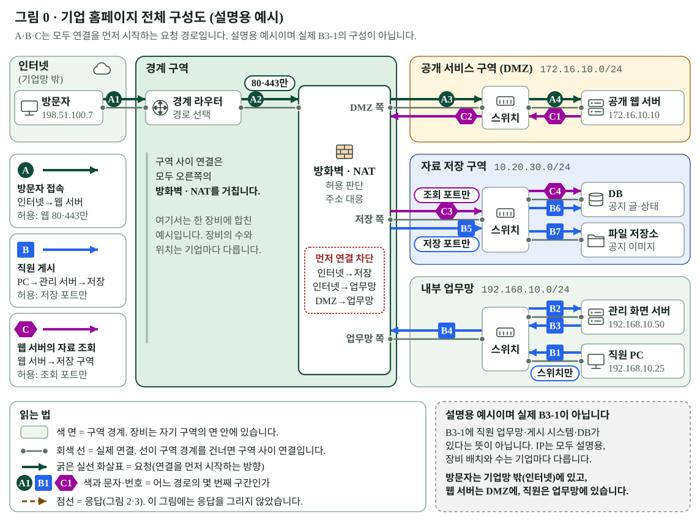
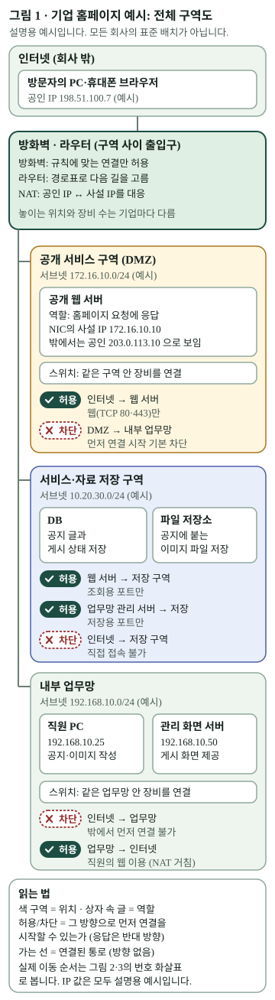
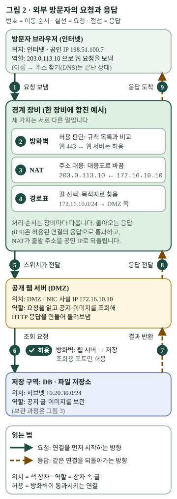
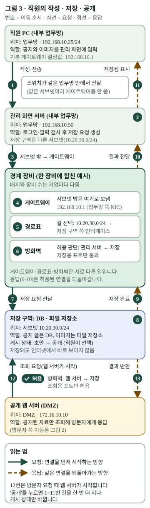
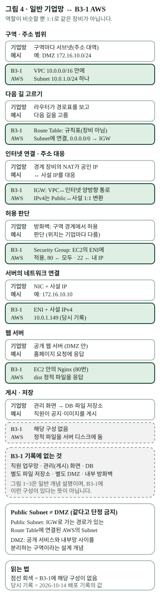
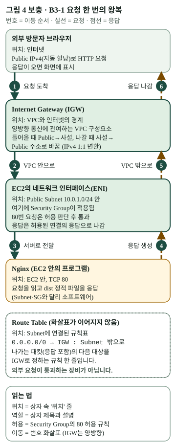

# B3-1 보강 자료 — 기업 홈페이지 구성도로 읽는 네트워크

> 대상: 네트워크를 처음 접하는 B3-1 교육생. 상태: **콘텐츠 초안(독립 검토 전)**. 웹 라우트·용어 목록·지식 지도·배포 설정에는 연결하지 않았습니다.
> 이 자료는 [B3-1 학습 가이드](../README.md)의 2·3장을 보강합니다. 2장의 “일반 네트워크 역할 ↔ AWS 자원” 표를 읽기 전에, **일반 기업망의 그림을 먼저 읽는 연습**을 합니다.

## 이 자료가 하는 일과 하지 않는 일

| 하는 일 | 하지 않는 일 |
| --- | --- |
| 기업 홈페이지라는 **설명용 예시**로 네트워크 요소의 위치·역할·허용되는 연결·실제 이동 방향을 구분해 읽게 합니다. | 이 예시가 모든 회사의 표준 배치라고 말하지 않습니다. 방화벽·라우터의 위치와 장비 수, DMZ의 구성은 기업마다 다릅니다. |
| 같은 역할이 B3-1의 AWS 구성에서는 무엇에 대응하는지 비교합니다. | B3-1의 EC2/Nginx 정적 배포에 직원 업무망, 게시 시스템, DB, 별도 DMZ가 있다고 말하지 않습니다. |

그림의 IP 주소(`172.16.10.0/24`, `203.0.113.10` 등)는 모두 설명용 예시입니다. `203.0.113.0/24`와 `198.51.100.0/24`는 문서 예시용으로 확보된 주소 범위입니다.

## 그림 목록과 읽는 법

| 그림 | 장면 | 한 줄 질문 |
| --- | --- | --- |
| [그림 0](assets/00-enterprise-network-overview.svg) | 0. 한눈에 보는 전체 구성도 | 방문자 접속·직원 게시·웹 서버의 자료 조회는 한 기업망 안에서 어떻게 다른 길을 갈까? |
| [그림 1](assets/01-network-zones.svg) | 1. 전체 구역도 | 회사 홈페이지를 둘러싼 네트워크는 어떤 구역으로 나뉠까? |
| [그림 2](assets/02-visitor-request-response.svg) | 2. 방문자의 요청·응답 | 방문자가 주소를 입력하면 요청과 응답은 어떤 순서로 오갈까? |
| [그림 3](assets/03-staff-publish-flow.svg) | 3. 직원의 작성·저장·공개 | 직원이 올린 공지는 어떻게 방문자 화면까지 갈까? |
| [그림 4](assets/04-general-vs-b31-aws.svg), [4 보충](assets/04b-b31-request-roundtrip.svg) | 4. B3-1 비교 | 이 역할들은 B3-1의 AWS 구성에서 무엇이 맡았을까? |

그림 0은 PC 화면의 넓은 영역을 쓰는 **가로 1144 단위의 가로형 전체도**입니다. 한눈에 전체 연결을 보는 그림이라 휴대전화 폭으로 줄이지 않고, 모바일에서는 **확대해서 읽습니다**(그림 아래 `[그림 크게 열기]`). 그림 1~4는 **가로 360 단위의 세로형**이며, 390px 휴대전화에서도 좌우 스크롤 없이 읽히도록 글자를 13 단위 이상으로 맞췄습니다. 그림 1~4는 같은 약속을 씁니다.

| 읽을 것 | 그림에서 보는 곳 |
| --- | --- |
| **위치** | 색이 있는 구역 상자와 상자 안의 `위치:` 줄 |
| **역할** | 상자 제목과 설명 |
| **허용되는 연결** | `허용`·`차단` 알약. 알약은 색이 아니라 모양(체크·엑스·점선)과 글자로 구분합니다. |
| **실제 이동 방향** | 번호가 붙은 화살표. 실선은 요청, 점선은 응답입니다. 번호가 없는 가는 선은 연결된 통로일 뿐 방향이 아닙니다. |

**그림 0만 다릅니다.** 그림 0은 세 흐름(A·B·C)을 구분해야 해서 선 모양이 응답이 아니라 **흐름의 종류**를 뜻합니다(실선·긴 점선·점). 응답을 점선으로 그린 것은 그림 2·3입니다.

그림은 글로 먼저 설명하고, 각 그림 아래에 **대체 설명**을 달았습니다. 그림을 크게 보려면 각 그림 아래의 `[그림 크게 열기]` 링크로 파일을 따로 열고 브라우저 확대를 쓰세요.

---

## 장면 0. 한눈에 보는 전체 구성도

> **질문:** 방문자, 직원, 웹 서버는 같은 기업망 안에서 각자 다른 길로 움직입니다. 그 길은 한 장에서 어디서 갈라지고 어디서 만날까요?
>
> **먼저 알아 둘 것:** 이 그림은 **설명용 기업망 예시**입니다. 실제 B3-1에 직원 업무망·게시 시스템·DB가 있다는 뜻이 아닙니다.

### 개념

이 그림은 뒤의 장면 1~3을 **한 장에 합친 지도**입니다. 세 가지를 구분해서 읽습니다.

- **구역과 연결선은 다릅니다.** 색이 있는 **면**이 구역의 경계이고, 장비는 자기 구역의 면 안에 있습니다. 장비 사이의 **회색 선**이 실제 연결입니다. 회색 선이 면의 경계를 건너는 곳이 구역 사이 연결입니다.
- **이동은 굵은 화살표와 번호로 봅니다.** 화살표는 연결을 **먼저 시작하는 방향**이고, 번호는 이동 순서입니다. 허용된 연결의 응답은 반대 방향으로 갑니다(그림 2 참조). 그림 0은 응답 선을 따로 그리지 않았습니다.
- **구역 사이를 지나는 연결은 모두 방화벽·NAT를 거칩니다.** 그림 0은 이 장비를 세 연결 지점(DMZ 쪽·저장 쪽·업무망 쪽)이 있는 한 장비로 합쳐 그렸습니다. 실제로는 장비를 나누기도 하고 배치와 수는 기업마다 다릅니다.

세 흐름은 선 모양과 번호 모양으로 구분합니다. 색만으로 구분하지 않습니다.

| 흐름 | 선·번호 | 지나는 길 | 허용 범위 | 자세히 보기 |
| --- | --- | --- | --- | --- |
| **A 방문자 접속** | 실선, 동그라미 A1~A4 | 방문자 → 경계 라우터 → 방화벽·NAT → DMZ 스위치 → 공개 웹 서버 | 웹 80·443만 | 그림 2 |
| **B 직원 게시** | 긴 점선, 네모 B1~B7 | 직원 PC → 업무망 스위치 → 관리 화면 서버 → 스위치 → 방화벽·NAT → 저장 구역 스위치 → DB·파일 저장소 | 저장용 포트만. 직원 PC와 관리 화면 서버 사이(B1·B2)는 같은 업무망이라 스위치만 거침 | 그림 3 |
| **C 웹 서버의 자료 조회** | 점, 육각형 C1~C4 | 공개 웹 서버 → DMZ 스위치 → 방화벽·NAT → 저장 구역 스위치 → DB | 조회용 포트만 | 그림 2의 6~7, 그림 3의 12~13 |

방화벽·NAT 안에 적힌 **먼저 연결 차단**은 “이 방향으로는 연결을 먼저 시작할 수 없다”는 뜻입니다. 인터넷에서 저장 구역·업무망으로, DMZ에서 업무망으로 먼저 거는 연결이 해당합니다.

그림 0이 **일부러 생략한 것**은 기본 게이트웨이와 경로표를 거치는 순서, 방화벽·NAT·경로표가 각각 답하는 질문, NAT의 주소 대응입니다. 이것은 그림 2·3에서 봅니다.

### 그림 읽기

[그림 크게 열기](assets/00-enterprise-network-overview.svg)

**대체 설명.** 왼쪽에서 오른쪽으로 인터넷의 방문자, 경계 구역의 경계 라우터와 방화벽·NAT, 그리고 오른쪽 세 구역이 놓여 있습니다. 오른쪽 세 구역은 위에서 아래로 공개 서비스 구역(DMZ), 자료 저장 구역, 내부 업무망이고, 각 구역 안에 스위치와 서버 또는 PC가 있습니다. DMZ에는 공개 웹 서버, 저장 구역에는 DB와 파일 저장소, 내부 업무망에는 관리 화면 서버와 직원 PC가 있습니다. 방화벽·NAT에는 DMZ 쪽·저장 쪽·업무망 쪽 연결 지점이 있고, 구역 사이 연결은 모두 이 장비를 거칩니다.

방문자 접속(A, 실선)은 A1 방문자에서 경계 라우터, A2 방화벽·NAT, A3 DMZ 스위치, A4 공개 웹 서버로 가며 웹 80·443만 허용됩니다. 웹 서버의 자료 조회(C, 점)는 방문자 요청 때 C1 웹 서버에서 DMZ 스위치, C2 방화벽·NAT, C3 저장 구역 스위치, C4 DB로 가며 조회용 포트만 허용됩니다. 직원 게시(B, 긴 점선)는 B1 직원 PC에서 업무망 스위치, B2 관리 화면 서버로 가고, B3 관리 화면 서버가 저장 연결을 시작해 다시 스위치로 보내고 B4 방화벽·NAT, B5 저장 구역 스위치, B6 DB, B7 파일 저장소로 가며 저장용 포트만 허용됩니다. 직원 PC와 관리 화면 서버는 같은 업무망이라 스위치만 거칩니다. 인터넷에서 저장 구역·업무망으로, DMZ에서 업무망으로 먼저 연결하는 것은 차단됩니다. 이 그림은 설명용 예시이며 실제 B3-1이 아닙니다.

### 부분 그림으로 이어 읽기

| 전체도에서 궁금한 곳 | 이어서 볼 그림 |
| --- | --- |
| 구역마다 무엇이 들어 있고 무엇이 허용·차단되는가 | 장면 1 · 그림 1 |
| A: 방문자의 요청이 방화벽·NAT·경로표를 지나는 순서 | 장면 2 · 그림 2 |
| B: 직원 PC의 게시가 저장 구역까지 가는 길(같은 서브넷과 다른 서브넷) | 장면 3 · 그림 3 |
| C: 웹 서버가 자료를 조회하는 연결과 그 방향 | 장면 2·3의 6~7, 12~13번 |
| 이 모든 것이 B3-1의 AWS 구성에서는 무엇에 대응하는가 | 장면 4 · 그림 4, 4 보충 |

### 실제 사례로 확인하기

B3-1 사례에는 이 그림의 **B(직원 게시)·C(자료 조회) 흐름과 저장 구역·내부 업무망이 없습니다.** 방문자가 Public IPv4로 접속해 EC2의 Nginx가 응답하는 A에 해당하는 부분만 장면 4에서 확인합니다. 그림 0의 모든 상자가 B3-1에 있다고 읽지 않습니다.

### 확인 질문

1. A·B·C 중 방화벽·NAT를 거치지 않고 끝나는 구간은 어디일까요? 왜 그럴까요?
2. 저장 구역에 먼저 연결을 시작하는 쪽은 B와 C에서 각각 누구인가요? 인터넷은 저장 구역에 먼저 연결할 수 있나요?
3. 그림에서 구역의 경계와 실제 연결선은 어떻게 구분했나요?
4. 그림 0의 흐름 중 B3-1에서 실제로 일어난 것은 무엇이고, 일어나지 않은 것은 무엇인가요?

---

## 장면 1. 회사 홈페이지를 둘러싼 구역

> **질문:** 회사 홈페이지는 누구나 볼 수 있어야 하지만, 직원용 시스템과 자료는 밖에서 함부로 들어오면 안 됩니다. 네트워크는 이 둘을 어떻게 나눌까요?
>
> **전체도에서:** 그림 0의 색 면(구역)을 하나씩 떼어 자세히 보는 장면입니다.

### 개념

- **구역과 서브넷.** 네트워크를 목적에 따라 나누고 각 구역에 주소 범위(서브넷)를 줍니다. 그림 1의 `172.16.10.0/24`, `10.20.30.0/24`, `192.168.10.0/24`가 구역마다 하나씩입니다. 이 범위는 **사설 IP**이고, 인터넷에서 보이는 주소는 **공인 IP**입니다.
- **DMZ.** 공개 서비스와 내부망 사이를 분리하는 구역입니다. NIST 용어집은 DMZ를 “내부 네트워크와 외부 네트워크 사이에 논리적으로 놓인 경계 네트워크 구간”(CNSSI 4009), “조직의 사설망과 인터넷 사이에 둔 ‘중립 지대’인 호스트 또는 네트워크 구간”(NIST SP 800-44·800-45) 등으로 정의합니다. 공개 웹 서버처럼 밖에서 접근해야 하는 서버를 이 구역에 둡니다.
- **방화벽.** 구역 사이를 오가는 연결을 **규칙에 따라 허용하거나 차단**합니다. “무엇을 통과시킬까”를 판단하는 장치입니다.
- **라우터와 경로표.** 목적지 주소를 보고 **다음 길**을 고릅니다. 허용 여부를 판단하는 장치가 아닙니다.
- **NAT.** 주소를 **서로 대응시켜 바꿉니다.** 예를 들어 밖에서 보이는 공인 IP와 서버 안의 사설 IP를 대응시킵니다. 보호 장치가 아니라 주소 대응입니다.
- **스위치.** 같은 구역 안의 장비를 연결합니다.
- **네트워크 인터페이스(NIC).** 서버·PC가 네트워크에 연결되는 접점이며 사설 IP는 여기에 설정됩니다.

> **배치는 기업마다 다릅니다.** 그림 1은 방화벽·라우터·NAT를 한 장비로 합쳐 그렸지만, 장비를 나누거나 방화벽 두 대 사이에 DMZ를 두는 구성도 있습니다. NIST 용어집은 DMZ를 “라우팅 방화벽의 인터페이스 하나”(NIST SP 800-41 Rev.1)로도, “방화벽 두 대를 연결해 만든 네트워크”(NISTIR 7711)로도 정의합니다. 그림 1은 이 중 **하나를 고른 예시**입니다.

### 그림 읽기

[그림 크게 열기](assets/01-network-zones.svg)

**대체 설명.** 위에서 아래로 인터넷, 방화벽·라우터 경계 장비, DMZ, 서비스·자료 저장 구역, 내부 업무망이 있습니다. 인터넷의 방문자는 DMZ의 공개 웹 서버에 웹(TCP 80·443)으로만 연결할 수 있고, DMZ에서 업무망으로 먼저 연결하는 것은 기본 차단입니다. 저장 구역은 웹 서버의 조회용 포트와 업무망 관리 서버의 저장용 포트만 받으며 인터넷의 직접 접속은 막습니다. 업무망은 밖에서 먼저 연결할 수 없고, 직원의 인터넷 이용은 NAT를 거쳐 나갑니다. 이 그림에는 이동 방향이 없습니다. 이동은 그림 2·3에서 봅니다.

**허용·차단 알약은 “그 방향으로 연결을 먼저 시작할 수 있는가”**입니다. 허용된 연결의 응답은 그 연결에 속한 응답으로 보고 요청의 반대 방향으로 통과시킵니다(연결 상태를 기억하는 방화벽 기준). 응답이 실제로 지나는 물리 경로와 장비 순서가 모든 기업망에서 요청과 똑같다는 뜻은 아닙니다.

### 요소별로 정리하기

| 요소 | 위치 | 역할 | 허용되는 연결 | 실제 이동 방향 |
| --- | --- | --- | --- | --- |
| 방문자 브라우저 | 인터넷 | 홈페이지를 요청 | 웹 서버로 TCP 80·443만 | 그림 2 |
| 방화벽·라우터·NAT(경계 장비) | 구역 사이 | 허용 판단, 다음 길 선택, 주소 대응 | 위 규칙 목록 전체 | 그림 2·3 |
| 공개 웹 서버 | DMZ | 홈페이지 요청에 응답 | 인터넷→웹 서버 허용, 웹 서버→저장 구역 조회용 포트만 | 그림 2의 5~8, 그림 3의 12~13 |
| 스위치 | 각 구역 안 | 같은 구역의 장비를 연결 | 구역 안 통신 | 그림 3의 1 |
| DB | 저장 구역 | 공지 글·게시 상태 저장 | 웹 서버 조회, 관리 서버 저장 | 그림 3의 8 |
| 파일 저장소 | 저장 구역 | 공지 이미지 저장 | DB와 같음 | 그림 3의 8 |
| 관리 화면 서버 | 내부 업무망 | 직원의 작성·게시 화면 제공 | 저장 구역으로 저장용 포트만 | 그림 3의 2~3 |
| 직원 PC | 내부 업무망 | 공지·이미지를 작성 | 관리 화면 서버로 접속 | 그림 3의 1 |

### 실제 사례로 확인하기

B3-1 사례에는 이 구역이 거의 없습니다. 장면 4에서 **어느 칸이 비는지**를 확인합니다. 먼저 “비어 있다는 것”을 기억해 두세요.

### 확인 질문

1. 인터넷에서 저장 구역으로 직접 접속하는 것이 차단되어 있는데, 방문자는 어떻게 공지를 볼 수 있을까요?
2. DMZ는 “내부망의 일부”일까요, 아니면 공개 서비스와 내부망 사이를 분리하는 구역일까요?
3. 그림 1처럼 방화벽·라우터·NAT가 항상 한 장비일까요? 근거는 무엇인가요?

---

## 장면 2. 방문자가 주소를 입력했을 때

> **질문:** 방문자 브라우저가 `203.0.113.10`으로 요청을 보내면 어떤 순서로 무엇이 일어날까요?
>
> **전체도에서:** 그림 0의 실선 흐름 A(방문자 접속)와 점 흐름 C(자료 조회)의 앞부분을 확대한 장면입니다. 방화벽·NAT 안에서 무슨 일이 일어나는지 순서대로 봅니다.

### 개념: 방화벽·NAT·경로표는 서로 다른 질문에 답합니다

| 장치 | 답하는 질문 | 하는 일 | 하지 않는 일 |
| --- | --- | --- | --- |
| 방화벽 | **통과시킬까?** | 규칙과 비교해 허용·차단 | 주소를 바꾸거나 길을 고르지 않음 |
| NAT | **어느 주소로 대응할까?** | `203.0.113.10` ↔ `172.16.10.10` 같은 대응 | 허용 여부를 판단하지 않음. NAT가 있다고 안전해지지 않음 |
| 경로표(라우터) | **다음 길은 어디?** | 목적지 범위에 맞는 인터페이스·다음 장비를 고름 | 허용 여부를 판단하지 않음 |

한 장비 안에서 이 세 가지가 처리되는 **순서는 제품과 설정에 따라 다릅니다.** 그림 2는 읽기 쉬운 한 가지 순서일 뿐입니다.

### 그림 읽기

[그림 크게 열기](assets/02-visitor-request-response.svg)

**대체 설명.** 위에서 아래로 방문자 브라우저, 경계 장비, 공개 웹 서버(DMZ), 저장 구역이 있습니다. 왼쪽 실선이 요청, 오른쪽 점선이 응답입니다. ①방문자가 공인 IP `203.0.113.10`으로 요청을 보냅니다. 경계 장비 안에서 ②방화벽이 웹 443 요청을 허용 판단하고, ③NAT가 공인 `203.0.113.10`을 사설 `172.16.10.10`으로 대응하고, ④경로표가 DMZ 쪽 인터페이스를 다음 길로 고릅니다. ⑤스위치가 웹 서버 NIC로 전달합니다. ⑥웹 서버가 저장 구역에 조회를 요청하며 방화벽이 조회용 포트만 허용합니다. ⑦조회 결과가 돌아오고, ⑧웹 서버의 응답이 경계 장비로 가며, ⑨NAT가 출발 주소를 공인 IP로 되돌려 방문자에게 도착합니다.

- **응답은 요청과 다른 규칙이 아닙니다.** 연결 상태를 기억하는 방화벽·NAT는 허용된 연결에 속한 응답을 요청의 반대 방향으로 통과시킵니다. 그래서 그림의 허용 알약은 요청 방향에만 붙습니다. 그림 2는 한 경계 장비가 요청과 응답을 모두 처리하는 단순한 예시로 그렸을 뿐, 응답이 실제로 지나는 물리 경로와 장비 순서가 모든 기업망에서 요청과 같다는 뜻은 아닙니다.
- **웹 서버의 사설 IP는 방문자에게 보이지 않습니다.** 방문자는 공인 IP만 압니다. ⑨에서 출발 주소가 공인 IP로 복원되기 때문입니다.
- **80과 443.** 구조는 같습니다. 443(HTTPS)은 연결 내용을 암호화하는 방식이며, 암호화를 어느 장치에서 끝내는지는 기업마다 다릅니다. 이 그림은 경로를 단순화했습니다.

### 실제 사례로 확인하기

`[확인 활동]` 내 브라우저에서 개발자 도구의 네트워크 탭을 열어 요청 한 건을 선택하세요. 요청 주소(공인 주소)와 응답 상태 코드는 보이지만 서버 안쪽의 사설 IP는 보이지 않습니다. 이것이 “주소 대응이 방문자에게 숨겨진다”는 뜻입니다. B3-1의 [배포 작업 기록](https://github.com/hyun02063185-AX-beginner/Codyssey_B3-1/blob/c68929943f1904a5c7c8033d2d49a30ace56e3d1/docs/deployment-log-2026-10-14.md)에는 서버의 사설 주소와 외부에서 화면을 연 공개 주소가 따로 적혀 있습니다.

### 확인 질문

1. 방화벽·NAT·경로표가 각각 답하는 질문을 한 문장씩 말해 보세요.
2. 응답이 돌아올 때 NAT가 하는 일은 무엇인가요? 방화벽은 응답에 새 허용 규칙이 꼭 필요할까요?
3. 경로표가 올바른데 방화벽이 80을 막고 있다면 방문자 화면에는 어떤 증상이 보일까요? (힌트: 다른 원인과 구분되나요?)

---

## 장면 3. 직원이 공지를 올릴 때

> **질문:** 직원이 올린 공지와 이미지는 어떤 길로 저장되고, 언제부터 방문자에게 보일까요?
>
> **전체도에서:** 그림 0의 긴 점선 흐름 B(직원 게시)를 확대한 장면입니다. 전체도에서 생략한 기본 게이트웨이와 경로표의 순서를 봅니다.

### 개념

- **같은 서브넷 안의 통신은 스위치가 맡습니다.** 직원 PC(`192.168.10.25`)와 관리 화면 서버(`192.168.10.50`)는 같은 서브넷이므로 기본 게이트웨이를 거치지 않습니다.
- **기본 게이트웨이.** 목적지가 **자기 서브넷 밖**일 때 패킷을 먼저 보내도록 설정된 주소입니다. 보통 경계 장비의 해당 구역 쪽 인터페이스 주소(`192.168.10.1`)입니다. 저장 구역(`10.20.30.0/24`)은 다른 서브넷이므로 게이트웨이로 보냅니다.
- **이후 순서.** 게이트웨이에 도착한 패킷은 **경로표**가 길을 고르고, **방화벽**이 허용 여부를 판단합니다. 세 가지는 서로 다른 일입니다.
- **DB와 파일 저장소.** 공지 글과 게시 상태는 DB에, 이미지 같은 파일은 파일 저장소에 둡니다. 저장 방식은 시스템마다 다릅니다.
- **저장과 공개는 다릅니다.** 저장 구역은 인터넷에서 직접 접속할 수 없습니다. 방문자가 공지를 보려면 DMZ의 공개 웹 서버가 **공개 상태인 자료만 조회해** 응답해야 합니다.

### 그림 읽기

[그림 크게 열기](assets/03-staff-publish-flow.svg)

**대체 설명.** 위에서 아래로 직원 PC, 관리 화면 서버, 경계 장비, 저장 구역이 있고 맨 아래에 공개 웹 서버(DMZ)가 있습니다. 1번에서 직원 PC가 스위치를 통해 같은 업무망의 관리 화면 서버로 공지와 이미지를 보냅니다. 2번에서 서버가 로그인과 입력을 확인하고 저장 요청을 만듭니다. 3번에서 저장 구역이 다른 서브넷이므로 기본 게이트웨이로 보냅니다. 경계 장비 안에서 4번 게이트웨이가 받고, 5번 경로표가 저장 구역 쪽 인터페이스를 고르고, 6번 방화벽이 저장용 포트만 허용합니다. 7번에서 저장 구역에 전달되고 8번에서 DB와 파일 저장소에 저장됩니다. 9~11번은 저장 완료 응답이 요청의 반대 방향으로 전달되어 직원 화면에 “저장됨”이 표시되는 것입니다(응답이 실제로 지나는 경로와 장비는 기업망마다 다를 수 있습니다). 이때 자료는 아직 인터넷에서 보이지 않습니다. 12번은 방문자 요청 때 **웹 서버가 먼저 연결을 시작해** 공개 상태의 자료를 조회하는 것(방화벽이 조회용 포트만 허용)이고 13번은 결과가 돌아오는 것입니다.

- 직원이 `공개`를 누르면 1~11번 길을 한 번 더 지나 **게시 상태만** 바뀝니다.
- **다른 설계도 있습니다.** 위 그림은 웹 서버가 저장 구역을 조회하는 방식입니다. 반대로 내부 시스템이 승인된 공개용 사본을 DMZ로 내보내는 방식도 있고, 이때는 연결을 시작하는 방향이 반대가 됩니다. 어느 쪽이 맞는지는 기업의 정책에 달려 있습니다.

### 요소별로 정리하기

| 요소 | 위치 | 역할 | 허용되는 연결 | 실제 이동 방향 |
| --- | --- | --- | --- | --- |
| 직원 PC | 내부 업무망 | 공지·이미지 작성 | 관리 화면 서버(같은 서브넷) | 1(요청) → 11(응답) |
| 스위치 | 업무망 | 같은 서브넷 안 전달 | 구역 안 통신 | 1 |
| 관리 화면 서버 | 내부 업무망 | 로그인·검사·저장 요청 생성 | 저장 구역으로 저장용 포트만 | 2~3 → 10 |
| 기본 게이트웨이 | 경계 장비의 업무망 쪽 인터페이스 | 서브넷 밖 목적지의 첫 도착지 | — | 3~4 |
| 경로표 | 경계 장비 | 저장 구역 방향 선택 | — | 5 |
| 방화벽 | 경계 장비 | 관리 서버→저장 구역 허용 판단 | 저장용 포트만 | 6 |
| DB·파일 저장소 | 저장 구역 | 공지 글·상태, 이미지 저장 | 저장·조회용 포트만 | 8 |
| 공개 웹 서버 | DMZ | 공개 자료 조회·응답 | 조회용 포트만(웹 서버가 시작) | 12~13 |

### 실제 사례로 확인하기

B3-1 사례에는 이 흐름이 없습니다. 파일을 올리는 방식은 [고정된 배포 기록](https://github.com/hyun02063185-AX-beginner/Codyssey_B3-1/blob/c68929943f1904a5c7c8033d2d49a30ace56e3d1/docs/deployment-log-2026-10-14.md)대로 **빌드한 `dist` 파일을 서버의 `/var/www/b3-1`에 배치**하는 것이었습니다. 관리 화면이나 DB를 거쳐 게시하는 흐름은 기록에 없습니다.

### 확인 질문

1. 직원 PC가 같은 업무망의 관리 화면 서버에 접속할 때 기본 게이트웨이를 쓰지 않는 이유는?
2. 직원은 “저장됨”을 봤는데 방문자 화면에 공지가 안 보입니다. **게시 상태, 웹 서버의 조회 연결(허용·차단), 웹 서버의 응답** 중 무엇부터 확인하겠습니까?
3. 12번 연결을 웹 서버가 시작하는 이유는 무엇이고, 반대 방식(내부가 공개용 사본을 내보냄)에서는 무엇이 달라지나요?

---

## 장면 4. B3-1의 AWS 구성과 비교

> **질문:** 지금까지 본 역할을 B3-1의 EC2/Nginx 배포에서는 무엇이 맡았을까요? 그리고 **무엇이 없을까요**?
>
> **전체도에서:** 그림 0의 어느 상자가 B3-1에 있고 어느 상자가 없는지 대응시켜 봅니다. 그림 0에서 B3-1에 해당하는 것은 방문자 접속(A)의 일부뿐입니다.

### 그림 읽기 — 역할 대응

[그림 크게 열기](assets/04-general-vs-b31-aws.svg)

**대체 설명.** 일곱 가지 역할을 위에서 아래로 비교합니다. 줄마다 위 칸은 기업망 예시, 아래 칸은 B3-1 AWS 구성입니다. 구역·주소는 서브넷과 VPC `10.0.0.0/16` 안의 Subnet `10.0.1.0/24`, 다음 길 고르기는 라우터의 경로표와 장비가 아닌 Route Table 규칙표, 인터넷 연결·주소 대응은 NAT와 Internet Gateway, 허용 판단은 방화벽과 EC2 네트워크 인터페이스에 적용되는 Security Group, 서버 연결은 NIC와 ENI, 웹 서버는 공개 웹 서버와 EC2 안의 Nginx입니다. 마지막 “게시·저장” 줄의 B3-1 칸은 점선 회색이며 두 가지를 나누어 적었습니다. 직원용 게시 화면·DB·별도 파일 저장소는 없지만, 빌드된 `dist` 정적 파일은 EC2 서버 디스크에 저장되어 Nginx가 제공합니다.

| 역할 | 일반 기업망(예시) | B3-1 AWS | 같다고 보면 놓치는 점 |
| --- | --- | --- | --- |
| 구역·주소 범위 | 구역별 서브넷 | VPC `10.0.0.0/16`, Subnet `10.0.1.0/24` | B3-1에는 구역이 하나뿐입니다. |
| 다음 길 고르기 | 라우터의 경로표 | Route Table(`0.0.0.0/0 → IGW`) | Route Table은 **규칙표**이지 통과하는 장비가 아닙니다. |
| 인터넷 연결·주소 대응 | 경계 장비의 NAT, 공인 IP | Internet Gateway, 자동 할당 Public IPv4 | IGW는 **양방향** 통신에 관여하고 IPv4에서 Public↔사설 1:1 변환을 합니다. IGW에는 허용 규칙이 없고 허용 판단은 Security Group이 합니다. |
| 허용 판단 | 구역 경계의 방화벽 | Security Group | EC2의 **네트워크 인터페이스에 적용**되며 연결 상태를 기억합니다. 경계 장비가 아닙니다. |
| 서버 연결 | NIC, 사설 IP | ENI, 사설 IPv4(당시 `10.0.1.149`) | SG가 붙는 지점이 ENI입니다. |
| 웹 서버 | DMZ의 공개 웹 서버 | EC2 안의 Nginx | EC2는 컴퓨터, Nginx는 그 안의 프로그램입니다. |
| 게시·저장 | 관리 화면, DB, 파일 저장소 | 직원용 게시 화면·DB·별도 파일 저장소는 **없음**. 빌드된 `dist` 정적 파일은 **EC2 서버 디스크에 저장**되고 Nginx가 제공 | 그림 3의 직원 게시 흐름은 B3-1에 없지만, 정적 파일을 서버에 저장해 두는 일 자체는 있습니다. “저장이 없다”로 읽지 않습니다. |

> **B3-1 기록에 없는 것:** 직원 업무망, 관리(게시) 화면, DB, 별도 파일 저장소, 별도 DMZ, 내부 방화벽. 그림 1~3은 일반 개념을 설명하는 예시입니다.

### Public Subnet은 DMZ가 아닙니다 (같다고 단정하지 않습니다)

- **Public Subnet.** AWS 문서는 IGW로 가는 경로가 있는 Route Table에 연결된 Subnet을 Public Subnet이라고 부릅니다. 이는 **경로에 대한 AWS의 정의**입니다.
- **DMZ.** 공개 서비스와 **내부망 사이를 분리하기 위한 구역**이라는 **설계 개념**입니다.
- B3-1에는 지킬 내부망이 따로 없으므로 “B3-1에 DMZ가 있다”고 말하지 않습니다. 다만 일반 설계에서는 인터넷 경로를 가진 서브넷에 공개 서버를 두므로 **역할이 비슷한 부분**이 있어, 2장의 비교 표처럼 “역할의 대응”으로만 읽습니다.

### 그림 읽기 — 요청 한 번의 왕복 (IGW·SG·Route Table의 자리)

[그림 크게 열기](assets/04b-b31-request-roundtrip.svg)

**대체 설명.** 위에서 아래로 외부 브라우저, Internet Gateway, EC2의 네트워크 인터페이스와 Security Group, EC2 안의 Nginx가 있습니다. 실선이 요청(1~3), 점선이 응답(4~6)입니다. IGW는 요청과 응답 모두에 관여하며 들어올 때 Public 주소를 사설 주소로, 나갈 때 출발 주소를 Public 주소로 바꿉니다. Security Group은 Subnet이 아니라 EC2의 네트워크 인터페이스에 적용되어 80번 요청을 허용합니다. 아래 점선 상자의 Route Table은 Subnet에 연결된 규칙표로, `0.0.0.0/0 → IGW` 규칙 한 줄이 Subnet 밖으로 나가는 패킷(응답 포함)의 다음 대상을 IGW로 정합니다. 요청이 통과하는 장비가 아니므로 화살표로 이어지지 않습니다.

- `0.0.0.0/0 → IGW`는 **경로표 안의 규칙 한 줄**이며 물리 장비나 요청이 지나가는 지점이 아닙니다.
- AWS 문서는 IGW로 가는 경로가 없는 Subnet의 인스턴스는 Public IP가 있어도 인터넷과 통신할 수 없다고 설명합니다. 그래서 Public Subnet이라는 이름이 아니라 **연결된 경로와 Public IPv4, Security Group 허용, 서버 응답**을 함께 확인합니다([3장](../chapters/03-internet-path.md)).
- AWS는 Subnet의 `.1` 주소를 VPC 라우터용으로 예약합니다. 기업망의 기본 게이트웨이 주소가 놓이는 자리와 **역할이 비슷하다고 읽을 수는 있으나**, 인스턴스의 게이트웨이 설정값을 B3-1에서 직접 확인한 것은 아닙니다.

### 실제 사례로 확인하기

고정된 B3-1 기록에서 읽을 수 있는 값입니다(당시 기록이며 현재 AWS 상태의 증명이 아닙니다).

| 항목 | 기록 |
| --- | --- |
| VPC / Subnet | `10.0.0.0/16` / `10.0.1.0/24` |
| 경로 | Route Table에 `0.0.0.0/0 → IGW`, Subnet에 명시적으로 연결 |
| 서버 주소 | 사설 `10.0.1.149`, 자동 할당 Public IPv4 |
| Security Group | inbound: HTTP TCP 80 `0.0.0.0/0`, SSH TCP 22 작업자 공인 IP 한 개(`/32`). outbound: all traffic |
| 웹 서버 | Nginx가 TCP 80에서 `/var/www/b3-1`의 정적 파일 응답 |

출처: [배포 작업 기록](https://github.com/hyun02063185-AX-beginner/Codyssey_B3-1/blob/c68929943f1904a5c7c8033d2d49a30ace56e3d1/docs/deployment-log-2026-10-14.md), [Nginx 설정](https://github.com/hyun02063185-AX-beginner/Codyssey_B3-1/blob/c68929943f1904a5c7c8033d2d49a30ace56e3d1/deploy/b3-1/nginx.conf).

`[확인 활동]` 다른 호스팅 방식을 고른 교육생은 자기 배포에서 아래 칸을 채워 보세요. 플랫폼이 대신 관리하는 칸은 그렇게 적으면 됩니다.

| 역할 | 내 배포에서 맡은 것 | 내가 설정했나, 플랫폼이 관리하나 |
| --- | --- | --- |
| 구역·주소 범위 | | |
| 인터넷 연결·주소 | | |
| 허용 판단 | | |
| 웹 서버 | | |
| 자료 보관 | | |

### 확인 질문

1. `0.0.0.0/0 → IGW`는 장비, 규칙, 주소 중 무엇인가요? 외부 요청이 그 줄을 “통과”한다는 말이 왜 부정확한가요?
2. Security Group을 “Subnet 전체에 걸린 방화벽”으로 그리면 무엇이 틀리나요?
3. B3-1의 Public Subnet을 DMZ라고 부르기 전에 확인해야 할 것은 무엇인가요?
4. 그림 3의 흐름 중 B3-1에서 **실제로 일어난** 것은 무엇이고, **일어나지 않은** 것은 무엇인가요?

**한 문장 정리:** 방화벽은 허용을, 경로표는 길을, NAT는 주소 대응을 맡습니다. B3-1에서는 Security Group, Route Table, IGW가 비슷한 역할을 나누어 맡지만 기업망의 직원망·게시 시스템·DB·별도 DMZ는 없었습니다.

---

## 출처

- NIST CSRC 용어집, [demilitarized zone](https://csrc.nist.gov/glossary/term/demilitarized_zone): DMZ 정의(CNSSI 4009-2022, NIST SP 800-41 Rev.1, SP 800-44·45 등).
- NIST SP 800-41 Rev.1, [Guidelines on Firewalls and Firewall Policy](https://nvlpubs.nist.gov/nistpubs/legacy/sp/nistspecialpublication800-41r1.pdf): 방화벽 배치 예시와 DMZ.
- CISA, [Layering Network Security Through Segmentation](https://cisa.gov/resources-tools/resources/layering-network-security-through-segmentation-infographic): 망 분리와 DMZ·방화벽의 역할. CISA는 이 인포그래픽이 엔지니어링 도면이 아니라고 밝힙니다.
- AWS, [인터넷 게이트웨이](https://docs.aws.amazon.com/vpc/latest/userguide/VPC_Internet_Gateway.html), [Security group](https://docs.aws.amazon.com/vpc/latest/userguide/vpc-security-groups.html), [Route table](https://docs.aws.amazon.com/vpc/latest/userguide/VPC_Route_Tables.html), [Subnet CIDR](https://docs.aws.amazon.com/vpc/latest/userguide/subnet-sizing.html), [VPC 동작 방식](https://docs.aws.amazon.com/vpc/latest/userguide/how-it-works.html).
- B3-1 사례: `Codyssey_B3-1` 커밋 `c68929943f1904a5c7c8033d2d49a30ace56e3d1`.

검증한 범위와 미검증 항목은 [QA 기록](qa.md), 강사용 진행 안내는 [강사 노트](instructor-notes.md), 기존 자료에 대한 수정 제안은 [수정 제안](existing-material-review.md)에 있습니다.

[← B3-1 학습 가이드 목차](../README.md)
