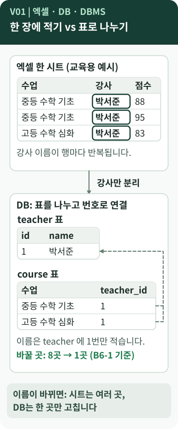
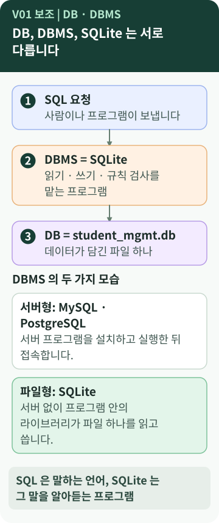

# Chapter 1 — 엑셀로 적어도 되는데, 왜 데이터베이스를 만들까?

> 학생 명단과 점수는 엑셀에도 적을 수 있습니다. 그런데 이번 미션은 왜 굳이 **데이터베이스**를 만들라고 할까요? 엑셀 파일과 `student_mgmt.db` 파일은 무엇이 다를까요?

**이 장에서 알게 되는 것**

- 엑셀 한 장에 모두 적을 때 생기는 불편과, 정보를 표로 나누는 이유
- DB·DBMS·SQLite·SQL이 각각 무엇을 가리키는지
- 내 컴퓨터에서 SQLite를 쓸 수 있는지 확인하는 방법

📱 모바일에서는 **"내 프로그램에 연결하기"와 "한 문장 정리"까지** 읽으면 핵심을 이해할 수 있습니다. 💻 그 뒤의 직접 확인은 컴퓨터 앞에서 내 프로젝트를 열고 읽으세요.

> 표기 규칙(`[요구 정리]` `[B6-1 사례]` `[학습 노트]` `[실행 확인]` `[개념]` `[보충]`)과 코드 종류 구분은 [README](../README.md#표기-규칙)에 있습니다.

---

## 먼저, 이런 궁금증에서 시작합니다

- 엑셀도 표인데, 데이터베이스는 무엇이 다를까?
- `student_mgmt.db`라는 파일 하나가 어떻게 "데이터베이스"일까?
- 설치한 적이 없는데 Mac에 `sqlite3`가 이미 있는 이유는? `[학습 노트]`

세 번째는 B6-1을 진행하며 정리한 학습 노트에 실제로 남아 있는 질문입니다.

## 일상으로 생각해 보면

이번 미션의 제목은 "정보를 깔끔하게 정리하는 **디지털 서랍장**"입니다.

- **엑셀 한 시트**는 큰 책상 위에 서류를 모두 펼쳐 놓은 모습과 비슷합니다. 한눈에 보이고 바로 고칠 수 있어 편합니다.
- **서랍장**은 칸마다 넣을 물건이 정해져 있고, 라벨이 붙어 있습니다. 양말 칸에 셔츠를 넣기는 어렵게 되어 있습니다.

데이터베이스는 이 서랍장 쪽에 가깝습니다. 정보를 종류별 칸(표)에 나누어 담고, **무엇을 넣어도 되는지 규칙**을 정해 둡니다. `[보충]` 이 비유는 여기까지입니다. 실제 데이터베이스의 "칸"은 **표(table)** 이고, 칸 사이를 잇는 **번호**가 중요합니다. (2·3장)

## 용어의 뜻

- [**데이터베이스(DB, Database)**](../../../terms/relational-database.md) — data(자료) + base(바탕·창고). 규칙에 따라 정리해 둔 **데이터의 모음**입니다. B6-1에서는 `student_mgmt.db` 파일 안의 표들입니다.
- **DBMS (Database Management System)** — 데이터베이스 **관리 시스템**. 데이터를 읽고 쓰고, 규칙을 검사하고, 요청을 처리하는 **프로그램**입니다.
- [**관계형 데이터베이스**](../../../terms/relational-database.md) — 데이터를 **표(table)** 와 표 사이의 **관계**로 담는 방식입니다.
- [**SQLite**](../../../terms/sqlite.md) — 관계형 DBMS의 한 종류입니다. SQL + lite(가벼운). **서버 없이** 프로그램 안의 라이브러리가 파일 하나를 읽고 씁니다.
- [**SQL**](../../../terms/sql.md) — DBMS에게 일을 시키는 **언어**입니다. 5장에서 자세히 봅니다.

> **이름이 비슷해서 헷갈리는 것** `[학습 노트]`
> SQL은 **언어**이고, SQLite는 그 언어를 알아듣고 실행하는 **프로그램(DBMS)** 입니다. 둘은 다릅니다.

> **영어 뜻만으로는 정확하지 않은 단어** `[개념]`
> "relational"을 "표 사이에 관계가 있다"로만 읽는 경우가 많습니다. 원래는 수학의 relation(표처럼 생긴 데이터 묶음)에서 온 말로 설명되곤 합니다. 지금은 **"표로 저장하고, 표를 번호로 연결하는 방식"** 으로 이해하면 충분합니다.

## 그림으로 보기



*위쪽 시트는 교육용 예시이고, 8행이라는 숫자만 B6-1 샘플 데이터로 센 값입니다.*

### 그림 읽는 법

1. **위쪽**: 수업·강사·점수를 한 시트에 적으면 강사 이름 `박서준`이 점수가 생길 때마다 반복됩니다. B6-1 샘플 데이터로 세면 8행입니다. `[실행 확인]`
2. **가운데 화살표**: 강사만 따로 표로 분리합니다.
3. **아래쪽**: 이름은 `teacher` 표에 한 번만 적고, `course` 표에는 번호(`1`)만 적습니다. 점선은 "번호로 가리킨다"는 뜻입니다. 이름이 바뀌면 `teacher`의 한 곳만 고치면 됩니다.



*DB, DBMS, SQLite를 한 번에 정리한 그림입니다.*

## B6-1 결과물에서 확인하기

B6-1은 공부방의 학생·수업·점수를 **6개 표**(`student`, `teacher`, `subject`, `course`, `enrollment`, `score`)에 나누어 담았습니다. `[B6-1 사례]` ([README](https://github.com/hyun02063185-AX-beginner/Codyssey_B6-1/blob/8b99440c830fddc6f78c1440cff8fa2591d47884/README.md))

학습 노트가 정리한 **엑셀 한 시트와 나눈 표의 차이**를 짧게 줄이면 이렇습니다. `[학습 노트]`

| 상황 | 엑셀 한 시트 | 나눈 표 + DB |
| --- | --- | --- |
| 중복 | 강사 이름이 행마다 반복 | `teacher`에 한 번 |
| 수정 | 모든 행을 찾아 고침 | 한 곳만 고침 |
| 잘못된 입력 | 150점도 입력됨 | 규칙이 거절 (4장) |
| 재현 | 클릭 기록이 남지 않음 | SQL 파일로 다시 만듦 |

> **"엑셀은 안 된다"는 뜻이 아닙니다.** `[개념]`
> 엑셀에도 데이터 유효성 검사가 있고, 표를 나눠 조회 함수로 연결할 수도 있습니다. 차이는 "할 수 있느냐"가 아니라, **규칙과 관계를 저장소가 기본으로 지키도록 설계하느냐**입니다. 학습 노트도 차이를 "데이터가 많으냐"가 아니라 "관계를 표현하고 규칙으로 지킬 수 있느냐"로 정리했습니다. `[학습 노트]`

### SQLite를 쓴 경험 — macOS에서

학습 노트에는 "설치하지 않았는데 Mac에 `sqlite3`가 있는 이유"를 **사실과 해석으로 나누어** 정리한 부분이 있습니다. `[학습 노트]`

| 구분 | 내용 |
| --- | --- |
| 사실 | 학습 노트 기록: 그 Mac에서 `sqlite3 --version`이 3.43.2로 확인됨 (버전은 OS마다 다름) |
| 사실 | SQLite 공식 사이트는 Apple을 포함한 많은 기본 앱이 SQLite를 쓴다고 소개함 ([sqlite.org/famous](https://sqlite.org/famous.html)) |
| 해석 | 그래서 `sqlite3` 명령도 함께 제공되는 것으로 이해할 수 있음. **Apple의 공식 설명은 아님** |

SQLite를 고른 이유도 노트에 있습니다. 서버 설치와 계정이 필요 없고 파일 하나로 동작해서, **공용 PC(관리자 권한 없음)** 에서도 바로 쓸 수 있었다고 정리했습니다. `[학습 노트]`

> **다른 컴퓨터에서는 다릅니다.** `[실행 확인]`
> 이 가이드를 만든 Windows 11 PC에는 `sqlite3` 명령이 기본으로 없었습니다. 대신 Python에 들어 있는 `sqlite3` 모듈로 SQLite 3.50.4를 쓸 수 있었습니다. **내 컴퓨터에 무엇이 있는지는 직접 확인**해야 합니다.

## 좋은 점과 한계

| 도구 | 좋은 점 | 한계 |
| --- | --- | --- |
| 엑셀 | 바로 보이고, 수식·차트가 쉬움 | 규칙과 관계를 사람이 지켜야 함 |
| 관계형 DB | 규칙·관계로 데이터를 지킴, 같은 결과를 다시 만들 수 있음 | 구조를 **먼저 설계**해야 함, 배울 것이 많음 |
| SQLite | 설치가 쉽고 파일 하나 | 쓰기와 동시 접속이 많은 서비스에는 서버형이 더 적합 `[학습 노트]` |

## 내 프로그램에 연결하기

내 B6-1 프로젝트에서 세 칸을 채워 보세요.

| 질문 | B6-1 사례의 답 |
| --- | --- |
| **DB**(데이터 모음)는 어디? | `student_mgmt.db` 파일 안의 표 6개 |
| **DBMS**(관리 프로그램)는 무엇? | SQLite |
| **SQL**(시키는 언어)은 어디에 적혀 있나? | `sql/` 폴더의 파일 3개 |

`student_mgmt.db`는 실행할 때 만들어지는 파일이라, 이 B6-1 저장소의 `.gitignore`(`*.db`)에 제외되어 **저장소에는 없습니다.** 내 컴퓨터에서 SQL을 실행한 뒤에 생깁니다. `[B6-1 사례]`

## 요구와 B6-1의 선택

- 로컬 DB 하나(SQLite·MySQL·PostgreSQL·H2 중)와 SQL 실행 도구를 준비해야 합니다. `[요구 정리]`
- **어떤 DBMS를 쓸지는 선택**입니다. B6-1은 SQLite를 골랐고, 이것이 모두가 따라야 하는 정답은 아닙니다. `[B6-1 사례]`
- 백엔드 프레임워크로 화면이나 API를 만들지 않고, **SQL만** 사용합니다. `[요구 정리]`

## 다른 사람에게 이렇게 설명할 수 있습니다

> "엑셀처럼 한 장에 다 적으면 같은 이름이 계속 반복되고 잘못된 값도 막지 못해요. 그래서 정보를 표로 나누고 번호로 연결했어요. 이 표들을 담은 것이 데이터베이스이고, 그 데이터베이스를 읽고 쓰고 규칙을 검사하는 프로그램이 DBMS인 SQLite예요."

**한 문장 정리:** 데이터베이스는 표와 규칙을 갖춘 **데이터의 모음**이고, DBMS는 그것을 **관리하는 프로그램**이며, SQL은 그 프로그램에게 **일을 시키는 언어**입니다.

---

## 💻 직접 확인해 보기 (선택)

> ⚠️ **원본 폴더를 건드리지 않습니다.** 아래 두 줄은 **터미널 명령**이지 SQL이 아닙니다.

**내 컴퓨터에 SQLite가 있는지**

```text
sqlite3 --version
python -c "import sqlite3; print(sqlite3.sqlite_version)"
```

*첫 줄은 `sqlite3` 프로그램이 설치된 경우, 둘째 줄은 Python이 설치된 경우에 쓸 수 있습니다. 둘 중 하나만 되어도 됩니다. 교육용 예시이며 원본 저장소의 코드가 아닙니다.*

**B6-1 전체를 한 번 실행해 보기**

B6-1 저장소의 `scripts/run_all.sh`는 같은 이름의 `student_mgmt.db`가 있으면 **지우고 새로 만듭니다.** 실제 데이터가 든 파일 옆에서 실행하지 말고, 저장소를 복사한 **연습용 폴더**에서 실행하세요. Windows에서는 `.sh` 파일이 바로 실행되지 않을 수 있으므로 `python scripts/run_queries.py`를 쓰면 됩니다. `[B6-1 사례]` `[실행 확인]`

## AI에게 물어볼 질문

> "내 B6-1 폴더에서 **DB 파일, DBMS, SQL 파일**에 해당하는 것을 각각 찾아서 표로 정리해 줘. 파일을 수정하지는 마. 그리고 `student_mgmt.db`가 저장소에 없는 이유도 설명해 줘."

---

**다음 장 →** [Chapter 2. 어떤 표가 필요한지는 어떻게 정할까?](02-data-modeling.md)
