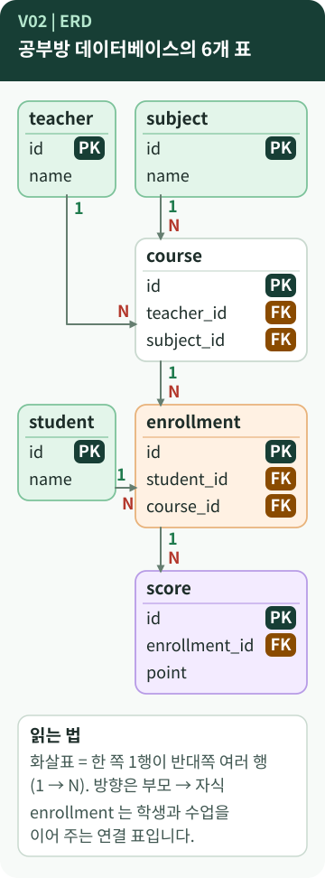

# Chapter 2 — 어떤 표가 필요한지는 어떻게 정할까?

> 공부방의 학생·수업·점수를 데이터베이스에 담으려면 가장 먼저 무엇을 정해야 할까요? 그리고 **ERD**는 그림을 예쁘게 그리는 일일까요?

**이 장에서 알게 되는 것**

- 표(테이블)·행·열·스키마가 각각 무엇을 가리키는지
- ERD를 읽는 방법과 `||--o{` 기호의 뜻
- "무엇을 표로 만들지" 정하는 데이터 모델링의 순서와, 그것이 **정답 하나가 아니라는 점**

📱 모바일에서는 **"내 프로그램에 연결하기"와 "한 문장 정리"까지** 읽으세요.

---

## 먼저, 이런 궁금증에서 시작합니다

- 정보를 표 몇 개로, 무엇을 기준으로 나누지?
- 행·열·스키마라는 말은 엑셀의 행·열과 같은 뜻일까?
- ERD 그림에 있는 `||--o{` 같은 기호는 어떻게 읽지? `[학습 노트]`

## 일상으로 생각해 보면

서랍장을 사 오면 가장 먼저 **칸마다 무엇을 넣을지** 정합니다. 양말, 속옷, 셔츠처럼 **종류가 같은 것끼리** 한 칸에 둡니다.

데이터에서도 똑같이 합니다. 공부방을 말로 설명해 보면 힌트가 나옵니다.

> "**학생**이 **수업**을 듣고 **시험 점수**를 받는다. 수업은 **과목**이고, **강사**가 가르친다."

여기서 따로 기록해 둘 대상(**학생, 수업, 과목, 강사**)과 "듣는다"는 **사건**(**수강**), "받는다"는 **결과**(**점수**)가 표 후보가 됩니다. `[보충]` 이것은 설계를 시작하는 한 가지 방법이며, B6-1이 이 순서로 설계했다는 기록은 아닙니다.

## 용어의 뜻

- [**표(table)**](../../../terms/table.md) — 같은 모양의 기록을 줄줄이 담는 단위. 엑셀의 **시트 하나**에 가깝습니다.
- **행(row, 레코드)** — 기록 **한 건**. 학생 한 명이 한 행입니다.
- **열(column, 필드)** — **한 종류의 정보**. `name`, `grade`처럼 이름과 [**데이터 타입**](../../../terms/column-data-type.md)(글자, 정수, 날짜 등)이 정해져 있습니다.
- [**스키마(schema)**](../../../terms/schema.md) — 표·열·타입·키·규칙을 정한 **구조의 약속**입니다. 칸 안의 물건(데이터)이 아니라 **칸의 구조**입니다.
- [**ERD**](../../../terms/erd.md) — Entity Relationship Diagram, 개체 관계 다이어그램. 표(개체)와 표 사이의 관계를 그린 **설계도**입니다.
- **데이터 모델링** — 무엇을 표로 만들고, 열에는 무엇을 두고, 표를 어떻게 연결할지 **정하는 일**입니다.

> **엑셀과 같으면서 다른 점** `[개념]`
> 엑셀 시트는 아무 칸에나 아무 값이나 넣을 수 있지만, DB의 표는 **열마다 이름·타입·규칙**이 먼저 정해져 있습니다. 그래서 "표를 만든다"는 말에는 **구조를 먼저 정한다**는 뜻이 들어 있습니다.

> **schema라는 말이 두 가지로 쓰입니다** `[개념]`
> 다른 DBMS에서는 표를 묶는 이름 공간을 schema라고 부르기도 합니다. 이 가이드의 schema는 **"표와 규칙의 구조"** 를 뜻합니다.

## 그림으로 보기



*B6-1의 ERD를 모바일에서 읽기 쉽게 다시 그린 것입니다. 열은 키와 핵심 열만 보여 줍니다. 원본은 [`erd.mmd`](https://github.com/hyun02063185-AX-beginner/Codyssey_B6-1/blob/8b99440c830fddc6f78c1440cff8fa2591d47884/docs/images/erd.mmd)입니다.*

### 그림 읽는 법

1. **상자 하나가 표 하나**입니다. 안의 `PK`는 행을 구분하는 번호표, `FK`는 다른 표의 번호를 적어 둔 칸입니다. (3장에서 자세히)
2. **화살표**는 한쪽의 1행이 반대쪽의 여러 행과 이어진다는 뜻입니다. 화살표 끝의 `1`과 `N`으로 방향을 읽습니다. 예를 들어 강사 1명이 수업 여러 개를 맡습니다.
3. 가운데 `enrollment`는 학생과 수업을 이어 주는 **연결 표**입니다. 왜 필요한지는 3장의 주제입니다.

### 원본 ERD의 기호 `||--o{`

원본 ERD(Mermaid로 작성)에서 관계는 `TEACHER ||--o{ COURSE`처럼 적혀 있습니다. `[학습 노트]`

| 기호 | 읽는 법 |
| --- | --- |
| `\|\|` | 반드시 **1개** |
| `o{` | **0개 이상** 여러 개 |

즉 "강사 1명은 수업을 **0개 이상** 맡는다"입니다. "0개 이상"이라서 **수강 신청이 없는 학생**이나 **수강생이 없는 수업**이 있어도 규칙 위반이 아닙니다. 3장과 6장에서 이 데이터를 다시 만납니다.

## B6-1 결과물에서 확인하기

| 표 | 담는 것 | 행 수 |
| --- | --- | --- |
| `student` | 학생 | 15 |
| `teacher` | 강사 | 10 |
| `subject` | 과목 | 10 |
| `course` | 수업 (어떤 과목을 누가 언제) | 12 |
| `enrollment` | 수강 (어떤 학생이 어떤 수업을) | 26 |
| `score` | 시험 점수 | 30 |

`[B6-1 사례]` ([README](https://github.com/hyun02063185-AX-beginner/Codyssey_B6-1/blob/8b99440c830fddc6f78c1440cff8fa2591d47884/README.md) 5절)

ERD가 SQL이 되는 모습은 `course` 표에서 볼 수 있습니다.

```sql
CREATE TABLE course (
    id          INTEGER PRIMARY KEY,
    course_name TEXT    NOT NULL,
    subject_id  INTEGER NOT NULL,
    teacher_id  INTEGER NOT NULL,
```

*원본 발췌 — [`sql/01_schema.sql`](https://github.com/hyun02063185-AX-beginner/Codyssey_B6-1/blob/8b99440c830fddc6f78c1440cff8fa2591d47884/sql/01_schema.sql) · `course` 표 앞부분*

ERD의 `INTEGER subject_id FK` 한 줄이 SQL에서는 `subject_id INTEGER NOT NULL`과 뒤따르는 `FOREIGN KEY` 선언으로 나뉘어 적힙니다. ERD는 **설계도**, `01_schema.sql`은 그 설계도를 **실제 표로 만드는 명령**입니다. `[학습 노트]`

### 학습 노트에 적힌 설계 선택 세 가지

- **점수는 학생이 아니라 수강(`enrollment`)에 붙였습니다.** "어떤 학생이 **어떤 수업에서** 받은 점수"가 정확히 표현되기 때문이라고 정리했습니다.
- **같은 수업을 중복해서 수강하지 못하도록** `UNIQUE (student_id, course_id)`를 걸었습니다.
- 학생과 수업의 N:M 관계는 연결 표로 풀었습니다. (3장)

세 가지 모두 **B6-1의 선택**이며, 다른 설계도 가능합니다. `[학습 노트]`

## 좋은 점과 한계

**데이터 모델링의 좋은 점**

- 같은 정보를 한 곳에만 적어 **중복과 어긋남이 줄어듭니다.**
- 표 사이의 연결이 정해져 있어 **필요한 질문을 SQL로 바로 쓸 수** 있습니다. (5~8장)

**한계와 주의**

- **정답은 하나가 아닙니다.** 예를 들어 강사 이름을 `course` 표 안에 글자로 적는 단순한 설계도 가능합니다. 대신 이름이 중복되고 오타가 생기기 쉽습니다. `[보충]`
- 구조를 정한 뒤 바꾸면 기존 데이터와 쿼리를 **함께 손봐야** 합니다. `[학습 노트]`
- B6-1은 **정규화**(중복을 줄이기 위한 표 분리 규칙 체계)를 깊게 다루지 않았습니다. "관계가 자연스럽고 쿼리가 잘 나오는 구조"를 목표로 삼았다고 노트에 정리되어 있습니다. [정규화](../../../terms/normalization.md)는 더 공부할 때 만나는 개념입니다. `[학습 노트]`
- **ERD는 요약입니다.** 원본 `erd.mmd`에는 `UNIQUE (student_id, course_id)` 같은 복합 규칙과 `CHECK` 조건이 그려져 있지 않습니다. 실제 규칙은 `01_schema.sql`에 있으므로, **ERD와 SQL을 함께 대조**해야 합니다. `[실행 확인]`
- **날짜 열의 실제 저장 방식**: `joined_at DATE`처럼 적어도, SQLite는 `'2025-03-02'` 같은 **글자(text)** 로 저장했습니다. `[실행 확인]` 날짜를 `>=`로 비교하는 Q04가 되는 이유는 5장에서 봅니다.

## 내 프로그램에 연결하기

내 프로젝트에서 이렇게 대조해 보세요.

1. ERD(`docs/images/erd.mmd` 또는 README의 그림)에서 **상자 개수**를 셉니다. 6개입니다.
2. `sql/01_schema.sql`에서 `CREATE TABLE`을 검색해 **개수**를 셉니다. 6개입니다.
3. 두 숫자가 같고 표 이름이 같으면, 설계도와 실제 구조가 맞는 것입니다.

ERD 그림 파일(`erd.png`)과 원본 코드(`erd.mmd`), README의 Mermaid는 **같은 내용**입니다. `[학습 노트]`

## 요구와 B6-1의 선택

- 자유 주제로 **최소 4개 표**를 만들고 각 표에 PK를 둡니다. 컬럼은 의미에 맞는 타입과 역할이 드러나는 이름을 씁니다. 샘플 데이터는 표마다 **10행 이상**입니다. `[요구 정리]`
- ERD 이미지는 **선택 제출물**입니다. `[요구 정리]`
- **공부방 주제와 6개 표는 B6-1의 선택**입니다. 4개 이상이면 되므로 표 개수와 주제는 달라도 됩니다. `[B6-1 사례]`

## 다른 사람에게 이렇게 설명할 수 있습니다

> "먼저 공부방에서 따로 기록할 대상을 찾아 학생, 강사, 과목, 수업, 수강, 점수 6개 표로 나눴어요. ERD는 그 표들이 어떻게 이어지는지 그린 설계도이고, 그 설계도를 SQL로 옮긴 것이 스키마 파일이에요. 설계는 하나의 정답이 아니라 제가 고른 구조예요."

**한 문장 정리:** 데이터 모델링은 **무엇을 표로 만들고 어떻게 이을지 정하는 일**이고, ERD는 그 결과를 한눈에 보이게 한 **설계도**입니다.

---

## 💻 직접 확인해 보기 (선택)

> ⚠️ 원본 `01_schema.sql`은 첫머리에서 기존 표를 **삭제한 뒤 새로 만듭니다.** 이미 데이터가 있는 DB 파일에는 실행하지 마세요. (9장)

- ERD와 SQL의 대응은 **파일을 열어서 읽는 것만으로** 확인할 수 있습니다. 실행할 필요가 없습니다.
- 대조해 볼 것: ERD의 `FK` 표시 5곳과 SQL의 `FOREIGN KEY` 선언 5개가 같은 자리인지.

## AI에게 물어볼 질문

> "내 ERD와 `01_schema.sql`을 비교해서 **서로 다른 점**이 있는지 표로 알려 줘. ERD에 안 그려진 제약조건(UNIQUE, CHECK 등)도 찾아 줘. 파일은 수정하지 마."

---

**이전 장 ←** [Chapter 1](01-database-basics.md) · **다음 장 →** [Chapter 3. 표와 표는 어떻게 이어질까?](03-keys-relations.md)
