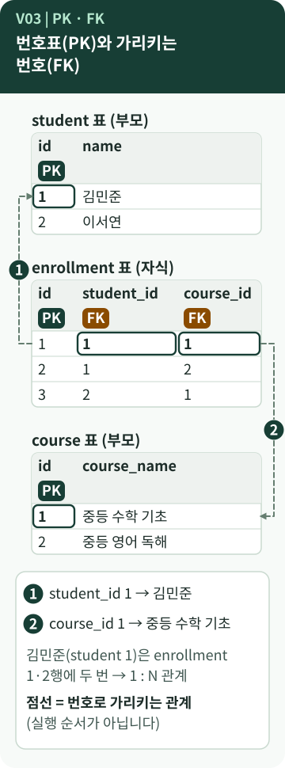
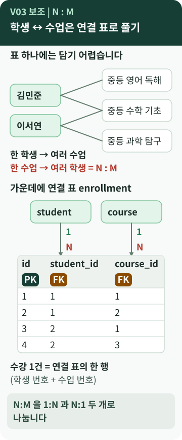

# Chapter 3 — 표와 표는 어떻게 이어질까?

> 학생은 여러 수업을 듣고, 한 수업에는 여러 학생이 있습니다. 표 하나로는 담기 어려운 이 관계를 B6-1은 왜 `enrollment`라는 **세 번째 표**로 풀었을까요?

**이 장에서 알게 되는 것**

- **PK**와 **FK**가 각각 무엇이고, 번호로 어떻게 표를 잇는지
- **1:N**과 **N:M** 관계, 그리고 **연결 표**가 필요한 이유
- 수강 신청이 없는 학생과 수강생이 없는 수업을 일부러 만든 이유

📱 모바일에서는 **"내 프로그램에 연결하기"와 "한 문장 정리"까지** 읽으세요.

---

## 먼저, 이런 궁금증에서 시작합니다

- 이름이 같은 학생이 있으면 어떻게 구분하지?
- 학생과 수업의 N:M 관계를 `enrollment`로 분리한 이유는? `[학습 노트]`
- PK와 FK는 JOIN을 하려면 꼭 있어야 하는 걸까?

## 일상으로 생각해 보면

- **번호표(PK)**: 학생증 번호처럼, 이름이 같아도 번호로는 한 명만 가리킬 수 있습니다.
- **번호를 적어 둔 쪽지(FK)**: 출석부에 이름 대신 "학생 번호 1번"이라고 적어 두면, 이름이 필요할 때 학생 명단에서 1번을 찾아보면 됩니다.
- **대출 기록장(연결 표)**: 도서관에서 "학생마다 빌린 책 목록"이나 "책마다 빌린 학생 목록"을 한 줄에 다 쓰기는 어렵습니다. 그래서 **"누가 무엇을 빌렸다"를 한 줄씩 적는 기록장**을 따로 둡니다.

`enrollment`는 이 대출 기록장과 같은 역할로, **"누가 어떤 수업을 신청했다"를 한 줄씩 적는 수강 기록장**입니다. `[보충]`

## 용어의 뜻

- [**PK (Primary Key, 기본키)**](../../../terms/primary-key.md) — 행 하나를 **유일하게 구분하는 값**입니다. primary는 "으뜸이 되는"이라는 뜻입니다. 같은 값이 두 번 나올 수 없고 비어 있을 수 없습니다. `[개념]`
- [**FK (Foreign Key, 외래키)**](../../../terms/foreign-key.md) — **다른 표의 PK를 가리키는 값**입니다. foreign은 "외국의"가 아니라 **"이 표 바깥(다른 표)의"** 라는 뜻으로 읽으면 쉽습니다.
- **부모 표 / 자식 표** — 가리킴을 **받는** 표가 부모, **적어 둔** 표가 자식입니다. `student`가 부모, `enrollment`가 자식입니다.
- [**1:N (일대다)**](../../../terms/one-to-many-relationship.md) — 부모의 **1행**에 자식 **여러 행**이 연결됩니다. 학생 1명 : 수강 여러 건.
- [**N:M (다대다)**](../../../terms/many-to-many.md) — 양쪽 모두 여러 개와 연결됩니다. 학생 ↔ 수업.
- **연결 표** — N:M을 **1:N 두 개로 나누기 위해 가운데 두는 표**입니다. 학습 노트는 이를 "연결 테이블"이라 불렀습니다. [카디널리티](../../../terms/cardinality.md)는 이런 관계의 "몇 개 대 몇 개"를 말합니다.

> **FK는 "번호를 적어 둔 열"이 아닙니다** `[개념]`
> 열에 번호를 적어 두는 것만으로는 규칙이 아닙니다. `FOREIGN KEY`를 **선언**해야 DBMS가 "그 번호가 부모에 있는지" 검사합니다. 선언이 있어도 SQLite에서는 **켜야** 검사합니다. 4장에서 다룹니다.

## 그림으로 보기



### 그림 읽는 법

1. 가운데 `enrollment`의 **첫 행**을 봅니다. `student_id`가 `1`, `course_id`가 `1`입니다. 두 칸 안의 ①②는 점선 옆의 ①②와 **짝**입니다.
2. **①**: `student_id = 1`은 위의 `student` 표에서 `id = 1`인 행(김민준)을 가리킵니다.
3. **②**: `course_id = 1`은 아래의 `course` 표에서 `id = 1`인 행(중등 수학 기초)을 가리킵니다.
4. `enrollment`의 2행도 `student_id = 1`입니다. 김민준 한 명이 `enrollment`에 **두 번** 나오므로 **1:N**입니다.
5. **점선은 "번호로 가리킨다"는 관계**입니다. ①②는 읽는 순서 표시이고, 컴퓨터가 실행하는 순서가 아닙니다.



*위쪽은 표 하나로 담기 어려운 모양, 아래쪽은 연결 표로 푼 모양입니다. 연결 표의 네 행은 B6-1의 `enrollment` 1~4번 행입니다.*

## B6-1 결과물에서 확인하기

`enrollment` 표를 만드는 부분의 핵심 세 줄입니다.

```sql
UNIQUE (student_id, course_id),
FOREIGN KEY (student_id) REFERENCES student (id),
FOREIGN KEY (course_id)  REFERENCES course (id)
```

*원본 발췌 — [`sql/01_schema.sql`](https://github.com/hyun02063185-AX-beginner/Codyssey_B6-1/blob/8b99440c830fddc6f78c1440cff8fa2591d47884/sql/01_schema.sql) · `enrollment` 표 뒷부분*

첫 줄은 "같은 학생이 같은 수업을 두 번 신청하지 못한다"는 규칙입니다. 둘째·셋째 줄은 각 번호가 `student`와 `course`에 **실제로 있어야 한다**는 선언입니다.

B6-1에는 이런 **1:N 관계가 5개** 있습니다. `[B6-1 사례]`

| 부모 표 → 자식 표 | 자식의 FK 열 |
| --- | --- |
| `teacher` → `course` | `teacher_id` |
| `subject` → `course` | `subject_id` |
| `student` → `enrollment` | `student_id` |
| `course` → `enrollment` | `course_id` |
| `enrollment` → `score` | `enrollment_id` |

**점수는 학생이 아니라 수강에 붙어 있습니다.** `enrollment` 1번(김민준의 중등 수학 기초)에는 점수가 두 건(88점, 91점) 있습니다. 수강 1건에 시험이 여러 번 쌓이므로 **수강 : 점수 = 1:N**입니다. `[실행 확인]`

### 일부러 만든 "짝 없는" 데이터

B6-1 샘플 데이터에는 **관계가 0개인 행**이 두 개 있습니다. `[B6-1 사례]`

- **학생 15번 문태양** — 수강 신청이 하나도 없습니다.
- **수업 12번 영어 회화** — 수강생이 한 명도 없습니다.

README는 이를 "LEFT JOIN과 DELETE 실습을 위한 의도된 데이터"라고 설명합니다. 모든 학생이 수강하고 모든 수업에 수강생이 있다면, **짝이 없는 경우를 어떻게 다루는가**(6장·9장)를 눈으로 확인할 수 없기 때문입니다.

> **ID는 어떻게 붙을까?** `[B6-1 사례]` `[실행 확인]`
> 스키마의 `INTEGER PRIMARY KEY`는 SQLite에서 번호를 자동으로 붙여 주는 열로 쓰입니다. 다만 B6-1의 샘플 데이터는 `id`를 **직접 적어서** 넣었습니다. 또 `AUTOINCREMENT`를 쓰지 않았기 때문에, 마지막 번호의 행을 지우면 **그 번호가 다시 쓰일 수 있습니다.** 번호를 "영원히 한 번만 쓰는 신분증"으로 믿으면 안 됩니다.

## 좋은 점과 한계

**좋은 점**

- 학생 정보는 `student`에 **한 번만** 적고, 나머지는 번호로 가리킵니다.
- 이름이 같은 학생이 있어도 번호로 정확히 한 명을 가리킵니다. (B6-1 샘플 데이터에는 이름이 같은 학생이 없습니다. 이 설명은 일반적인 이유입니다.)
- 표가 나뉘어 있어 **한 곳만 고치면** 됩니다.

**한계와 주의**

- 표가 늘어 읽을 때 **JOIN이 필요**합니다. (6장)
- 점수에서 학생까지 가려면 `score → enrollment → student` **두 단계**를 거칩니다.
- `UNIQUE (student_id, course_id)`는 **같은 수업을 다시 듣는 경우**를 기록하지 못하게 합니다. 재수강을 기록하려면 설계를 바꿔야 합니다. 설계 선택에는 이런 한계가 따릅니다. `[보충]`
- 연결 표의 PK를 `(student_id, course_id)` 두 열을 묶은 [**복합키**](../../../terms/composite-key.md)로 두는 설계도 있습니다. B6-1은 별도의 `id`에 `UNIQUE`를 더하는 방법을 골랐습니다.
- **FK 선언이 JOIN의 필수 조건은 아닙니다.** FK는 "번호가 유효하다"를 **보장하는 규칙**이고, JOIN은 조건을 적어서 하는 **조회 방법**입니다. (6장)

## 내 프로그램에 연결하기

1. `sql/01_schema.sql`에서 `FOREIGN KEY`를 검색합니다. B6-1은 5개입니다.
2. 하나씩 **"자식.열 → 부모.id"** 문장으로 바꿔 적어 봅니다. 예: `enrollment.student_id → student.id`
3. 샘플 데이터(`02_sample_data.sql`)에서 `enrollment`의 `student_id`와 `course_id`를 보고 **"누가 무엇을 듣는다"** 로 읽어 봅니다. 예: 1번 행은 학생 1번이 수업 1번을 듣는다.
4. 수강 신청이 없는 학생과 수강생이 없는 수업을 찾아 봅니다. B6-1에서는 15번 학생과 12번 수업입니다.

## 요구와 B6-1의 선택

- **각 표에 PK**를 두고, **최소 2개의 FK로 1:N 관계**를 만들어야 합니다. `[요구 정리]`
- **N:M을 연결 표로 푸는 것은 요구가 아닙니다.** B6-1이 학생·수업 도메인을 고르면서 필요해서 쓴 선택입니다. 1:N만으로 이루어진 다른 도메인도 가능합니다. `[B6-1 사례]`
- FK 5개, `UNIQUE (student_id, course_id)`, 의도된 "짝 없는" 데이터는 B6-1의 구현 선택입니다.

## 다른 사람에게 이렇게 설명할 수 있습니다

> "학생과 수업은 서로 여러 개씩 연결되는 N:M 관계라서, 가운데에 수강 표를 두고 학생 번호와 수업 번호를 한 줄씩 적게 했어요. 그러면 학생 1명 : 수강 여러 건, 수업 1개 : 수강 여러 건이라는 1:N 두 개로 풀려요. 번호를 가리키는 FK를 선언해 두어서, 없는 학생이나 수업을 가리키지 못해요."

**한 문장 정리:** PK는 행의 **번호표**, FK는 다른 표의 번호표를 **적어 둔 열**이고, N:M 관계는 **연결 표**를 가운데 두어 1:N 두 개로 풉니다.

---

## 💻 직접 확인해 보기 (선택)

> ⚠️ 연습용 DB 파일에서만 합니다.

- 연습용 DB를 연 뒤 **조회만** 해 보세요. (SQL은 5장에서 배웁니다.) 지금은 `02_sample_data.sql` 파일을 열어 `enrollment` 부분을 눈으로 읽어도 충분합니다.
- 읽어 볼 질문: **"수업 1번(중등 수학 기초)을 듣는 학생은 몇 명이고 누구일까?"** 정답은 김민준·이서연·최유나 3명입니다. `[실행 확인]`

## AI에게 물어볼 질문

> "내 `01_schema.sql`의 모든 FOREIGN KEY를 '자식 표.열 → 부모 표.id' 형태로 정리하고, 어느 표가 N:M을 푸는 연결 표인지 알려 줘. 파일은 수정하지 마."

---

**이전 장 ←** [Chapter 2](02-data-modeling.md) · **다음 장 →** [Chapter 4. 잘못된 데이터는 누가 막아 줄까?](04-data-integrity.md)
