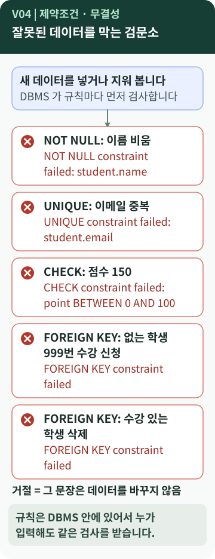
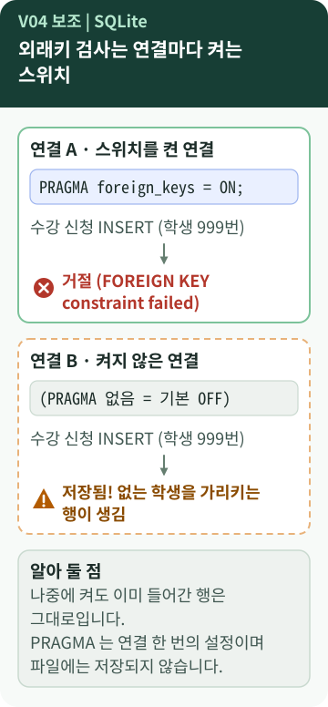

# Chapter 4 — 잘못된 데이터는 누가 막아 줄까?

> 엑셀에서는 점수 칸에 150을 적어도, 없는 학생 번호를 적어도 그대로 입력됩니다. 데이터베이스는 이런 입력을 어떻게 거절할까요? 그리고 SQLite의 `PRAGMA foreign_keys = ON`은 왜 **매번** 필요할까요?

**이 장에서 알게 되는 것**

- **제약조건**과 **무결성**이 무엇이고, 어떤 규칙이 어떤 실수를 막는지
- B6-1에서 직접 실행해 확인한 거절 결과들
- SQLite의 외래키 검사가 **연결마다 켜야 하는 설정**인 이유와 주의점

📱 모바일에서는 **"내 프로그램에 연결하기"와 "한 문장 정리"까지** 읽으세요.

---

## 먼저, 이런 궁금증에서 시작합니다

- 점수에 150을 넣거나, 없는 학생 번호로 수강 신청을 하면 어떻게 될까? `[학습 노트]`
- SQL 파일 맨 위의 `PRAGMA foreign_keys = ON;`은 무엇이고, 빼면 어떻게 될까? `[학습 노트]`
- "제약조건"과 "무결성"은 같은 말일까?

## 일상으로 생각해 보면

아파트 공동 현관을 떠올려 보세요. 열쇠나 비밀번호가 있는 사람만 들어올 수 있습니다. 입구에서 **자동으로** 걸러 주기 때문에, 안에 있는 사람이 매번 의심할 필요가 없습니다.

- 엑셀은 "사람이 조심해서 입력"하는 방식에 가깝습니다.
- 데이터베이스는 **입구에서 규칙을 검사**합니다. 어떤 프로그램이, 누가 입력하든 같은 검사를 받습니다. `[보충]`

## 용어의 뜻

- [**제약조건(constraint)**](../../../terms/data-integrity.md) — 데이터가 지켜야 할 **규칙을 표에 적어 두는 것**입니다. constraint는 "제약, 제한"이라는 뜻입니다.
- [**무결성(integrity)**](../../../terms/data-integrity.md) — "흠이 없고 온전한 상태"라는 뜻으로, 데이터가 **정확하고 서로 어긋나지 않는 성질**입니다. 제약조건은 무결성을 지키는 **수단**입니다.
- **NULL** — "값이 없음"입니다. 숫자 0이나 빈 글자와 다릅니다.
- [**NOT NULL**](../../../terms/not-null.md) — 비워 둘 수 없습니다. 예: 학생 이름.
- [**UNIQUE**](../../../terms/unique-constraint.md) — 같은 값이 두 번 들어갈 수 없습니다. 예: 이메일.
- **CHECK** — 조건을 만족해야 합니다. 예: 점수는 0 이상 100 이하.
- **FOREIGN KEY** — 가리키는 번호가 부모 표에 **실제로 있어야** 합니다. [참조 무결성](../../../terms/referential-integrity.md)을 지킵니다.
- **PRAGMA** — SQLite 전용 **설정 명령**입니다. 표준 SQL이 아닙니다.
- **연결(connection)** — 프로그램이 DB 파일에 **접속한 한 번의 세션**입니다.

학습 노트는 무결성을 세 종류로 정리했습니다. `[학습 노트]` (분류 방식은 책마다 조금 다를 수 있습니다.)

| 종류 | 뜻 | B6-1에서 지키는 수단 |
| --- | --- | --- |
| 개체 무결성 | 모든 행이 고유하다 | PK |
| 참조 무결성 | 가리키는 대상이 실제로 있다 | FK |
| 도메인 무결성 | 값이 허용 범위 안에 있다 | NOT NULL · UNIQUE · CHECK |

## 그림으로 보기



### 그림 읽는 법

1. 맨 위는 **새 데이터를 넣거나 지우려는 요청**입니다.
2. 아래의 **다섯 칸**은 규칙마다 거절되는 실제 예입니다. 빨간 ✕ 표시 아래의 영어 문장은 DBMS가 돌려준 **오류 메시지 그대로**입니다.
3. 거절되면 그 문장은 데이터를 **한 줄도 바꾸지 않습니다.**
4. 마지막 두 칸은 같은 `FOREIGN KEY`라도 **넣을 때**(없는 학생 999번)와 **지울 때**(수강 기록이 있는 학생)가 다름을 보여 줍니다.

## B6-1 결과물에서 확인하기

학습 노트가 "직접 실행해서 확인한 것"으로 정리한 표입니다. `[학습 노트]` 이 가이드를 만들면서 **같은 SQL 파일로 다시 실행해 같은 결과**를 얻었습니다. `[실행 확인]`

| 시도 | 결과 |
| --- | --- |
| 없는 학생 번호(999)로 수강 신청 INSERT | `FOREIGN KEY constraint failed` |
| 수강 기록이 있는 학생(1번) DELETE | `FOREIGN KEY constraint failed` |
| 이미 있는 이메일로 학생 INSERT | `UNIQUE constraint failed: student.email` |
| 점수 150 INSERT | `CHECK constraint failed: point BETWEEN 0 AND 100` |
| `PRAGMA foreign_keys = ON` **없이** 999번 INSERT | **오류 없이 저장됨** |

추가로 확인한 것: 이름을 `NULL`로 넣으면 `NOT NULL constraint failed: student.name`, 같은 수업을 다시 신청하면 `UNIQUE constraint failed: enrollment.student_id, enrollment.course_id`가 나왔습니다. `[실행 확인]`

`score` 표의 규칙은 이렇게 적혀 있습니다.

```sql
point         INTEGER NOT NULL
              CHECK (point BETWEEN 0 AND 100),
FOREIGN KEY (enrollment_id) REFERENCES enrollment (id)
```

*원본 발췌 — [`sql/01_schema.sql`](https://github.com/hyun02063185-AX-beginner/Codyssey_B6-1/blob/8b99440c830fddc6f78c1440cff8fa2591d47884/sql/01_schema.sql) · `score` 표 일부*

### SQLite의 외래키 검사는 "연결마다" 켭니다



*연결 A는 스위치를 켰고, 연결 B는 켜지 않았습니다.*

B6-1의 SQL 파일 세 개는 모두 맨 위에 다음 한 줄을 둡니다. `[B6-1 사례]`

```sql
PRAGMA foreign_keys = ON;
```

*원본 발췌 — `sql/01_schema.sql`·`02_sample_data.sql`·`03_queries.sql`의 첫머리*

README는 "SQLite는 외래키 검사가 기본 OFF"라서 넣었다고 설명합니다. 제작 중 확인한 사실은 이렇습니다. `[실행 확인]`

- **새 연결의 기본값은 0(OFF)** 이었습니다.
- 한 연결에서 켜도 **같은 파일에 새로 접속한 연결은 다시 0**이었습니다. 설정은 **DB 파일에 저장되지 않고 연결에만** 적용됩니다.
- 트랜잭션(여러 작업을 묶는 구간) **안에서** 켜려고 하면 무시되었습니다. 그래서 설정은 **작업 시작 전**에 합니다.
- OFF 상태에서 `student_id = 999`인 수강 행이 저장되었고, 나중에 ON으로 바꿔도 **이미 들어간 행은 남아** 있었습니다. 이런 행은 `PRAGMA foreign_key_check`로 찾을 수 있었습니다.

> **"FOREIGN KEY를 선언했다"와 "FK 검사가 켜져 있다"는 다릅니다.** `[개념]`
> 선언은 표 정의에 적힌 것이고, 검사는 **그 연결에서 스위치가 켜져 있을 때** 동작합니다. 미션이 요구하는 "FK 무결성이 실제 동작"은 이 둘을 모두 확인하라는 뜻으로 읽을 수 있습니다. `[요구 정리]`

스키마에는 `ON DELETE` 옵션이 없어서, **자식이 있는 부모를 지우려 하면 기본 동작으로 거절**됩니다. 부모를 지울 때 자식도 함께 지우는 [CASCADE](../../../terms/cascade-delete-policy.md) 같은 정책은 B6-1에서 쓰지 않았습니다. `[B6-1 사례]`

## 좋은 점과 한계

**좋은 점**

- 누가, 어떤 프로그램으로 입력해도 **같은 검사**를 받습니다.
- 오류 메시지가 **어떤 규칙에 걸렸는지** 알려 줍니다. (`student.email` 등)

**한계와 주의**

- 제약조건은 **형식과 관계**를 검사합니다. **의미가 맞는지**는 모릅니다. 점수 58을 85로 잘못 적어도 0~100이므로 통과합니다.
- **스위치를 켜지 않으면** 선언만 있고 검사는 없습니다. (SQLite)
- 이미 잘못 들어간 데이터를 **소급해서** 막아 주지는 않습니다.
- 현실의 서비스는 화면·프로그램의 검증과 DB의 규칙을 **함께** 씁니다. `[개념]`
- 학년 1~3, 요일, 학교급 같은 `CHECK` 범위는 **이 공부방 도메인의 가정**입니다. 다른 학교급이 생기면 규칙을 바꿔야 합니다. `[B6-1 사례]`

## 내 프로그램에 연결하기

1. SQL 파일 세 개의 **맨 위**에 `PRAGMA foreign_keys = ON;`이 있는지 확인합니다.
2. Python 같은 프로그램으로 실행한다면, **연결을 만든 직후** 켜는지 봅니다. B6-1의 `scripts/run_queries.py`도 연결 직후 `PRAGMA foreign_keys = ON`을 실행합니다. `[B6-1 사례]`
3. 제약조건을 찾아 봅니다.

| 종류 | B6-1의 예 |
| --- | --- |
| NOT NULL | `student.name`, `teacher.name`, `subject.name` 등 |
| UNIQUE | `student.email`, `teacher.phone`, `subject.name`, `enrollment(student_id, course_id)` |
| CHECK | 학년 1~3, 점수 0~100, 요일, 학교급 |
| FK | `course` 2개, `enrollment` 2개, `score` 1개 |

## 요구와 B6-1의 선택

- **NOT NULL 1개 이상, UNIQUE 1개 이상을 적용하고, FK 무결성이 실제로 동작해야 합니다.** `[요구 정리]`
- 보너스로 **FK 에러를 의도적으로 재현**하고 원인과 해결을 기록하는 과제가 있습니다. `[요구 정리]`
- `CHECK`는 위 요구에 적혀 있지 않습니다. B6-1이 데이터 범위를 지키려고 **추가로 쓴 선택**입니다. `[B6-1 사례]`

## 다른 사람에게 이렇게 설명할 수 있습니다

> "잘못된 데이터를 사람이 아니라 DB가 막게 했어요. 이름은 비울 수 없고, 이메일은 중복될 수 없고, 점수는 0~100이고, 수강 행은 실제 있는 학생과 수업만 가리켜요. SQLite는 외래키 검사가 기본으로 꺼져 있어서, 연결할 때마다 PRAGMA로 켜 줘야 해요."

**한 문장 정리:** 제약조건은 **입구에서 규칙을 검사**해 무결성을 지키는 장치이고, SQLite의 외래키 검사는 **연결마다 켜야** 동작합니다.

---

## 💻 직접 확인해 보기 (선택)

> ⚠️ **연습용 DB 복사본에서만** 합니다. 스위치를 일부러 끄는 실험은 잘못된 행을 만듭니다. 끝나면 그 DB 파일을 버리세요.

**거절되는 입력** (연습용 DB에서 실행해도 데이터는 바뀌지 않습니다)

```sql
PRAGMA foreign_keys = ON;
INSERT INTO score
  (enrollment_id, exam_date, point)
VALUES (1, '2026-01-01', 150);
```

*교육용 예시 — 원본 아님. `CHECK constraint failed`가 나오는지 확인합니다.*

**같은 일을 스위치 없이 해 보기**는 선택입니다. 새 연결에서 `PRAGMA foreign_keys;`로 값을 조회해 0이 나오는지만 확인해도 "연결마다 켠다"는 말의 뜻을 알 수 있습니다.

## AI에게 물어볼 질문

> "내 DB 실행 방법(터미널 명령 또는 Python)에서 **외래키 검사가 켜져 있는지** 확인하는 방법을 알려 줘. 그리고 연습용 복사본에서 FK 오류를 일부러 재현하는 SQL을 알려 줘. 원본 DB는 건드리지 마."

---

**이전 장 ←** [Chapter 3](03-keys-relations.md) · **다음 장 →** [Chapter 5. 데이터베이스에게 어떻게 부탁할까?](05-sql-queries.md)
