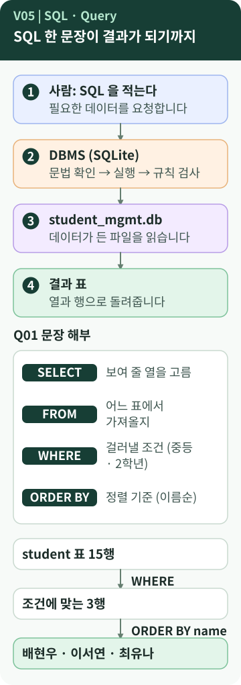

# Chapter 5 — 데이터베이스에게 어떻게 부탁할까?

> SQL은 프로그래밍 언어일까요? 터미널에 입력하는 `sqlite3 student_mgmt.db < sql/01_schema.sql`은 SQL일까요, 아닐까요? Python 스크립트는 SQLite의 일을 대신해 줄까요?

**이 장에서 알게 되는 것**

- **SQL**과 **쿼리(Query)** 가 무엇이고, 조회 문장 `SELECT`가 어떻게 읽히는지
- 조건(`WHERE`)·정렬(`ORDER BY`)·개수 제한(`LIMIT`)·패턴(`LIKE`)
- **SQL 문**, **터미널 명령**, **SQLite 점 명령**, **Python 스크립트**를 구분하는 법

📱 모바일에서는 **"내 프로그램에 연결하기"와 "한 문장 정리"까지** 읽으세요.

---

## 먼저, 이런 궁금증에서 시작합니다

- SQL은 어떤 언어이고, 쿼리는 무엇일까?
- `sqlite3 student_mgmt.db < sql/01_schema.sql` 한 줄은 SQL일까? `[학습 노트]`
- `run_all.sh`와 Python은 SQLite가 하는 일을 대신하는 걸까? `[학습 노트]`

## 일상으로 생각해 보면

도서관 사서에게 **요청서**를 낸다고 생각해 보세요.

> "성이 '김'으로 시작하는 학생 명단을 이름순으로 주세요."

요청서에는 **무엇이 필요한지**만 적습니다. 서가를 어떤 순서로 뒤질지는 사서가 정합니다. SQL이 바로 이 요청서이고, 사서가 DBMS(SQLite)입니다. `[보충]` 이렇게 "무엇을 원하는지만 적는" 방식을 **선언형**이라고 합니다. `[개념]`

## 용어의 뜻

- [**SQL**](../../../terms/sql.md) — **S**tructured **Q**uery **L**anguage, 구조화된 질의 언어. 표 형태로 구조화된 데이터에 대한 질의(Query)를 적는 언어입니다.
- **쿼리(Query, 질의)** — DB에 보내는 **요청**입니다. 넓게는 SQL 문 전체, 좁게는 "조건에 맞는 데이터를 보여 달라"는 **조회 요청**을 뜻합니다. 학습 노트도 두 의미를 함께 씁니다. `[학습 노트]` 실행 과정은 [쿼리 실행](../../../terms/query-execution.md)에서 더 볼 수 있습니다.
- [**SELECT**](../../../terms/select.md) — 보여 줄 열을 **고른다**.
- **FROM** — 어느 표에서 가져올지.
- **WHERE** — 걸러낼 **조건**.
- **ORDER BY** — 정렬 기준. `DESC`는 내림차순(큰 것부터).
- **LIMIT** — 결과 **개수 제한**.
- **LIKE** — 글자 **패턴** 비교. `'김%'`의 `%`는 "아무 글자가 0개 이상"입니다.

SQL 문은 하는 일에 따라 나누어 부르기도 합니다. `[학습 노트]`

| 분류 | 하는 일 | B6-1에서 |
| --- | --- | --- |
| DDL (정의) | 표 구조를 만들고 바꿈 (`CREATE`) | `01_schema.sql` |
| DML (조작) | 데이터를 넣고 고치고 지움 (`INSERT` `UPDATE` `DELETE`) | `02_sample_data.sql`, Q16·Q17 |
| DQL (조회) | 데이터를 읽음 (`SELECT`) | Q01~Q14 |
| DCL·TCL | 권한 · 트랜잭션 제어 | 별도 SQL 문으로 다루지 않음. Python 스크립트는 `commit()`을 호출함 |

분류 기준은 책마다 조금 다릅니다. DQL을 DML에 포함해서 부르는 교재도 있습니다. `[학습 노트]`

> **DB마다 말투(방언)가 있습니다** `[학습 노트]` `[요구 정리]`
> 같은 SQL이라도 DBMS마다 문법이 조금 다릅니다. 미션은 **DB 고유 문법을 쓰면 그 쿼리에 주석으로 밝히라**고 합니다. B6-1에서는 `PRAGMA foreign_keys`와 `EXPLAIN QUERY PLAN`이 SQLite 전용입니다.

## 그림으로 보기



### 그림 읽는 법

1. **①~④**는 한 문장이 결과가 되는 **큰 흐름**입니다. 사람이 SQL을 쓰고(①), SQLite가 문법을 확인해 실행하고(②), 데이터 파일을 읽어(③), 표로 돌려줍니다(④).
2. **아래쪽**은 B6-1의 Q01을 부품으로 나눈 것입니다. `SELECT`(열), `FROM`(표), `WHERE`(조건), `ORDER BY`(정렬)입니다.
3. 맨 아래 세 칸은 **건수의 변화**입니다. 학생 15행 → 조건에 맞는 3행 → 이름순 정렬. 이 흐름은 **이해를 돕기 위한 단순화**이며, 실제 DBMS는 효율을 위해 내부 실행 순서를 바꿀 수 있습니다. `[개념]`

## B6-1 결과물에서 확인하기

기본 조회 쿼리 4개(Q01~Q04)입니다. `[B6-1 사례]`

| 쿼리 | 하는 일 | 핵심 문법 | 결과 |
| --- | --- | --- | --- |
| Q01 | 중등 2학년 학생 | `WHERE` 두 조건 + `ORDER BY` | 3행: 배현우·이서연·최유나 |
| Q02 | 점수 상위 5건 | `ORDER BY ... DESC` + `LIMIT` | 98·97·95·94·93 |
| Q03 | 성이 '김'인 학생 | `LIKE '김%'` | 2행: 김민준·김서윤 |
| Q04 | 2026-10-01 이후 시험 | 날짜 조건 + 정렬 | 10행 |

```sql
SELECT id, name, school, school_level, grade
FROM student
WHERE school_level = '중등' AND grade = 2
ORDER BY name;
```

*원본 발췌 — [`sql/03_queries.sql`](https://github.com/hyun02063185-AX-beginner/Codyssey_B6-1/blob/8b99440c830fddc6f78c1440cff8fa2591d47884/sql/03_queries.sql) · Q01 / 결과는 [`results/query_results.md`](https://github.com/hyun02063185-AX-beginner/Codyssey_B6-1/blob/8b99440c830fddc6f78c1440cff8fa2591d47884/results/query_results.md)*

두 가지를 짚어 둡니다.

- **`LIMIT`은 `ORDER BY`와 함께 씁니다.** 정렬 없이 "5건만"이라고 하면 **어떤 5건인지 정해지지 않습니다.** Q02가 점수 내림차순으로 먼저 정렬한 이유입니다. `[개념]`
- **Q04의 날짜 비교** `exam_date >= '2026-10-01'`는 글자 비교입니다. `YYYY-MM-DD` 형식에서는 글자 순서와 날짜 순서가 같아서 맞게 동작합니다. 날짜를 `2026/10/1`처럼 형식이 다르게 적으면 결과가 틀려질 수 있습니다. `[개념]` `[실행 확인]` (2장의 "날짜는 글자로 저장")

## 이 줄은 SQL일까? — 명령의 층을 나누기

가장 많이 헷갈리는 부분입니다. 학습 노트가 정리한 대로 나누어 봅니다. `[학습 노트]`

```text
sqlite3   student_mgmt.db   <   sql/01_schema.sql
   ①           ②            ③          ④
```

*명령 줄은 [`README.md`](https://github.com/hyun02063185-AX-beginner/Codyssey_B6-1/blob/8b99440c830fddc6f78c1440cff8fa2591d47884/README.md) 4절의 실행 방법과 같고, ①~④ 표시는 [`docs/mission_study.md`](https://github.com/hyun02063185-AX-beginner/Codyssey_B6-1/blob/8b99440c830fddc6f78c1440cff8fa2591d47884/docs/mission_study.md) 6장의 분해를 옮긴 것입니다.*

| 부분 | 뜻 |
| --- | --- |
| ① `sqlite3` | SQLite 프로그램을 실행한다 |
| ② `student_mgmt.db` | 이 DB 파일을 대상으로 한다 (없으면 새로 만든다) |
| ③ `<` | 오른쪽 파일의 내용을 **입력으로 넣는다** (터미널의 입력 리다이렉션) |
| ④ `sql/01_schema.sql` | 입력으로 넣을 SQL 파일 |

풀어 쓰면 **"`01_schema.sql`에 적힌 SQL 문들을 읽어서 `student_mgmt.db`에 실행해 줘"** 입니다. 이 줄 **자체는 SQL이 아니라 터미널 명령**이고, 진짜 SQL(`CREATE TABLE ...`)은 파일 안에 있습니다.

| 구분 | 역할 | 예 |
| --- | --- | --- |
| **SQL 문** | DB에게 시키는 언어 | `SELECT * FROM student;` |
| **터미널(쉘) 명령** | `sqlite3` 같은 프로그램을 부름 | `sqlite3 student_mgmt.db < 파일` |
| **SQLite 점(`.`) 명령** | `sqlite3` 대화창 안에서 쓰는 명령. SQL이 아님 | `.tables` `.headers on` `.quit` |
| **셸 스크립트** | Python 스크립트를 실행 | `./scripts/run_all.sh` |
| **Python 스크립트** | SQL 파일 실행과 결과 문서 정리를 자동화 | `scripts/run_queries.py` |

### B6-1 사례의 실행 방법 두 가지

이 B6-1 결과물의 README는 실행 방법을 두 가지로 안내합니다. 다른 교육생이 Python을 사용해야 한다는 뜻은 아닙니다. `[B6-1 사례]`

- **방법 A**: `sqlite3` 명령으로 SQL 파일을 하나씩 실행합니다. 방법 A만으로도 과제는 완성됩니다. (결과 문서는 터미널 출력을 직접 저장해야 합니다.) `[학습 노트]`
- **방법 B**: `scripts/run_all.sh` → `scripts/run_queries.py`. Python의 내장 `sqlite3` 모듈이 **SQLite 라이브러리를 직접 호출**해 같은 SQL 파일을 같은 순서로 실행하고, 쿼리별 결과를 `results/query_results.md`로 모읍니다.

> **Python은 SQL을 대신하지 않습니다.** `[학습 노트]` `[실행 확인]`
> 방법 B의 Python은 위의 `sqlite3` **명령을 실행하는 것이 아닙니다.** 실행하는 SQL 파일과 순서는 같고, Python은 **실행과 결과 정리를 돕는 보조 도구**입니다. `run_queries.py`를 읽어 보면 새 DB를 만들고(`01`→`02` 실행), `03`을 쿼리별로 나눠 실행해 표로 기록합니다.

> **운영체제별 주의** `[실행 확인]` `[개념]`
> - Windows PowerShell에서는 `sqlite3 a.db < b.sql`이 **오류**가 났습니다. 이 터미널은 `<`를 입력 리다이렉션으로 쓰지 못합니다. 이럴 때는 `sqlite3` 대화창에서 `.read 파일`을 쓰거나 방법 B를 쓸 수 있습니다.
> - `01_schema.sql`은 첫머리에서 **기존 표를 삭제하고 다시 만듭니다.** 위 명령은 **연습용으로 새로 만든 DB 파일**에만 실행하세요. (9장)

## 좋은 점과 한계

학습 노트는 "SQL(언어)"과 "관계형 DB(방식)"의 장단점을 나누어 정리했습니다. SQL 쪽만 줄이면 이렇습니다. `[학습 노트]`

| 좋은 점 | 한계 |
| --- | --- |
| 표준 언어라 기본 문법을 여러 DBMS에서 씀 | DBMS마다 방언이 있음 |
| 선언형이라 코드가 짧음 | 복잡해지면 읽기 어려움 (JOIN 여러 단계, 중첩 서브쿼리) |
| `SELECT … FROM … WHERE`처럼 영어에 가까움 | 쓰는 방식에 따라 속도가 다를 수 있음 |
| 스키마·샘플 데이터·쿼리 SQL 파일을 새 DB에 같은 순서로 실행해 결과를 재현할 수 있음 | 반복·복잡한 절차는 프로그래밍 언어와 함께 씀 |

## 내 프로그램에 연결하기

1. `sql/03_queries.sql`을 열어 `[Q01]`~`[Q04]`를 찾습니다. 각 쿼리 위에 **"확인:"으로 시작하는 한 줄 설명**이 있습니다. 미션이 요구한 "목적 설명 1줄"입니다. `[B6-1 사례]`
2. `WHERE`, `ORDER BY`, `LIMIT`, `LIKE`를 **각각 하나씩** 찾아 "무슨 일을 하는지" 소리 내어 말해 봅니다.
3. 내가 실행한 줄이 **SQL 문인지, 터미널 명령인지** 표(위)에서 골라 봅니다.

## 요구와 B6-1의 선택

- 총 **15개 이상**의 SQL을 작성합니다: 기본 조회 4+, JOIN 4+, 집계 3+, 서브쿼리 1+, UPDATE/DELETE 2+, INDEX 1+. 각 쿼리에 **목적 설명 한 줄**을 붙이고 실행 결과를 스크린샷이나 텍스트로 남깁니다. `[요구 정리]`
- B6-1은 **17개**(조회 4 · JOIN 5 · 집계 4 · 서브쿼리 1 · 인덱스 1 · 수정·삭제 2)이고, 결과를 `results/query_results.md` 텍스트로 남겼습니다. `[B6-1 사례]`
- **실행 방법(sqlite3 명령 / Python 스크립트)은 선택**입니다. 요구는 쿼리와 결과이지 Python 스크립트가 아닙니다. `[B6-1 사례]`

## 다른 사람에게 이렇게 설명할 수 있습니다

> "SQL은 데이터베이스에게 '이런 데이터를 보여 줘'라고 부탁하는 언어예요. 어떻게 찾을지는 SQLite가 정해요. `sqlite3 ... < 파일` 줄은 SQL이 아니라 터미널 명령이고, SQL은 그 파일 안에 있어요. Python 스크립트는 같은 SQL 파일을 같은 순서로 실행하고 결과 문서를 만들어 주는 도우미예요."

**한 문장 정리:** SQL은 DBMS에게 **무엇이 필요한지 적는 언어**이고, 터미널 명령과 Python 스크립트는 그 SQL을 **실행하러 가는 길**일 뿐입니다.

---

## 💻 직접 확인해 보기 (선택)

> ⚠️ 연습용 폴더·연습용 DB 파일에서만 합니다.

- `sql/03_queries.sql`의 Q01~Q04를 **복사해서 한 줄씩** 실행해 보고, 결과 행 수가 `results/query_results.md`와 같은지 비교합니다. (3행·5행·2행·10행)
- `WHERE` 조건 숫자를 바꿔 보며(예: `grade = 3`) **결과가 어떻게 달라지는지** 봅니다. 파일은 저장하지 않아도 됩니다.

## AI에게 물어볼 질문

> "내 README의 실행 명령 한 줄을 **터미널 명령 / SQL 문 / sqlite3 점 명령**으로 나누어 설명해 줘. 그리고 내 `run_queries.py`가 SQLite와 어떻게 연결되는지 알려 줘. 코드는 수정하지 마."

---

**이전 장 ←** [Chapter 4](04-data-integrity.md) · **다음 장 →** [Chapter 6. 여러 표를 한 번에 보려면?](06-sql-joins.md)
