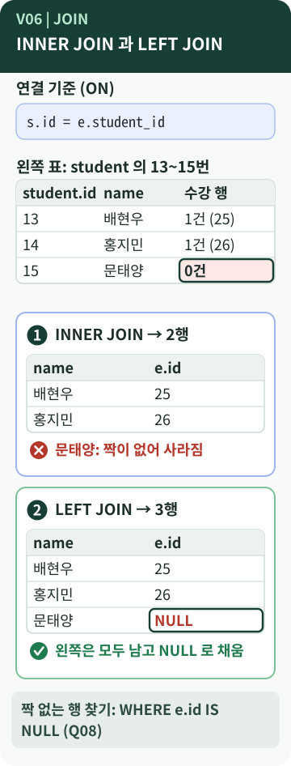

# Chapter 6 — 여러 표를 한 번에 보려면?

> 수강 신청이 없는 학생 문태양은 어떤 조회에서는 **사라지고**, 어떤 조회에서는 `NULL`과 함께 **남습니다**. 같은 학생인데 결과가 왜 다를까요?

**이 장에서 알게 되는 것**

- 나뉜 표를 한 번에 보려면 왜 **JOIN**이 필요한지
- **INNER JOIN**과 **LEFT JOIN**이 "짝이 없는 행"을 다루는 방식의 차이
- `NULL`로 "없는 것"을 찾는 방법과, JOIN 결과가 조용히 틀어질 수 있는 경우

📱 모바일에서는 **"내 프로그램에 연결하기"와 "한 문장 정리"까지** 읽으세요.

---

## 먼저, 이런 궁금증에서 시작합니다

- 학생·수강·수업이 서로 다른 표에 있는데, "학생 이름 + 수업 이름"은 어떻게 한 번에 볼까?
- INNER JOIN과 LEFT JOIN은 **실제 결과가** 어떻게 다를까? `[학습 노트]`
- JOIN을 하려면 FK를 꼭 선언해 두어야 할까?

## 일상으로 생각해 보면

학생 **명단**과 수강 **신청서 묶음**이 따로 있다고 해 봅시다. 둘을 **학생 번호로 짝 지어** 보려 합니다.

- **짝이 있는 학생만** 적은 명단을 만들면: 신청서가 없는 학생은 명단에서 **빠집니다.** → INNER JOIN
- **학생 명단은 전부 적고**, 신청서가 없으면 수업 칸을 **빈칸**으로 두면: 모두 남고 빈칸이 생깁니다. → LEFT JOIN `[보충]`

## 용어의 뜻

- [**JOIN**](../../../terms/join.md) — 서로 다른 표의 행을 **연결 조건에 맞춰 이어서** 한 번에 조회하는 방법입니다. join은 "잇다, 결합하다"라는 뜻입니다.
- **ON** — 연결 조건. `e.student_id = s.id`처럼 "어느 열끼리 같으면 짝으로 본다"를 적습니다.
- **별칭(alias)** — 표에 붙이는 짧은 이름. `student s`, `enrollment e`처럼 씁니다.
- [**INNER JOIN**](../../../terms/inner-join.md) — **양쪽 모두에 짝이 있는 행만** 남깁니다. inner는 "안쪽(겹치는 부분)"입니다.
- [**LEFT JOIN**](../../../terms/left-join.md) — **왼쪽 표는 모두** 남기고, 짝이 없으면 오른쪽 열을 `NULL`로 채웁니다. 정식 이름은 `LEFT OUTER JOIN`입니다. "왼쪽"은 `FROM`에 **먼저 적은 표**입니다.
- **NULL / IS NULL** — 값이 없음 / 값이 없는지 묻는 조건. `= NULL`이 아니라 **`IS NULL`** 로 씁니다. `[개념]`

> **"inner"와 "left"를 그림으로 외우는 것보다** `[학습 노트]`
> INNER는 "안쪽(겹치는 것)만", LEFT는 **"왼쪽을 지킨다"** 로 기억하세요. 빠지면 안 되는 쪽을 왼쪽에 놓고 LEFT JOIN합니다.

## 그림으로 보기



### 그림 읽는 법

1. **맨 위 상자**는 연결 기준입니다. `s.id = e.student_id`, 학생 번호가 같으면 짝입니다.
2. **왼쪽 표**는 `student`의 13~15번입니다. 오른쪽 열에 각 학생의 수강 행 수를 적었습니다. 15번 문태양만 **0건**입니다.
3. **① INNER JOIN**: 짝이 있는 2행만 남습니다. 문태양은 **사라집니다.** (✕ 표시)
4. **② LEFT JOIN**: 왼쪽(학생)은 모두 남고, 문태양의 `e.id`는 **`NULL`** 입니다. (✓ 표시)
5. 단순화를 위해 수업 이름 대신 수강 행 번호(`e.id`)를 보여 줍니다. 실제 쿼리에서는 `course` 표를 한 번 더 이어서 수업 이름을 얻습니다.

## B6-1 결과물에서 확인하기

학습 노트가 같은 조건에서 JOIN 종류만 바꿔 비교한 결과입니다. `[학습 노트]` 이 가이드를 만들면서 같은 데이터로 다시 실행해 **같은 결과**를 확인했습니다. `[실행 확인]`

| 비교 | INNER JOIN | LEFT JOIN |
| --- | --- | --- |
| 학생 13~15번 | 2행 (문태양 없음) | 3행 (문태양의 수업 칸이 `NULL`) |
| 학생 ↔ 수강 전체 | 26행 | 27행 (수강 없는 문태양 1행 추가) |
| 수업 11·12번 | 고등 수학 심화 3건만. **영어 회화 없음** | 고등 수학 심화 3건 + **영어 회화(수강 `NULL`) 1건** |

### "없는 것 찾기" — LEFT JOIN과 `IS NULL`

LEFT JOIN 결과에서 **오른쪽 값이 `NULL`인 행만** 고르면, 짝이 없는 행을 찾을 수 있습니다. INNER JOIN으로는 이 질문에 답할 수 없습니다. 짝이 없는 행이 **먼저 사라지기** 때문입니다. `[학습 노트]`

```sql
SELECT s.id, s.name, s.school
FROM student s
LEFT JOIN enrollment e ON e.student_id = s.id
WHERE e.id IS NULL;
```

*원본 발췌 — [`sql/03_queries.sql`](https://github.com/hyun02063185-AX-beginner/Codyssey_B6-1/blob/8b99440c830fddc6f78c1440cff8fa2591d47884/sql/03_queries.sql) · Q08. 결과: 15번 문태양 (새봄중)*

이 장의 JOIN 쿼리 다섯 개입니다. `[B6-1 사례]`

| 쿼리 | 하는 일 | 종류 |
| --- | --- | --- |
| Q05 | 학생별 수강 중인 수업 (3개 표) | INNER |
| Q06 | 수업별 과목과 담당 강사 | INNER |
| Q07 | 학생 이름 + 수업명 + 점수 (4개 표, `LIMIT 10`) | INNER |
| Q08 | 수강 신청이 없는 학생 | LEFT + `IS NULL` |
| Q09 | 수강생이 없는 수업 | LEFT + INNER 혼합 |

Q09는 `course`에 `enrollment`를 LEFT JOIN해 "수강 기록이 없는 수업"을 남긴 다음, `teacher`를 **INNER JOIN**으로 붙입니다. `course.teacher_id`는 `NOT NULL`이라 모든 수업에 강사가 있으므로, INNER로 붙여도 수업이 사라지지 않습니다. `[B6-1 사례]`

### JOIN은 FK 선언이 없어도 됩니다 — 그래서 FK가 중요합니다

- **JOIN에는 FK 선언이 필수가 아닙니다.** 연결 조건(`ON`)만 맞으면 FK가 없는 두 표도 이을 수 있습니다. FK는 "그 번호가 **유효하다**"를 지켜 주는 규칙입니다. `[개념]` `[실행 확인]`
- 외래키 검사를 **끈** 연결에서 존재하지 않는 학생 999번의 수강 행을 넣어 보았습니다. 수강 행은 27개가 되었지만 학생-수강 INNER JOIN은 **여전히 26행**이었습니다. 오류도 경고도 없이 **그 행만 조용히 빠졌습니다.** `[실행 확인]`

무결성이 깨지면 JOIN은 에러를 내지 않고 **틀린 결과를 낼 수 있습니다.** 4장의 `PRAGMA foreign_keys = ON`이 중요한 이유입니다.

## 좋은 점과 한계

**좋은 점**

- 나뉜 정보를 **한 번에** 봅니다. (Q05~Q07)
- LEFT JOIN으로 **없는 것**을 찾습니다. (Q08, Q09)

**한계와 주의**

- 1:N 관계를 이으면 행이 **늘어납니다.** 점수 30건을 기준으로 학생·수업을 이으면 30행이 나옵니다. "학생 수"를 세고 싶은데 행이 많아진 결과를 그대로 세면 틀립니다. (7장)
- **LEFT JOIN 뒤 `WHERE`에서 오른쪽 열 조건을 걸면** `NULL` 행이 걸러져 INNER JOIN처럼 동작합니다. 같은 조건을 `ON`에 넣으면 왼쪽 행이 남습니다. (아래 표) `[실행 확인]`
- 표를 많이 이으면 **읽기 어렵고 느려질 수** 있습니다. 8장의 인덱스가 이와 이어집니다. `[학습 노트]`
- "왼쪽"은 **적은 순서**입니다. 표 순서를 바꾸면 결과가 달라집니다.

| 조건을 적는 위치 | 학생 13~15번 결과 |
| --- | --- |
| `WHERE e.course_id = 11` | 수업 11번을 듣는 학생만 나옴 (문태양 등 사라짐) |
| `ON … AND e.course_id = 11` | 13·15번은 `NULL`로 **남고** 14번만 11 |

## 내 프로그램에 연결하기

1. `sql/03_queries.sql`에서 `INNER JOIN`과 `LEFT JOIN`을 검색해 **어느 쿼리에 쓰였는지** 표시해 봅니다.
2. Q08에서 `LEFT JOIN`을 `INNER JOIN`으로 바꾸면 **결과가 0행이 될 것**이라고 **먼저 예측**하고, 연습용 DB에서 확인합니다.
3. JOIN 개수를 셀 때는 기준을 정합니다. B6-1 문서 안에서도 README는 "INNER JOIN 3개, LEFT JOIN 2개"(Q05~Q09 기준), 쿼리 파일 머리말은 "INNER JOIN 4개 / LEFT JOIN 2개"라고 적어 **세는 기준이 서로 다릅니다.** Q09는 두 종류가 섞여 있고, Q10~Q12·Q14에도 JOIN이 쓰입니다. `[B6-1 사례]`

## 요구와 B6-1의 선택

- **JOIN 쿼리 4개 이상**, 그중 **INNER JOIN 2개 이상, LEFT JOIN 1개 이상**을 포함합니다. `[요구 정리]`
- B6-1은 Q05~Q09(5개)를 JOIN 범주로 두었고, "없는 것 찾기"에 LEFT JOIN을 쓴 것은 **B6-1의 선택**입니다. `[B6-1 사례]`
- 수강 신청이 없는 학생과 수강생이 없는 수업이 **샘플에 들어 있는 것**도 B6-1의 선택입니다. (3장)

## 다른 사람에게 이렇게 설명할 수 있습니다

> "INNER JOIN은 짝이 있는 행만 보여 주고, LEFT JOIN은 왼쪽 표를 전부 남기고 짝이 없으면 NULL로 보여 줘요. 그래서 수강 신청이 없는 문태양은 INNER JOIN에서는 사라지고 LEFT JOIN에서는 NULL과 함께 남아요. 그 NULL을 이용해서 '수강 신청이 없는 학생'을 찾았어요."

**한 문장 정리:** INNER JOIN은 **짝이 있는 행만**, LEFT JOIN은 **왼쪽을 전부 남기고 짝이 없으면 `NULL`** 로 보여 주며, 그 `NULL`로 "없는 것"을 찾습니다.

---

## 💻 직접 확인해 보기 (선택)

> ⚠️ `SELECT`만 쓰므로 데이터는 바뀌지 않지만, 연습용 DB에서 하세요.

```sql
SELECT s.id, s.name
FROM student s
INNER JOIN enrollment e
  ON e.student_id = s.id
WHERE s.id = 15;
```

*교육용 예시 — 원본 아님. Q08의 `LEFT JOIN`을 `INNER JOIN`으로 바꾼 것입니다. 0행이 나오면 "짝이 없는 행이 먼저 사라진다"를 확인한 것입니다.*

## AI에게 물어볼 질문

> "내 `03_queries.sql`의 JOIN 쿼리를 하나씩 보고, **INNER와 LEFT 중 무엇을 썼는지**, 그리고 LEFT JOIN이라면 왼쪽 표가 무엇인지 표로 정리해 줘. 파일은 수정하지 마."

---

**이전 장 ←** [Chapter 5](05-sql-queries.md) · **다음 장 →** [Chapter 7. 묶어서 계산하려면?](07-group-aggregation.md)
