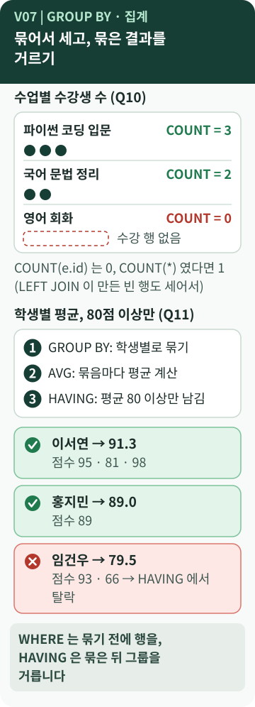

# Chapter 7 — 묶어서 계산하려면?

> "수업마다 수강생이 몇 명이지?", "학생별 평균이 80점 이상인 학생은?" 행 하나하나가 아니라 **묶음 단위의 숫자**가 필요할 때는 어떻게 할까요? 그리고 `WHERE`와 `HAVING`은 무엇이 다를까요?

**이 장에서 알게 되는 것**

- **COUNT · SUM · AVG**로 개수·합계·평균을 구하는 방법
- **GROUP BY**가 "묶는" 방식
- **WHERE**(묶기 전)와 **HAVING**(묶은 뒤)의 차이, 그리고 `COUNT`가 0을 놓치는 함정

📱 모바일에서는 **"내 프로그램에 연결하기"와 "한 문장 정리"까지** 읽으세요.

---

## 먼저, 이런 궁금증에서 시작합니다

- 수업별 수강생 수를 세고 싶다. **수강생이 0명인 수업**도 나오게 하려면?
- 평균 80점 이상인 학생만 보고 싶다. `WHERE`에 쓰면 될까?
- 평균은 소수점이 길게 나오는데, 보기 좋게 하려면?

## 일상으로 생각해 보면

성적표에서 **반별 평균**을 구할 때를 떠올려 보세요. 학생을 **반별로 묶고**, 묶음마다 평균을 냅니다. 마지막으로 "평균 80 이상인 반만" 골라냅니다.

- 묶기 **전**에 "결석한 학생은 빼자"고 거르는 것 → `WHERE`
- 묶어서 평균을 낸 **뒤**에 "평균이 80 이상인 반만" 거르는 것 → `HAVING` `[보충]`

## 용어의 뜻

- [**집계(aggregate)**](../../../terms/aggregate-function.md) — 여러 행을 모아 **하나의 값**으로 만드는 계산입니다. [집계 요약](../../../terms/summary-aggregation.md)도 같은 맥락입니다.
  - **COUNT** 개수 · **SUM** 합계 · **AVG** 평균
- [**GROUP BY**](../../../terms/group-by.md) — "이 기준으로 **묶어라**." 학생별, 수업별처럼 같은 값을 가진 행을 한 묶음으로 만들고, 집계는 **묶음마다** 따로 합니다.
- **HAVING** — **묶은 결과**에 거는 조건. 영어 단어 뜻("가지고 있다")만으로는 `WHERE`와 구분하기 어렵습니다. **언제 거르는가(시점)** 로 기억하세요.
- **ROUND(값, 1)** — 소수 첫째 자리까지 반올림해 **보여 줍니다.**
- **AS** — 결과 열에 붙이는 이름(별칭). `student_count`처럼요.

처리 순서를 **교육용으로 단순화**하면 이렇습니다. `[개념]` 실제 DBMS는 효율을 위해 내부 실행을 바꿀 수 있지만, 결과는 이 순서의 의미와 같습니다.

```text
1. FROM · JOIN : 표를 이음
2. WHERE       : 행을 거름
3. GROUP BY    : 묶음
4. COUNT·SUM·AVG : 묶음마다 계산
5. HAVING      : 묶음을 거름
6. ORDER BY · LIMIT : 정렬, 개수 제한
```

## 그림으로 보기



### 그림 읽는 법

1. **위쪽(Q10)** 은 수업별 수강생 수입니다. 점(●) 하나가 수강 **행 하나**입니다. 파이썬 코딩 입문은 점 3개 → `COUNT = 3`입니다.
2. **영어 회화**는 수강 행이 없어 점선 빈 상자이고 `COUNT = 0`입니다. LEFT JOIN으로 수업을 남겼기 때문에 0으로 **나타납니다.** (6장)
3. **아래쪽(Q11)** 은 학생별 평균입니다. ① 학생별로 **묶고** ② 묶음마다 **평균**을 내고 ③ 평균 80 이상만 **남깁니다.**
4. 초록 ✓는 통과한 학생(이서연 91.3, 홍지민 89.0), 빨강 ✕는 **HAVING에서 탈락**한 임건우(점수 93·66 → 평균 79.5)입니다.

## B6-1 결과물에서 확인하기

**Q10 — 수업별 수강생 수**

```sql
SELECT c.course_name, COUNT(e.id) AS student_count
FROM course c
LEFT JOIN enrollment e ON e.course_id = c.id
GROUP BY c.id, c.course_name
```

*원본 발췌 — [`sql/03_queries.sql`](https://github.com/hyun02063185-AX-beginner/Codyssey_B6-1/blob/8b99440c830fddc6f78c1440cff8fa2591d47884/sql/03_queries.sql) · Q10 (뒤의 `ORDER BY` 줄은 생략)*

결과는 12개 수업 중 3명인 수업 4개, 2명인 수업 7개, **0명인 영어 회화 1개**입니다. `[B6-1 사례]` `[실행 확인]`

> **`COUNT(e.id)`와 `COUNT(*)`는 다릅니다** `[실행 확인]`
> 영어 회화는 LEFT JOIN 결과에서 `NULL`로 채운 **한 행**이 됩니다. `COUNT(e.id)`는 `NULL`을 세지 않아 **0**이고, `COUNT(*)`는 행 자체를 세어 **1**이 됩니다. Q10이 `COUNT(e.id)`를 쓴 이유입니다.

**Q11 — 학생별 평균, 80점 이상만**

```sql
GROUP BY s.id, s.name
HAVING AVG(sc.point) >= 80
```

*원본 발췌 — `sql/03_queries.sql` · Q11의 `GROUP BY`와 `HAVING` 두 줄*

시험을 본 학생 14명 중 **6명**이 남습니다(이서연 91.3 · 오서현 90.3 · 홍지민 89.0 · 장예린 88.5 · 김민준 83.7 · 정도윤 80.3). `[실행 확인]`

> **`WHERE`로 바꾸면 다른 질문이 됩니다** `[실행 확인]`
> `WHERE sc.point >= 80`으로 **묶기 전에** 80점 미만 점수를 버리면, 임건우는 93점 한 건만 남아 평균이 **93.0**이 됩니다. 원래 임건우의 평균은 79.5입니다. `WHERE`는 **어떤 행을 계산에 쓸지**, `HAVING`은 **계산한 결과를 어떤 묶음만 보여 줄지**를 정합니다.

**그 밖의 집계**

- **Q12**: 강사별로 `COUNT`·`SUM`·`AVG`를 함께 씁니다. 예: 박서준 응시 8건, 총점 668, 평균 83.5.
- **Q13**: `student` 표만 `GROUP BY school`로 묶어 학교별 학생 수를 셉니다. (강남고 4 · 새봄중 4 · 한빛중 4 · 해든고 3, 합계 15)

## 좋은 점과 한계

**좋은 점**

- 수천 행이어도 "묶음별 숫자"를 **한 문장**으로 구합니다.
- `HAVING`으로 계산 결과를 바로 거릅니다.

**한계와 주의**

- **무엇이 한 행인지**를 먼저 정하지 않으면 숫자가 틀립니다. 6장처럼 1:N을 이은 뒤 행을 세면 같은 대상이 **여러 번** 세어질 수 있습니다.
- **평균의 평균**에 주의합니다. Q12의 평균은 "강사의 시험 **한 건**당 평균"이고, "학생별 평균을 다시 평균 낸 값"과 다를 수 있습니다. `[개념]`
- `COUNT(열)`과 `AVG`는 `NULL`을 **무시**합니다. `[개념]`
- 표시용 `ROUND`와 조건용 `AVG`는 **다른 값**입니다. 정도윤은 80.3으로 보이지만 실제 평균은 소수가 이어지는 값이고, `HAVING`은 반올림 전 값으로 판정합니다. `[B6-1 사례]`
- 평균이 **한 건의 점수**(홍지민 89.0)일 수도 있어, 건수 없이 평균만 보면 오해하기 쉽습니다. Q11이 `exam_count`를 함께 보여 주는 이유입니다. `[B6-1 사례]`
- `GROUP BY`에는 `id`와 `name`을 **함께** 적었습니다. 이름이 같은 사람·수업이 있을 수 있어 **번호로 구분**하기 위해서입니다. 또 SQLite는 `GROUP BY`에 없는 열을 보여 주는 것도 비교적 너그럽게 받아 주지만, 다른 DBMS는 오류를 낼 수 있어 보여 줄 열은 **함께 적는 습관**이 안전합니다. `[개념]`

## 내 프로그램에 연결하기

1. Q10~Q13을 열고 각 쿼리의 **결과 한 행이 무엇인지** 말해 봅니다. (수업 / 학생 / 강사 / 학교)
2. `HAVING`이 쓰인 쿼리를 찾아, 그 조건이 **묶은 뒤의 값**(`AVG(...)`)을 쓰는지 확인합니다.
3. `LEFT JOIN`과 `COUNT(열)`을 함께 쓰는 쿼리(Q10)에서 **0이 나오는 행**을 찾아 봅니다.

## 요구와 B6-1의 선택

- **집계 쿼리 3개 이상**을 작성합니다. `[요구 정리]`
- B6-1은 Q10~Q13(4개)로 `COUNT` · `SUM` · `AVG`를 모두 썼습니다. `HAVING`은 요구 정리에는 따로 적혀 있지 않고, **B6-1이 Q11에서 쓴 선택**입니다. `[B6-1 사례]`

## 다른 사람에게 이렇게 설명할 수 있습니다

> "GROUP BY로 수업이나 학생별로 묶고 COUNT, SUM, AVG로 묶음마다 계산했어요. WHERE는 묶기 전에 어떤 행을 쓸지 거르고, HAVING은 계산한 결과에서 어떤 묶음을 보여 줄지 걸러요. 수강생이 없는 수업도 0으로 나오게 LEFT JOIN과 COUNT(e.id)를 같이 썼어요."

**한 문장 정리:** `GROUP BY`는 **묶고**, 집계 함수는 **묶음마다 계산**하며, `WHERE`는 묶기 **전**에, `HAVING`은 묶은 **뒤**에 거릅니다.

---

## 💻 직접 확인해 보기 (선택)

> ⚠️ `SELECT`만 쓰므로 데이터는 바뀌지 않습니다. 연습용 DB에서 하세요.

```sql
SELECT c.course_name,
       COUNT(*), COUNT(e.id)
FROM course c
LEFT JOIN enrollment e
  ON e.course_id = c.id
WHERE c.id = 12
GROUP BY c.id;
```

*교육용 예시 — 원본 아님. 영어 회화의 `COUNT(*)`는 1, `COUNT(e.id)`는 0이 나와야 합니다.*

## AI에게 물어볼 질문

> "내 `03_queries.sql`의 `GROUP BY` 쿼리마다 **결과 한 행이 무엇을 뜻하는지**, `WHERE`와 `HAVING` 중 무엇을 썼는지, `COUNT`가 NULL을 어떻게 다루는지 설명해 줘. 코드는 수정하지 마."

---

**이전 장 ←** [Chapter 6](06-sql-joins.md) · **다음 장 →** [Chapter 8. 서브쿼리와 인덱스는 무엇이 다를까?](08-subquery-index.md)
