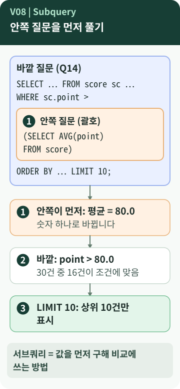
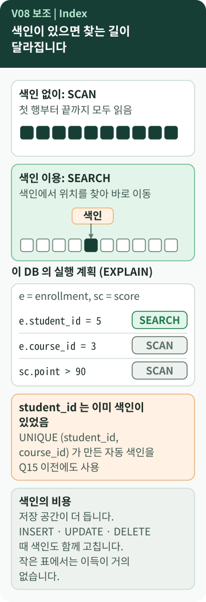

# Chapter 8 — 서브쿼리와 인덱스는 무엇이 다를까?

> "전체 평균보다 높은 점수"를 찾으려면 평균을 **먼저** 알아야 합니다. 그리고 데이터가 많아지면 어떻게 더 빨리 찾을까요? 두 가지 모두 쿼리를 "똑똑하게" 만드는 것 같지만, 사실은 **전혀 다른 종류의 도구**입니다.

**이 장에서 알게 되는 것**

- **서브쿼리**: 값을 먼저 구해서 비교에 쓰는 방법
- **인덱스(색인)**: 같은 질문을 **더 효율적으로 찾게** 돕는 별도의 구조
- 둘의 차이, 그리고 인덱스가 **언제나 이득은 아닌** 이유

📱 모바일에서는 **"내 프로그램에 연결하기"와 "한 문장 정리"까지** 읽으세요.

---

## 먼저, 이런 궁금증에서 시작합니다

- "전체 평균보다 높은 점수"는 평균이 필요한데, **한 문장 안에서** 어떻게 비교할까?
- 인덱스를 만들면 **항상** 빨라질까?
- 서브쿼리와 인덱스는 둘 다 "성능 기능"일까?

## 일상으로 생각해 보면

- **서브쿼리**: "평균보다 높은 학생은?"이라는 질문에 답하려면 먼저 **평균을 계산**해야 합니다. 그 숫자를 알고 나서 학생들과 비교합니다.
- **인덱스**: 두꺼운 책의 **뒤쪽 색인**입니다. 책 전체를 넘기지 않고 색인에서 쪽수를 찾습니다. 하지만 책이 얇으면 색인이 필요 없고, 책 내용이 바뀌면 **색인도 고쳐야** 합니다. `[보충]`

## 용어의 뜻

- [**서브쿼리(Subquery)**](../../../terms/subquery.md) — sub는 "아래·부속"이라는 뜻입니다. 쿼리 **안에 괄호로 넣은 또 다른 쿼리**입니다. 안쪽이 **먼저** 계산되고, 바깥 쿼리가 그 결과를 사용합니다.
- [**인덱스(Index, 색인)**](../../../terms/database-index.md) — 특정 열의 값을 **빨리 찾도록** 따로 만들어 두는 정렬된 구조입니다. 데이터 자체가 아니라 "위치를 알려 주는 목록"입니다.
- **SCAN / SEARCH** — 실행 계획에 나오는 말. `SCAN`은 표를 **처음부터 훑는 것**, `SEARCH ... USING INDEX`는 **색인으로 위치를 찾는 것**입니다.
- **EXPLAIN QUERY PLAN** — SQLite 전용. 쿼리를 **어떤 방법으로 실행할지(실행 계획)** 보여 줍니다. `[B6-1 사례]`

| | 서브쿼리 | 인덱스 |
| --- | --- | --- |
| 무엇인가 | 쿼리 안에 넣은 쿼리 | 표에 덧붙이는 색인 구조 |
| 하는 일 | 값을 먼저 구해 비교에 씀 | 같은 질문을 더 효율적으로 찾게 함 |
| 결과에 미치는 영향 | **질문 자체**를 만들어 결과를 정함 | 결과는 **그대로**, 찾는 방법과 속도만 달라짐 |
| 어디에 남나 | 쿼리 안에만 있음 | `CREATE INDEX`로 만들면 **DB에 남음** |

## 그림으로 보기



### 그림 읽는 법 (서브쿼리)

1. 파란 큰 상자가 **바깥 질문**, 안쪽 주황 상자가 **괄호 안의 질문**입니다.
2. **①** 안쪽이 먼저 실행되어 **숫자 하나(80.0)** 가 됩니다.
3. **②** 바깥 질문이 `point > 80.0`으로 조건을 비교합니다. 30건 중 16건이 맞습니다.
4. **③** `LIMIT 10`으로 상위 10건만 보여 줍니다.



### 그림 읽는 법 (인덱스)

1. 위쪽 두 상자는 **SCAN**(모든 칸을 차례로 읽음)과 **SEARCH**(색인에서 위치를 찾아 바로 감)의 차이입니다. 네모 10개는 표의 행을 단순화한 것입니다.
2. 가운데 표는 이 DB에서 **실제로 확인한 실행 계획**입니다. `student_id` 조건은 `SEARCH`, `course_id`와 `point` 조건은 `SCAN`이었습니다. `[실행 확인]`
3. 주황 상자와 맨 아래 상자는 **주의점과 비용**입니다. 이 DB에서는 `student_id`에 이미 색인이 있었습니다. (아래 설명)

## B6-1 결과물에서 확인하기

### 서브쿼리 — Q14

```sql
WHERE sc.point > (SELECT AVG(point) FROM score)
ORDER BY sc.point DESC
LIMIT 10;
```

*원본 발췌 — [`sql/03_queries.sql`](https://github.com/hyun02063185-AX-beginner/Codyssey_B6-1/blob/8b99440c830fddc6f78c1440cff8fa2591d47884/sql/03_queries.sql) · Q14의 마지막 세 줄 (앞의 `SELECT`와 `JOIN`은 생략)*

- 전체 평균은 **80.0**이고(30건), 평균보다 **높은** 기록은 16건입니다. `LIMIT 10` 때문에 결과 문서에는 10건이 나옵니다. `[실행 확인]`
- `>`이므로 **정확히 80점인 기록은 빠집니다.** 80점 시험이 있어 실제로 제외됩니다. `[실행 확인]`
- 미션의 **보너스**는 같은 요구를 JOIN과 서브쿼리 **두 방식으로 비교**해 보는 것입니다. `[요구 정리]` "평균"처럼 **값 하나**와 비교하는 질문은 서브쿼리가 읽기 쉽습니다. JOIN으로도 풀 수 있지만 평균을 한 줄짜리 표로 만들어 이어야 해서 더 복잡해집니다. `[보충]`

### 인덱스 — Q15

```sql
CREATE INDEX IF NOT EXISTS idx_enrollment_student_id ON enrollment (student_id);
EXPLAIN QUERY PLAN
SELECT * FROM enrollment WHERE student_id = 5;
```

*원본 발췌 — `sql/03_queries.sql` · Q15 (`EXPLAIN QUERY PLAN`은 SQLite 전용이라고 주석으로 밝혀 둠)*

결과 문서의 실행 계획 줄은 `SEARCH enrollment USING INDEX idx_enrollment_student_id (student_id=?)`입니다. `[B6-1 사례]` 색인을 **사용했다**는 증거입니다.

> **그런데 색인을 만들기 전에도 `SEARCH`였습니다** `[실행 확인]`
> 같은 DB에서 `CREATE INDEX`를 **하기 전에** 같은 질문의 실행 계획을 보니 `SEARCH enrollment USING INDEX sqlite_autoindex_enrollment_1 (student_id=?)`였습니다. 3장의 `UNIQUE (student_id, course_id)`가 **자동으로 색인을 만들었고**, 그 색인은 첫 열이 `student_id`라서 `student_id` 단독 검색에도 쓰인 것입니다.
> 그래서 이 스키마에서는 Q15의 색인이 **이미 있던 길과 겹칩니다.** 요구("INDEX 1개 이상 + 적용 이유")는 충족하지만, **이 한 줄이 속도를 바꿨다**고 말하려면 만들기 전과 후의 계획을 비교해야 합니다.

반대로 아직 **색인이 없는 조건**은 `SCAN`이었습니다. (`enrollment.course_id = 3`, `score.point > 90`) 이런 열이 색인 후보입니다. 다만 표가 26행, 30행뿐이라 **속도 차이는 눈으로 느낄 수 없습니다.** `[실행 확인]`

> **`EXPLAIN` 출력에서 읽을 것은 문장뿐입니다** `[실행 확인]`
> Python으로 보면 실행 계획은 `id · parent · notused · detail` 네 열로 나옵니다. B6-1 결과 문서의 `notused`는 0이었고 이번 실행(SQLite 3.50.4)은 62였습니다. **SQLite 버전에 따라 달라지는 내부 값**이므로 `detail` 문장만 읽으면 됩니다.

## 좋은 점과 한계

**서브쿼리**

- 좋은 점: "먼저 구하고, 그 값으로 비교"를 **한 문장**에 담습니다.
- 한계: 중첩이 깊어지면 읽기 어렵습니다. `[학습 노트]`

**인덱스**

- 좋은 점: 자주 찾거나 이을 열을 **빨리 찾게** 돕습니다. `[학습 노트]`
- 한계 — **읽기 이점과 비용을 함께** 봅니다. `[개념]`
  - **저장 공간**이 더 듭니다.
  - `INSERT` · `UPDATE` · `DELETE` 때 **색인도 함께 고쳐야** 합니다.
  - 표가 작거나, 거의 모든 행을 읽는 조건이면 **이득이 작습니다.**
  - **모든 열에 만들면** 쓰기가 느려질 수 있어 필요한 곳에만 만듭니다. `[학습 노트]`
- README·학습 노트의 "FK 컬럼에는 인덱스를 두면 JOIN/조회가 빨라진다"는 **대체로 맞는 경향**입니다. 다만 이미 같은 열을 앞에 둔 색인이 있으면 중복이고, 데이터가 적으면 차이가 거의 없습니다. SQLite의 외래키와 색인 관계는 공식 문서([sqlite.org/foreignkeys.html](https://sqlite.org/foreignkeys.html))에서 확인할 수 있습니다.

## 내 프로그램에 연결하기

1. Q14에서 **괄호 안의 `SELECT`** 를 찾아, 그것만 따로 실행하면 어떤 숫자가 나올지 **먼저 예측**해 봅니다. (80.0)
2. Q15의 `detail` 문장을 읽고 `SEARCH`인지 `SCAN`인지 말해 봅니다.
3. 내 스키마의 `UNIQUE` 제약이 **자동 색인**을 만들고 있는지 생각해 봅니다. 내 `CREATE INDEX`가 그것과 **겹치는지** 확인하는 습관이 좋습니다.

## 요구와 B6-1의 선택

- **서브쿼리 1개 이상, INDEX 1개 이상**을 작성합니다. `[요구 정리]`
- 인덱스를 **왜 걸었는지 이유**를 적는 것은 B6-1이 Q15 주석에 한 방식입니다. `[B6-1 사례]`
- `enrollment.student_id`를 인덱스 대상으로 고른 것은 B6-1의 **선택**입니다. 다른 열을 고르거나 다른 실행 계획 비교 방식을 써도 요구는 충족합니다.

## 다른 사람에게 이렇게 설명할 수 있습니다

> "서브쿼리는 질문 안에서 평균 같은 값을 먼저 구해 비교에 쓰는 방법이에요. 인덱스는 같은 질문을 더 빨리 찾게 하는 색인이라서 결과는 바뀌지 않아요. 그리고 인덱스는 저장 공간과 쓰기 비용이 들어서, 실행 계획으로 확인하고 필요한 곳에만 만들어요."

**한 문장 정리:** **서브쿼리는 질문의 논리**(값을 먼저 구해 비교)이고, **인덱스는 찾는 방법**(결과는 같고 속도·계획이 달라짐)이라서 서로 다른 종류의 도구입니다.

---

## 💻 직접 확인해 보기 (선택)

> ⚠️ `EXPLAIN QUERY PLAN`은 쿼리를 어떻게 실행할지 **보여 주기만** 합니다. 반면 `CREATE INDEX`는 DB에 **남는 변경**이므로 연습용 DB에서만 하세요.

```sql
EXPLAIN QUERY PLAN
SELECT * FROM enrollment
WHERE course_id = 3;
```

*교육용 예시 — 원본 아님. `SCAN enrollment`처럼 나오면 이 조건에는 쓸 색인이 없다는 뜻입니다.*

## AI에게 물어볼 질문

> "내 DB의 모든 `UNIQUE`와 `CREATE INDEX`를 나열하고, 같은 열을 **중복해서** 색인하는 것은 없는지 알려 줘. 그리고 Q15의 만들기 전후 `EXPLAIN QUERY PLAN` 결과를 비교하는 방법을 알려 줘. 원본 DB는 수정하지 마."

---

**이전 장 ←** [Chapter 7](07-group-aggregation.md) · **다음 장 →** [Chapter 9. 고치고 지울 때는 어떻게 안전하게 할까?](09-update-delete.md)
