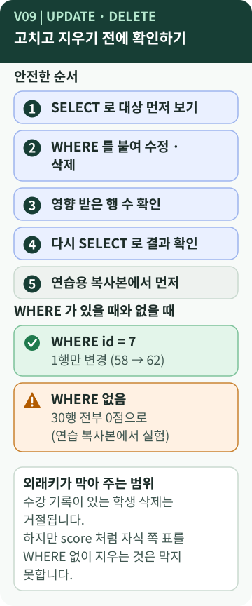

# Chapter 9 — 고치고 지울 때는 어떻게 안전하게 할까?

> `UPDATE`나 `DELETE`에서 `WHERE`를 빼먹으면 어떻게 될까요? 지운 데이터는 되돌릴 수 있을까요? B6-1의 Q16·Q17은 왜 SQL 파일의 **맨 끝**에 있을까요?

**이 장에서 알게 되는 것**

- `UPDATE`와 `DELETE`가 하는 일, 그리고 `WHERE`가 **얼마나 중요한지**
- 바꾸기 전후에 **조회로 확인**하는 안전한 순서
- 외래키가 **막아 주는 것과 못 막는 것**, 그리고 SQL 파일을 다시 실행할 때의 주의점

📱 모바일에서는 **"내 프로그램에 연결하기"와 "한 문장 정리"까지** 읽으세요.

---

## 먼저, 이런 궁금증에서 시작합니다

- 점수를 정정하고 싶다. 어떻게 **한 건만** 고칠까?
- `WHERE`를 빼먹으면? 지운 데이터는 되돌릴 수 있을까?
- Q16·Q17이 파일 맨 마지막에 있는 이유는? `[B6-1 사례]`

## 일상으로 생각해 보면

칠판에서 **한 글자를 고칠 때**는 그 글자만 지우고 다시 씁니다. 그런데 "지워 주세요"라고만 말하고 **어디를 지울지 말하지 않으면** 칠판 전체가 지워질 수 있습니다. 그래서 지우기 전에 **"무엇을 지울지" 먼저 가리켜 확인**합니다. `[보충]`

## 용어의 뜻

- [**UPDATE**](../../../terms/update.md) — 이미 있는 행의 값을 **바꿉니다.** `SET 열 = 새 값`으로 무엇을 어떻게 바꿀지 적습니다.
- [**DELETE**](../../../terms/delete.md) — 행을 **지웁니다.**
- **WHERE** — **어느 행에만** 적용할지 정하는 조건. 이것이 없으면 `UPDATE`와 `DELETE`는 **표의 모든 행**에 적용됩니다.
- **영향 받은 행 수** — 문장이 실제로 바꾼 행의 개수. "1행을 고치려 했다면 1이어야 한다"는 확인 기준이 됩니다.
- [**트랜잭션(transaction)**](../../../terms/transaction.md) — 작업을 **한 묶음**으로 확정(commit)하거나 확정 전에 취소(rollback)하는 방법입니다. B6-1의 Python 스크립트는 `commit()`을 호출하지만, 변경 전 확인부터 변경 후 확인까지를 명시적 트랜잭션으로 묶어 취소하는 실습은 하지 않았습니다. `[학습 노트]`

`UPDATE`와 `DELETE`는 [CRUD](../../../terms/crud.md)의 **U**와 **D**입니다. `INSERT`(C)와 `SELECT`(R)는 앞에서 보았습니다.

## 그림으로 보기



### 그림 읽는 법

1. **위쪽 ①~⑤**는 안전한 순서입니다. 먼저 `SELECT`로 대상을 보고, `WHERE`를 붙여 바꾸고, 영향 행 수를 확인하고, 다시 `SELECT`로 결과를 봅니다. ⑤는 **연습용 복사본에서 먼저** 해 보라는 권고입니다.
2. **가운데**는 같은 `UPDATE`라도 `WHERE id = 7`이면 **1행**, `WHERE`가 없으면 **30행 전부**가 바뀐다는 대비입니다. 후자는 **연습용 복사본**에서 확인한 값입니다. `[실행 확인]`
3. **아래 상자**는 외래키가 **어디까지 지켜 주는지**를 말합니다.

## B6-1 결과물에서 확인하기

**Q16 — 점수 정정**: 채점 오류로 7번 점수를 58점에서 62점으로 고칩니다. 변경 전후를 조회합니다.

```sql
SELECT id, point FROM score WHERE id = 7;
UPDATE score SET point = 62 WHERE id = 7;
SELECT id, point FROM score WHERE id = 7;
```

*원본 발췌 — [`sql/03_queries.sql`](https://github.com/hyun02063185-AX-beginner/Codyssey_B6-1/blob/8b99440c830fddc6f78c1440cff8fa2591d47884/sql/03_queries.sql) · Q16 / 결과: 58 → 62, 영향 행 수 1*

**Q17 — 수강 신청이 없는 학생 삭제**: 15번 학생을 지우되, **수강 기록이 없을 때만** 지웁니다.

```sql
DELETE FROM student
WHERE id = 15
  AND id NOT IN (SELECT student_id FROM enrollment);
```

*원본 발췌 — `sql/03_queries.sql` · Q17 / 앞뒤로 학생 수를 세어 15명 → 14명, 영향 행 수 1*

두 쿼리에서 배울 점입니다. `[B6-1 사례]`

- **전·후 조회**를 함께 둡니다. 눈으로 "바뀐 것이 맞다"를 확인할 수 있습니다.
- `WHERE id = ...`로 **한 행만** 겨냥합니다. Q17은 `NOT IN`으로 한 번 더 조건을 걸어 "자식이 없을 때만"이라는 의도를 **쿼리 안에 적어 둡니다.**
- **파일 맨 뒤**에 두었습니다. 파일 머리말에 "UPDATE / DELETE는 마지막에 배치해 앞쪽 조회 결과에 영향을 주지 않는다"고 적혀 있습니다.

### 실행하면 DB가 바뀝니다 — 순서와 재실행

`03_queries.sql`을 한 번 실행하면 Q16·Q17의 결과가 **DB에 남습니다.** `[실행 확인]`

- Q17 뒤에는 문태양이 `student`에서 **사라지므로**, 같은 DB에서 Q08("수강 신청이 없는 학생")을 다시 실행하면 **0행**이 나옵니다.
- 같은 DB에서 `03`을 **두 번** 실행하면 Q16은 같은 값(62)으로 다시 쓰고, Q17은 이미 지워서 **영향 행 수가 0**입니다.
- **새 DB에서 처음부터**(`01 → 02 → 03`) 실행하면 매번 같은 결과가 나옵니다. B6-1의 `run_all.sh`가 하는 방식입니다.

> **`01_schema.sql`은 "처음부터 다시 만들기"용입니다** `[B6-1 사례]`
> 이 파일은 첫머리에서 `DROP TABLE IF EXISTS`로 **여섯 개 표를 모두 지우고** 새로 만듭니다. 학습용 DB를 반복해서 만들려는 설계입니다. **이미 데이터가 쌓인 DB에 실행하면 그 데이터가 모두 사라집니다.** 연습용으로 새로 만든 DB에서만 쓰세요. `scripts/run_queries.py`도 같은 이름의 `student_mgmt.db`가 있으면 **지우고 다시 만듭니다.** 실제 서비스에서 표 구조를 바꿀 때는 [마이그레이션](../../../terms/database-migration.md)이라는 별도의 방법을 씁니다. `[개념]`

### WHERE가 없을 때, 그리고 외래키가 막아 주는 것

연습용 복사본(메모리 DB)에서 확인한 결과입니다. `[실행 확인]`

| 실행한 문장 | 결과 |
| --- | --- |
| `UPDATE score SET point = 0;` (`WHERE` 없음) | **30행 전부** 0점. 오류·경고 없음 |
| `DELETE FROM score;` (`WHERE` 없음) | 30행 **전부 삭제**. 외래키가 막지 못함 |
| `DELETE FROM student;` (`WHERE` 없음) | 수강 기록이 있는 학생이 있어서 **거절** (`FOREIGN KEY constraint failed`) |
| 외래키 검사를 끈 연결에서 `DELETE ... WHERE id = 1` | 삭제됨. 수강 행 2건이 **없는 학생을 가리킴** |

`score`는 **다른 표가 가리키지 않는 마지막 자식 표**라서 외래키가 지켜 주지 않습니다. 외래키는 "가리키는 번호가 있어야 한다"를 지킬 뿐, **"실수로 지우지 않는다"** 를 지키지는 않습니다.

## 좋은 점과 한계

**좋은 점**

- 바꾸기 전후에 `SELECT`로 확인하면 **실수가 눈에 띕니다.**
- `WHERE`가 변경 범위를 **한 줄로** 정합니다.
- 외래키가 켜져 있으면 **자식이 있는 부모의 삭제**는 막아 줍니다. (4장)

**한계와 주의**

- `WHERE`를 빼먹은 문장도 **문법상 올바른 SQL**이라 DBMS가 경고하지 않습니다.
- `DELETE`는 **자동으로 되돌릴 수 없습니다.** 확정 전에는 트랜잭션을 취소할 수 있지만, B6-1의 스크립트는 결과를 확정합니다. 실습에서는 복사본·백업을 안전장치로 쓰세요. `[개념]` `[학습 노트]`
- **영향 행 수**가 기대와 다르면(1행을 기대했는데 30행) 즉시 이상 신호입니다. 하지만 이미 반영된 뒤에 알게 됩니다.
- `NOT IN (서브쿼리)`는 서브쿼리 결과에 `NULL`이 있으면 **아무 행도 고르지 못하는** 함정이 있습니다. Q17에서는 `enrollment.student_id`가 `NOT NULL`이라 안전합니다. `[개념]`
- 삭제 대신 "삭제됨" 표시 열을 두어 **지우지 않는** 설계도 있습니다. 이번 미션 범위는 아닙니다. `[보충]`

## 내 프로그램에 연결하기

1. 03 파일에서 **`UPDATE`와 `DELETE`를 찾아** 각각의 `WHERE`가 **무엇을 한 행으로 좁히는지** 말해 봅니다.
2. 각 문장 앞뒤에 **확인용 `SELECT`** 가 있는지 봅니다. 없다면 "어떻게 확인할까"를 생각해 봅니다.
3. **"이 파일을 같은 DB에서 두 번 실행하면 무엇이 달라질까?"** 를 먼저 예측해 봅니다.
4. `01_schema.sql`을 실행하는 줄 근처에 **"연습용 DB 전용"** 이라고 메모해 두면 안전합니다.

## 요구와 B6-1의 선택

- **UPDATE와 DELETE를 합쳐 2개 이상** 작성합니다. `[요구 정리]`
- B6-1은 `UPDATE` 1개(Q16), `DELETE` 1개(Q17)입니다. **전·후 조회를 붙이는 방식**과 **파일 맨 뒤에 두는 배치**는 B6-1의 선택입니다. `[B6-1 사례]`
- 트랜잭션·뷰·프로시저·트리거는 이번 미션의 범위 밖입니다. `[요구 정리]`

## 다른 사람에게 이렇게 설명할 수 있습니다

> "UPDATE와 DELETE는 WHERE가 핵심이에요. WHERE를 빼면 표 전체가 바뀌거나 지워지고, 외래키도 모든 실수를 막아 주진 않아요. 그래서 먼저 SELECT로 대상을 보고, 바꾼 다음 영향 행 수와 결과를 다시 조회했어요. 그리고 01_schema.sql은 표를 모두 지우고 다시 만드는 파일이라 연습용 DB에서만 실행해요."

**한 문장 정리:** `UPDATE`·`DELETE`는 **`WHERE`로 범위를 좁히고, 바꾸기 전후를 조회로 확인**해야 안전하며, 외래키는 일부 삭제만 막아 줍니다.

---

## 💻 직접 확인해 보기 (선택)

> ⚠️ **원본 DB 파일은 건드리지 않습니다.** 파일을 **복사한 연습용 DB**에서만 합니다. 이 장의 실습은 데이터가 실제로 바뀝니다.

가장 안전한 첫 연습은 **바꾸지 않고 대상만 세어 보는 것**입니다.

```sql
SELECT COUNT(*) FROM score
WHERE point < 60;
```

*교육용 예시 — 원본 아님. 같은 `WHERE`로 `UPDATE`나 `DELETE`를 쓴다면 몇 행이 영향을 받을지 미리 알 수 있습니다.*

복사본에서 Q16을 실행한 뒤, 영향 행 수가 1인지, 전·후 점수가 58과 62인지 직접 확인해 보세요.

## AI에게 물어볼 질문

> "내 `03_queries.sql`의 UPDATE·DELETE 문마다, **WHERE가 영향을 주는 행의 범위**와 **실행 후 DB에 남는 변화**를 설명해 줘. 같은 DB에서 다시 실행하면 무엇이 달라지는지도 알려 줘. 파일은 수정하지 마."

---

**이전 장 ←** [Chapter 8](08-subquery-index.md) · **다음 장 →** [Chapter 10. 하나의 데이터베이스로 한 번에 설명하기](10-database-overview.md)
