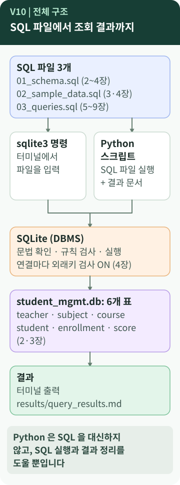
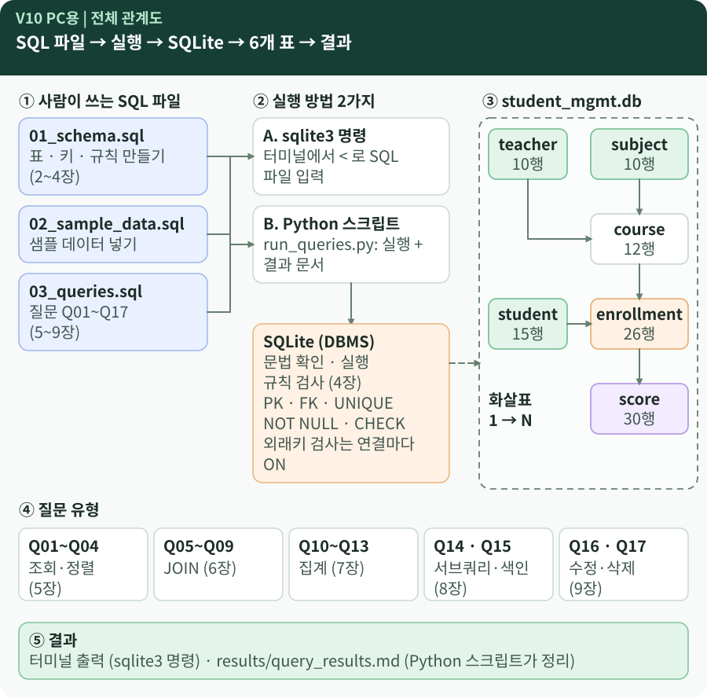

# Chapter 10 — 하나의 데이터베이스로 한 번에 설명하려면?

> 표 6개, SQL 파일 3개, 쿼리 17개를 3분 안에 다른 사람에게 설명하려면 어떤 순서로 이어야 할까요? 그리고 이 다음에 배우게 될 **JPA/ORM**은 지금 한 일과 어떻게 이어질까요?

**이 장에서 알게 되는 것**

- 1~9장의 개념이 **하나의 데이터베이스** 안에서 어떻게 이어지는지
- 한 사람(15번 학생 문태양)을 따라가며 **모든 개념을 한 줄로 꿰는 법**
- JPA/ORM이 **왜 후속 학습으로 이어지는지**, 그리고 이번 미션에서는 무엇을 쓰지 **않았는지**

📱 모바일에서는 **그림, "한 사람을 따라가 보기", "한 문장 정리"** 를 읽으세요. 💻 PC에서는 아래의 **전체 관계도**를 열어 두고 읽으면 연결이 한눈에 보입니다.

---

## 먼저, 이런 궁금증에서 시작합니다

- 앞에서 따로 배운 개념들이 **하나의 DB 안에서** 어떻게 이어질까?
- 다른 사람에게 설명할 때 **어떤 순서**로 말하면 좋을까?
- JPA/ORM은 무엇이고, 이번 미션과 무슨 관계일까? `[학습 노트]`

## 일상으로 생각해 보면

서랍장을 한 번 더 떠올려 봅니다. 서랍장을 **설계**하고(칸 정하기), **만들고**(칸에 규칙 달기), **채우고**(물건 넣기), **꺼내 보고**(조회), **고칩니다**(수정·삭제). 그리고 이 전체를 **다시 똑같이 만들 수 있게 기록**해 둡니다(SQL 파일).

B6-1의 이야기도 같은 순서입니다. `[보충]`

## 용어의 뜻

- **전체 구조(overview)** — 파일·실행 방법·DBMS·표가 **서로 어떻게 이어져 있는지** 한눈에 그린 것입니다. 개별 개념이 아니라 **연결**을 보는 관점입니다.
- [**ORM**](../../../terms/object-relational-mapping.md) — Object-Relational Mapping, 객체-관계 매핑. 프로그램의 **객체**와 DB의 **표(행)** 를 서로 이어 주는 기술입니다. 개발자가 SQL을 직접 쓰지 않아도 ORM이 대신 SQL을 만들어 실행합니다. `[학습 노트]`
- [**JPA**](../../../terms/jpa.md) — **자바**에서 ORM을 쓰는 표준 규격입니다. 이 장에서는 **다음에 만날 개념**으로만 소개합니다. `[학습 노트]`

## 그림으로 보기

### 그림 읽는 법 (모바일)

1. **맨 위**는 사람이 쓰는 SQL 파일 3개입니다. (2~9장)
2. **실행 방법 두 가지**(터미널의 `sqlite3` 명령, Python 스크립트)로 **같은 파일**을 실행합니다. 5장에서 구분한 층입니다.
3. 두 길이 합쳐져 **SQLite(DBMS)** 로 들어갑니다. 여기서 문법을 확인하고 **규칙을 검사**하며, 외래키 검사는 **연결마다 켭니다.** (4장)
4. SQLite는 `student_mgmt.db`의 **6개 표**를 읽고 씁니다. (2·3장)
5. 마지막으로 결과가 터미널 출력과 `results/query_results.md`로 나옵니다.
6. 맨 아래 문장 — **Python은 SQL을 대신하지 않습니다.**

### 💻 PC에서 보는 전체 관계도

*PC 화면에서 보도록 가로로 넓게 그린 그림입니다. 좁은 화면에서는 글자가 너무 작아지므로 보이지 않을 수 있고, 그럴 때는 위의 모바일 그림(V10)이 **같은 개념**을 보여 줍니다. PC용에는 6개 표의 1→N 관계와 질문 유형(Q01~Q17)이 더 들어 있습니다.*

| 선·표시 | 뜻 |
| --- | --- |
| 실선 화살표 (왼쪽 → 오른쪽 → 아래) | SQL이 실행으로 **전달되는 방향** |
| 점선 화살표 (SQLite → DB 상자) | SQLite가 DB 파일을 **읽고 쓰는** 관계 |
| 표 사이의 화살표 (`1 → N`) | 부모 → 자식, **번호로 가리키는** 관계 |
| 점선 큰 상자 | `student_mgmt.db` 파일 하나가 **담고 있는 범위** |

## 개념이 이어진 모습

| 장 | 개념 | B6-1에서 만나는 곳 |
| --- | --- | --- |
| 1 | DB · DBMS · SQLite | `student_mgmt.db`, SQLite |
| 2 | 표 · 스키마 · ERD | 6개 표, `erd.mmd` |
| 3 | PK · FK · 1:N · N:M | `enrollment`, FK 5개 |
| 4 | 제약조건 · 무결성 | `NOT NULL` `UNIQUE` `CHECK`, `PRAGMA` |
| 5 | SQL · SELECT · 조건 · 정렬 | Q01~Q04, 실행 방법 |
| 6 | JOIN | Q05~Q09 |
| 7 | GROUP BY · 집계 · HAVING | Q10~Q13 |
| 8 | 서브쿼리 · 인덱스 | Q14 · Q15 |
| 9 | UPDATE · DELETE | Q16 · Q17 |

## B6-1 결과물에서 확인하기 — 한 사람을 따라가 보기

15번 학생 **문태양** 한 명을 따라가면 모든 개념이 한 줄로 이어집니다. `[B6-1 사례]` `[실행 확인]`

1. **만들기·채우기** (2·3장): `02_sample_data.sql`이 `student`에 문태양을 넣지만 `enrollment`에는 15번 행이 **없습니다.** 부모 표(`student` `teacher` `subject`)를 먼저 넣고 자식 표를 뒤에 넣는 순서입니다.
2. **관계는 0개 이상** (3장): 학생과 수강은 "0개 이상"이라 수강이 없어도 **규칙 위반이 아닙니다.**
3. **INNER JOIN에서는 안 보임** (6장): Q05(학생별 수업)에서 문태양은 **나오지 않습니다.**
4. **LEFT JOIN으로 발견** (6장): Q08이 `NULL`을 이용해 **문태양을 찾습니다.**
5. **집계에서는** (7장): Q11(학생별 평균)은 시험 본 학생만 나오므로 문태양이 **없고**, Q13(학교별 학생 수)은 `student` 표만 세므로 새봄중 4명에 **포함됩니다.** 같은 사람도 **무엇을 세느냐**에 따라 보였다 안 보였다 합니다.
6. **삭제** (4·9장): 문태양은 자식(수강 행)이 없어서 Q17이 **FK 위반 없이** 지웁니다. 반대로 수강 기록이 있는 1번 학생을 지우려 하면 외래키가 **거절**합니다.
7. **그 뒤** (9장): 지운 뒤에는 학생이 14명이 되고, Q08을 다시 실행하면 **0행**, 새봄중은 **3명**이 됩니다.

수업 쪽의 **영어 회화(12번)** 도 같은 이야기입니다. Q09가 "수강생이 없는 수업"으로 찾고, Q10이 `0`으로 세지만, Q17처럼 지우지는 않습니다.

## 이 다음에 이어지는 학습 — JPA/ORM

- B6-1 미션은 이후 JPA/ORM 학습에 필요한 **관계(1:N), 키(PK/FK), 무결성, 조인 기반 조회 사고방식**을 먼저 익히는 것이 목적이라고 안내합니다. `[요구 정리]` `[학습 노트]`
- 예를 들어 `student` 1 : N `enrollment` 관계가 ORM에서는 "학생 객체가 수강 목록을 가진다"로 표현됩니다. `[학습 노트]`
- ORM이 만든 쿼리가 느리거나 이상할 때, 지금 배운 **SQL 관점**(JOIN, 실행 계획, 인덱스)이 원인을 찾는 데 쓰입니다. `[학습 노트]`

> **이번 미션에서 쓰지 않았습니다** `[요구 정리]` `[B6-1 사례]`
> JPA/ORM은 B6-1 결과물에서 **쓰지 않은 기술**입니다. 이 미션은 백엔드 프레임워크 없이 **SQL만** 씁니다. 뷰(View)·프로시저·트리거 같은 고급 기능도 범위 밖이고, 정규화 이론은 깊게 다루지 않았습니다. 이 장에서는 "다음에 만날 개념"으로만 소개합니다.

> **JPA와 SQLAlchemy는 같지 않습니다** `[요구 정리]` `[개념]`
> 요구사항 정리본에 따르면 이후 미션(B6-2·B6-3)은 Python의 [SQLAlchemy ORM](../../../terms/sqlalchemy-orm.md)을 사용합니다. JPA는 Java의 규격이고 SQLAlchemy는 Python의 도구라서 **서로 다른 구현**이지만, "객체와 표를 이어 준다"는 ORM의 생각은 같습니다. 같은 정리본은 B6-1을 그 미션들의 **필수 선행으로 직접 지정하지는 않는다**고 적고 있습니다.

## 좋은 점과 한계

**이 통합 설명의 좋은 점**

- 개념을 따로 외우지 않고 **한 사람·한 DB의 이야기**로 설명할 수 있습니다.
- 문제가 생기면 **어느 층**(설계 / 규칙 / 조회 / 변경 / 실행 방법)인지 나누어 찾습니다.

**한계와 주의**

- V10은 **전체 구조를 단순화**한 그림입니다. 실제 SQLite 내부(문법 분석, 실행 계획, 저장 형식 등)는 생략했습니다.
- ORM을 배워도 **SQL을 몰라도 된다는 뜻은 아닙니다.** ORM이 만든 쿼리를 이해하려면 이 가이드의 개념이 필요합니다. `[학습 노트]`
- B6-1의 구조(6개 표, 연결 표, 17개 쿼리)는 **하나의 구현 사례**입니다. 모든 교육생이 같은 설계를 해야 하는 것은 아닙니다.

## 내 프로그램에 연결하기

V10 모바일 그림의 상자 안에 **내 프로젝트의 이름**을 채워 봅니다.

| 칸 | B6-1의 답 | 내 프로젝트의 답 |
| --- | --- | --- |
| DB 파일 | `student_mgmt.db` | |
| DBMS | SQLite | |
| SQL 파일 | `01` `02` `03` | |
| 실행 방법 | `sqlite3` 명령 / Python | |
| 표 개수와 관계 | 6개, FK 5개 | |
| 결과 기록 | `results/query_results.md` | |

그리고 **한 사람(한 행)** 을 정해 그 행이 INNER JOIN과 LEFT JOIN, 집계에서 어떻게 보이는지 말해 봅니다.

## 요구와 B6-1의 선택

> 아래는 **요구사항 정리본**과 **B6-1 결과물**의 대응입니다. 정리본은 원본 미션 문서가 아니라 사용자가 관리하는 요약입니다. (README의 "근거의 수준" 참고)

| 항목 | 요구 정리 `[요구 정리]` | B6-1 `[B6-1 사례]` |
| --- | --- | --- |
| DBMS | SQLite·MySQL·PostgreSQL·H2 중 1개 | SQLite |
| 표 | 최소 4개, 각 표에 PK | 6개 |
| FK | 최소 2개의 FK로 1:N | 5개 |
| 제약조건 | NOT NULL 1+, UNIQUE 1+, FK 무결성 동작 | 여러 개 + CHECK + `PRAGMA` |
| 샘플 데이터 | 표마다 10행 이상 | 10~30행 (student 15 · teacher 10 · subject 10 · course 12 · enrollment 26 · score 30) |
| SQL 개수 | 15개 이상 (조회 4+ · JOIN 4+ · 집계 3+ · 서브쿼리 1+ · UPDATE/DELETE 2+ · INDEX 1+) | 17개 (4 · 5 · 4 · 1 · 2 · 1) |
| JOIN 종류 | INNER 2+, LEFT 1+ | INNER 다수, LEFT 3개 (Q08·Q09·Q10) |
| 설명·결과 | 쿼리마다 목적 1줄, 결과는 스크린샷 또는 텍스트 | 주석 "확인:" 한 줄, `results/query_results.md` |
| 제출물 | 스키마 SQL · INSERT SQL · 쿼리 SQL · 실행 결과 캡처 폴더 · (선택) ERD | `01` `02` `03` SQL, 결과 문서, `erd.png` |
| 실행 방법 | (요구 없음) | `sqlite3` 명령 또는 Python 스크립트 |

두 가지는 **요구가 아니라 B6-1의 선택**입니다: 연결 표 `enrollment`, 의도된 "짝 없는" 데이터, Python 보조 스크립트, `CHECK` 제약. 또 정리본의 제출물 항목은 "실행 결과 **캡처 폴더**"인데 B6-1은 결과를 **텍스트 문서 하나**로 남겼습니다. 정리본이 "스크린샷 또는 텍스트"를 허용하므로 요구와 충돌하지는 않지만, **제출 형식은 원본 미션 문서나 운영진에게 확인**해야 합니다.

## 다른 사람에게 이렇게 설명할 수 있습니다

> "공부방의 학생, 강사, 과목, 수업, 수강, 점수를 6개 표로 나누고 번호로 연결했어요. 학생과 수업의 다대다 관계는 수강 표로 풀었고, 외래키와 제약조건으로 잘못된 입력을 막았어요. SQLite는 연결마다 외래키 검사를 켜야 해요. 그 데이터를 조건 조회, JOIN, 집계, 서브쿼리, 인덱스, 수정·삭제 17개 쿼리로 조회했고, 수강 신청이 없는 학생은 INNER JOIN에서는 사라지지만 LEFT JOIN에서는 NULL로 남아 찾을 수 있었어요. JPA/ORM은 이번에 쓰지 않았고, 이 관계와 키 개념이 나중에 객체로 옮겨지는 후속 학습이에요."

**한 문장 정리:** 하나의 데이터베이스는 **설계(표·관계) → 규칙(제약) → 질문(SQL) → 변경(수정·삭제) → 실행(DBMS)** 이 이어진 것이고, 이 흐름이 이후 **JPA/ORM**의 바탕이 됩니다.

**스스로 점검해 보기** `[보충]` (공식 동료평가 문항이 아니라 이 가이드가 제안하는 점검 질문입니다)

- 엑셀과 다른 점을 **"관계와 규칙"** 으로 설명할 수 있나요?
- 연결 표가 왜 필요한지 **학생·수업 예**로 말할 수 있나요?
- INNER JOIN과 LEFT JOIN의 결과가 **왜 다른지** 문태양으로 설명할 수 있나요?
- `PRAGMA foreign_keys = ON`을 **빼면 어떻게 되는지** 말할 수 있나요?
- `WHERE`와 `HAVING`, 서브쿼리와 인덱스의 차이를 **한 문장씩** 말할 수 있나요?
- `01_schema.sql`을 **아무 DB에나 실행하면 안 되는 이유**를 말할 수 있나요?

---

## 💻 직접 확인해 보기 (선택)

> ⚠️ 저장소를 **복사한 연습용 폴더**에서만 합니다. 같은 이름의 `student_mgmt.db`가 있으면 지우고 새로 만듭니다.

1. B6-1 저장소를 복사한 폴더에서 전체를 한 번 실행합니다. (`./scripts/run_all.sh`, Windows는 `python scripts/run_queries.py`)
2. 새로 만들어진 `results/query_results.md`를 원본과 **비교**해 봅니다. 쿼리 17개의 결과는 같아야 합니다.
3. 다만 **Q15의 실행 계획 표 한 칸**(`notused` 열)은 SQLite 버전에 따라 다를 수 있습니다. 이 가이드를 만들 때 SQLite 3.50.4로 실행한 결과가 그랬고, 나머지 17개 결과는 모두 같았습니다. `[실행 확인]`

## AI에게 물어볼 질문

> "내 B6-1 폴더를 기준으로 **3분 설명 스크립트**를 써 줘. 순서는 ① 표와 관계 ② 제약조건 ③ 조회(JOIN·집계) ④ 변경 ⑤ 실행 방법으로 하고, 내 파일과 쿼리 번호를 근거로 넣어 줘. 파일은 수정하지 마."

---

**이전 장 ←** [Chapter 9](09-update-delete.md) · [전체 목차로](../README.md)
