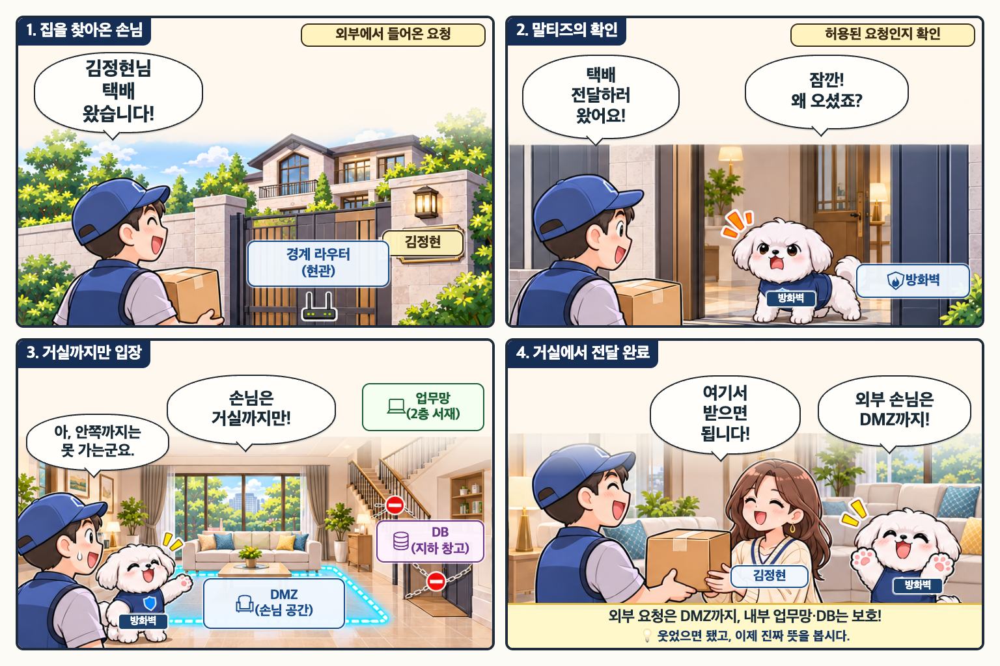
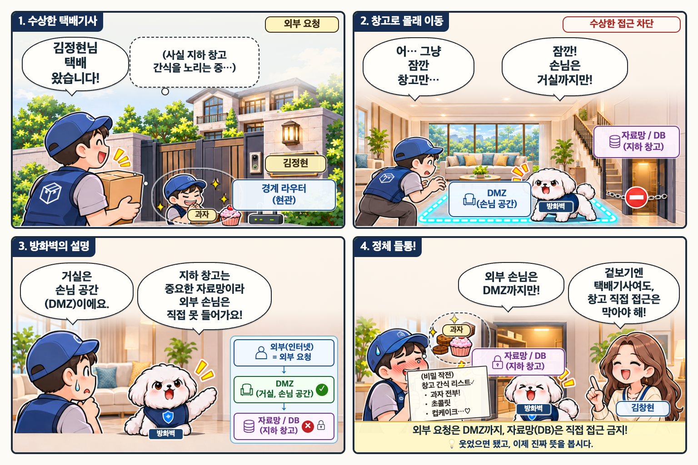

# B3-1 일반 회사망 웹툰 3편 · Owner 검토

2026-11-03 · **Stage A 제작 완료 / DRAFT / Owner 시각·콘텐츠·공개 승인 대기**

기준 브랜치: `feature/b31-company-network-webtoons`

BASE: `6b3a7f33e67a3d11a42c13f8a0910782f8701e4a`

## 검토하기

- [PC 2×2·모바일 4컷·원본 비교 페이지](review.html): 파일을 브라우저로 직접 열거나 로컬 Vite에서 `/content/webtoons/company-network/review.html`로 연다. 서비스 메뉴에는 연결하지 않았다.
- [원본 12컷 대응표](panel-mapping.md), [전사 데이터](source-map.json), [QA·원본 차이 목록](qa.md).
- 각 편의 `script.md`는 원본 전사 원고, `image-prompt.md`는 실제 built-in imagegen 생성 프롬프트다. CLI/API fallback은 사용하지 않았다.

| 순서 | 원고 | PC 2×2 | 모바일 PNG | WebP 시안 |
|---|---|---|---|---|
| 1 · 정상적인 외부 요청 | [원고](../episodes/b31-network-external-dmz-01/script.md) | [1536×1024](../episodes/b31-network-external-dmz-01/master.png) | 같은 폴더 `panel-1.png` ~ `panel-4.png` | 같은 폴더 `preview/` |
| 2 · 내부 구역 사이의 접근 통제 | [원고](../episodes/b31-network-internal-policy-02/script.md) | [1536×1024](../episodes/b31-network-internal-policy-02/master.png) | 같은 폴더 `panel-1.png` ~ `panel-4.png` | 같은 폴더 `preview/` |
| 3 · 수상한 택배기사 | [원고](../episodes/b31-network-suspicious-access-03/script.md) | [1536×1024](../episodes/b31-network-suspicious-access-03/master.png) | 같은 폴더 `panel-1.png` ~ `panel-4.png` | 같은 폴더 `preview/` |

### 1편



### 2편


### 3편



## 파일과 재현

- 제공된 원본: `originals/episode-1.png` ~ `episode-3.png` (첨부파일 그대로 복사, SHA-256 보존).
- 그림 원본: 각 에피소드 디렉터리 `art.png`. 글자·말풍선 없는 이미지이며 덮어쓰지 않고 보존한다.
- 편집 가능한 조판 원본: `../episodes.json` 마지막 3편 + `layout-v1.css` + `scripts/webtoon_company_network_layout.mjs`.
- 합성 원본: `master.png` 3개, `panel-{1..4}.png` 12개.
- 검토용 WebP: 각 편 `preview/` 아래 11개씩, 총 33개. **public/에는 생성하지 않는다.**
- 실제 생성 그림의 행 경계는 `artRows`로 지정한다. 1편 512/512, 2편 560/464, 3편 539/485를 각각 정확한 736×480 컷에 배치한다.
- 2편 3컷은 세 말풍선과 구조도를 모두 보존하기 위해 그림을 아래에 작게 배치하는 `artFrame`을 적용한다.

```sh
# Node·npm, Python/Pillow, Playwright와 Chrome이 설치된 환경
WEBTOON_CHROME_PATH='/Applications/Google Chrome.app/Contents/MacOS/Google Chrome' \
  node scripts/render_webtoon_episodes.mjs --include-drafts \
  b31-network-external-dmz-01 b31-network-internal-policy-02 b31-network-suspicious-access-03
python3 scripts/export_webtoon_assets.py --draft-preview \
  b31-network-external-dmz-01 b31-network-internal-policy-02 b31-network-suspicious-access-03
node scripts/build_company_network_review.mjs
python3 -m unittest discover -s scripts -p 'test_*webtoon*.py'
```

로컬 Vite가 5173에서 실행 중이면 `node scripts/check_company_network_review.mjs`로 1440/390/360px 검사를 재현한다. Chrome 경로는 `WEBTOON_CHROME_PATH`, 서버는 `WEBTOON_REVIEW_ORIGIN`으로 변경할 수 있다.

## Owner Gate

3편 마지막 컷의 원본 명찰은 **김창현**, 나머지 컷은 **김정현**이다. 현재 초안은 원본의 김창현을 보존했다. 수정 여부는 Owner 확인 대상이다.

Owner는 원문·인물·집 구조·한국어 가독성·기술 표지·PC/모바일을 검토한다. 이 요청은 제작 지시이며 완성본 승인으로 간주하지 않는다. `approval.date/content/publication`은 모두 비어 있다.

승인된 리비전의 콘텐츠 및 공개 승인이 명시된 뒤 같은 PR에서만 `approved` 전환 → 공개 WebP export → 22편 기대값 갱신 → 신규 3편 경로·관련 용어·모바일 확인을 수행한다. 현재 공개 19편 고정 기대값을 22로 바꾸지 않는다. 자동 병합·main 병합·배포는 하지 않는다.
