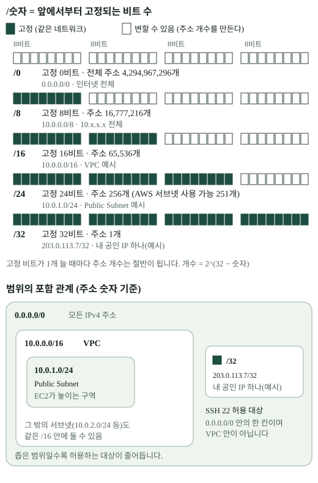

<!--
DRAFT · B3-1 콘텐츠 Pilot · 대상: content/terms/cidr.md (교체 전 Owner 검토용)
출처 표기: [작업지시] / [AI 보충]
시각 자료: assets/cidr-range.svg
-->

# CIDR

## 한 줄 설명

IP 주소 **범위**를 `10.0.0.0/16`처럼 한 줄로 적는 표기법입니다. 슬래시 뒤 숫자가 **클수록 범위는 좁아집니다.**

## 쉽게 설명하면

> **비유:** 전화번호 `02-123-4567`에서 앞의 `02-123`이 같으면 같은 동네입니다. 앞자리를 **더 많이 고정할수록** 그 번호가 속하는 동네는 **작아집니다.**

IP 주소는 32개의 0/1 칸(비트)입니다. `/숫자`는 **앞에서부터 몇 칸을 고정하는지**를 뜻합니다. 고정하지 않은 칸은 마음대로 바뀔 수 있고, 그 칸의 개수가 주소 개수를 정합니다.

## 정확한 설명

### 접두사 길이 비교 [작업지시]

| 표기 | 고정 비트 | 변하는 비트 | 주소 개수 | 이 미션에서의 쓰임 |
|---|---:|---:|---:|---|
| `0.0.0.0/0` | 0 | 32 | 4,294,967,296 | **모든 주소.** 보안 규칙에서 "누구나" |
| `10.0.0.0/8` | 8 | 24 | 16,777,216 | `10.x.x.x` 전체 (사설 대역 예시) |
| `10.0.0.0/16` | 16 | 16 | 65,536 | **VPC** 전체 범위 |
| `10.0.1.0/24` | 24 | 8 | 256 | **Public Subnet** |
| `203.0.113.7/32` | 32 | 0 | 1 | **내 공인 IP 하나** (SSH 허용) — 예시 주소 |

주소 개수는 **2^(32 − 숫자)** 입니다. 숫자가 1 커질 때마다 변하는 칸이 하나 줄어서 개수가 **절반**이 됩니다.

## 왜 `/16`, `/24`, `/32`를 서로 다르게 쓸까 [작업지시]

| 쓰는 곳 | 쓰는 값 | 이유 |
|---|---|---|
| VPC | `/16` | 안에서 서브넷을 여러 개 나눌 **넉넉한 공간**이 필요합니다. |
| Subnet | `/24` | VPC 범위의 **일부 구역**입니다. 서버 수십~수백 대를 둘 만합니다. |
| SSH 접근 제한 | `/32` | 허용할 대상이 **딱 한 주소**(내 공인 IP)여야 합니다. |

### 범위의 포함 관계

`10.0.1.0/24`는 `10.0.0.0/16` **안에** 들어갑니다. 서브넷은 VPC 범위를 쪼갠 것이기 때문입니다.
`/32`는 다릅니다. SSH를 허용하는 `203.0.113.7/32`는 `0.0.0.0/0` 안의 한 주소일 뿐, **VPC 안의 주소가 아닙니다.** 내 컴퓨터는 VPC 밖 인터넷에 있습니다.

## `0.0.0.0/0`과 `/32`의 차이 [작업지시]

| 규칙 | 의미 | SSH 22에 쓰면 |
|---|---|---|
| `0.0.0.0/0` | 전 세계 모든 IPv4 주소 | **위험.** 누구나 22번 포트에 접속을 시도할 수 있습니다. 인증이 있어도 시도 자체를 막지 못합니다. |
| `<내 공인 IP>/32` | 그 주소 하나 | 의도한 사용 방식. 다른 곳에서는 22번에 닿지 못합니다. |

HTTP 80처럼 **누구나 접속해야 하는 서비스**에는 `0.0.0.0/0`이 맞습니다. 같은 `0.0.0.0/0`이라도 **어떤 포트에 쓰는지**에 따라 의미가 달라집니다.
> 주소 하나만 허용하려면 `203.0.113.7`이 아니라 **`203.0.113.7/32`** 형태로 `/32`까지 적는다고 기억합니다. [AI 보충]

## 전체 주소 개수와 AWS에서 쓸 수 있는 개수 [AI 보충]

AWS는 **각 서브넷의 앞 4개와 마지막 1개, 총 5개를 예약**해서 쓸 수 없습니다.

| 서브넷 | 전체 주소 | AWS에서 사용 가능 |
|---|---:|---:|
| `/24` | 256 | 251 |
| `/28` | 16 | 11 |

- AWS에서 서브넷은 `/16`~`/28` 크기만 만들 수 있습니다. VPC도 `/16`~`/28`입니다.
- "주소 개수"와 "EC2 인스턴스 최대 수"를 같은 숫자로 쓰지 않습니다. `/24`에는 주소가 256개이고 AWS가 할당할 수 있는 IPv4 주소는 251개지만, 한 인스턴스에 여러 IP를 할당할 수 있고 계정·인스턴스·네트워크 인터페이스 한도도 있으므로 이것이 EC2 인스턴스 최대 수를 뜻하지는 않습니다.

## 흔한 오해

| 오해 | 실제 |
|---|---|
| 숫자가 클수록 범위가 넓다 | **좁습니다.** 숫자는 고정된 비트 수입니다. |
| `/24`는 24개의 주소다 | 24는 **비트 수**입니다. 주소는 256개입니다. |
| `203.0.113.7/32`는 VPC 안의 주소다 | 인터넷에 있는 내 컴퓨터의 공인 IP입니다. |
| `0.0.0.0/0`은 항상 위험하다 | 웹 서비스의 HTTP 80에는 정상입니다. **SSH 같은 관리 포트에** 쓰면 위험합니다. |
| 서브넷 `/24` 주소를 256개 모두 쓸 수 있다 | AWS는 5개를 예약해서 **251개**입니다. |

## 이 미션에서는 왜 필요한가

VPC `10.0.0.0/16`, Public Subnet `10.0.1.0/24`, SSH `내 IP/32`를 정할 때 쓰고, Security Group 화면에서 `0.0.0.0/0`을 보면 "이것이 전체를 뜻하는데 이 포트에 열어도 되는가"를 판단해야 합니다. 미션 요구사항 중 "`0.0.0.0/0` 전체 포트 허용 규칙을 만들지 않는다"가 바로 이 판단입니다.

## 동료평가 질문

1. `/16`과 `/24` 중 어느 쪽이 더 넓은 범위인가요? 이유는 무엇인가요?
2. SSH를 `0.0.0.0/0`으로 열면 안 되는 이유와, HTTP 80은 그래도 되는 이유를 설명해 보세요.
3. `/24`의 256개 주소와 AWS에서 할당 가능한 251개 주소를 EC2 인스턴스 최대 수라고 바로 말할 수 없는 이유는 무엇인가요?
4. 내 공인 IP가 바뀌면 어떤 규칙을 고쳐야 하나요?

## 관련 용어

- `subnet`
- `security-group`
- `virtual-private-cloud`
- `public-ip`
- `route-table`
